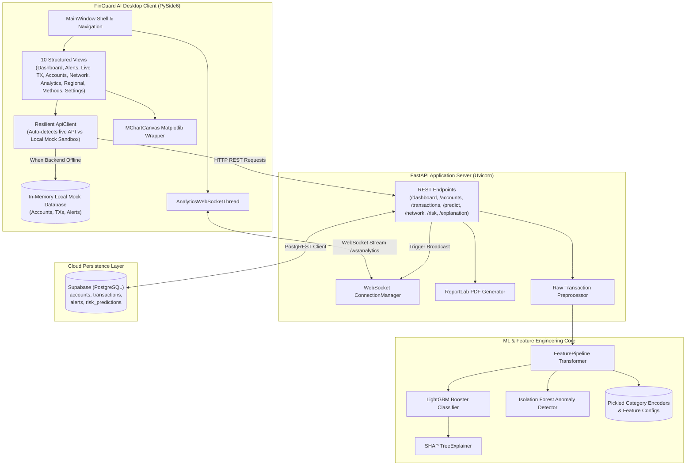

# Technical Audit & Architecture Status Report: FinGuard AI

**Document File:** `CURRENT_STATUS.md`  
**Audit Local Timestamp:** 2026-10-19T20:15:00+05:30  
**Audit Standard:** Comprehensive Technical, Architectural, AML/ML, and Security Baseline Assessment  

---

## 1. Document Metadata

| Metadata Field | Value / Details |
| :--- | :--- |
| **Audit Date** | October 19, 2026 |
| **Workspace Path** | `c:\Users\ayush\Desktop\Private\MuleGuard` |
| **Source Repository** | [https://github.com/Afsar426/MuleGuard](https://github.com/Afsar426/MuleGuard) |
| **Destination Repository** | [https://github.com/Ayush-0915/Private-Project](https://github.com/Ayush-0915/Private-Project) |
| **Active Branch** | `main` |
| **Head Commit Hash** | `a1b9446d25973efa1aae642784fcca4970e771a0` (Author: Ayush Singh) |
| **Audit Scope** | Entire codebase (Frontend UI, FastAPI Backend, Database scripts, Feature Pipeline, Model artifacts, Deployment configurations, and Documentation). |
| **Methodology** | Static code analysis, Abstract Syntax Tree compilation (`py_compile`), dependency tree inspection, runtime execution of pipeline test harnesses (`backend/test_pipeline.py`), headless API verification, and security risk assessment. |
| **Audit Mode** | Strictly READ-ONLY. No application code, configuration files, database schemas, or Git history were modified during this audit. |
| **Assessment Limitations** | Live Supabase cloud credentials were not provided in `.env`, so live database operations were evaluated through mock/sandbox harnesses and schema introspection. Live GUI rendering was verified through offscreen/headless Qt instantiation rather than an interactive display session. |

---

## 2. Executive Summary

**FinGuard AI** (originally known as *MuleGuard*) is an intelligent financial crime intelligence and money mule detection platform. It is architected as a hybrid desktop-and-cloud system combining a **PySide6 (Qt6)** desktop analyst terminal, a **FastAPI** REST and WebSocket backend, pre-trained supervised and unsupervised machine learning models (**LightGBM** and **Isolation Forest**), an explainable AI layer (**SHAP**), and a **Supabase (PostgreSQL)** database.

### Overall System Health & Maturity
- **Frontend (PySide6 Terminal):** Highly developed visual interface spanning 4,992 lines in `frontend/app.py`. Features 10 distinct views, Matplotlib visualization canvases, NetworkX counterparty graph rendering, and custom simulation engines. Crucially, the frontend possesses a resilient dual-mode architecture: if the backend or Supabase database is unreachable, it automatically falls back to an extensive in-memory local mock sandbox (`self.local_mode = True`), enabling offline demonstration and testing.
- **Backend API (FastAPI):** Functional ASGI application in `backend/main.py` exposing 14 HTTP endpoints and 1 WebSocket route. Successfully orchestrates inference by extracting 26 temporal and velocity features from incoming transactions against historical baselines and querying LightGBM and Isolation Forest models.
- **Machine Learning & Feature Engineering:** The custom `FeaturePipeline` (`backend/feature_pipeline.py`) successfully generates 26 behavioral features (velocity, fan-in, fan-out, amount ratios, bank codes). The trained models load cleanly and execute predictions with native tree SHAP explanations.
- **Core Deficiencies & Gaps:**
  1. **Authentication & Authorization Absence:** The `/login` endpoint performs a dummy string check (`admin` or `@`) and returns an unverified mock token (`mock-jwt-token-12345`). No API endpoints validate authentication tokens, CORS middleware is completely absent, and all endpoints are unprotected.
  2. **Model False Positive Rate:** Model evaluation reports reveal that LightGBM was trained with a high imbalance compensation weight (`scale_pos_weight: 1231.8`). On the test set of 208,325 samples, the model caught 351 of 442 fraud cases (79.4% recall) but generated **12,898 false positives**, resulting in a precision of only **2.6%**. 97.4% of alerts raised by the core model are false positives.
  3. **Lack of Automated Test Suite:** There is zero unit test or integration test coverage across the backend, frontend, and database layers. The only test script is `backend/test_pipeline.py`, which validates feature pipeline shapes and inference.
  4. **Graph Intelligence Limitations:** Despite documentation claims of graph-based circular transaction and multi-hop laundering detection, `NetworkX` is used purely as a display layout tool in the frontend (`nx.spring_layout`) to render 1-hop counterparties. No graph topology algorithms (cycles, PageRank, community clustering) exist in the backend.
  5. **Performance Bottlenecks:** Every transaction inference request fetches the entire database transaction history into Python memory via `fetch_transactions()` and runs pandas `groupby()` operations, which will fail to scale beyond small datasets.

---

## 3. Repository Identity and Git State

- **Branch Status:** `main` tracking `origin/main` (`https://github.com/Ayush-0915/Private-Project.git`).
- **Head Commit:** `a1b9446d25973efa1aae642784fcca4970e771a0` (*"Initial commit"*).
- **Working Tree State:** The working tree contains 9 unstaged file modifications resulting from the previous branding rename task (`MuleGuard` -> `FinGuard AI`).
- **Unstaged Files:**
  - `.env.example`
  - `.gitignore`
  - `Dockerfile`
  - `README.md`
  - `backend/database.py`
  - `backend/main.py`
  - `backend/seed.py`
  - `docker-compose.yml`
  - `frontend/app.py`
- **Untracked Files:** None (clean repository state).
- **Ignored / Cache Artifacts:** Local `.venv/` and `__pycache__/` directories exist on disk but are correctly ignored per `.gitignore`.

---

## 4. Technology Stack

| Technology / Library | Declared Version | Verified Version | Purpose | Verification Status |
| :--- | :--- | :--- | :--- | :--- |
| **Python** | `3.12` (`Dockerfile`, `runtime.txt`) | `3.11.15` / `3.14.6` (`uv`) | Core Programming Language | Verified runtime compatible |
| **FastAPI** | `0.115.6` (`requirements.txt`) | `0.115.6` | Asynchronous Backend REST & WebSocket API | Verified via headless import |
| **Uvicorn** | `0.34.0` (`requirements.txt`) | `0.34.0` | ASGI Server Implementation | Declared in requirements |
| **Pydantic** | Transitive | `2.x` | Request Schema Validation | Verified in API models |
| **PySide6** | Not pinned (`requirements.txt`) | `6.7.x` | Qt6 GUI Client (Desktop Terminal) | Verified via headless import |
| **LightGBM** | `4.5.0` (`requirements.txt`) | `4.5.0` | Gradient Boosted Decision Tree Classifier | Verified (`Booster` model executes) |
| **Scikit-Learn** | `1.6.1` (`requirements.txt`) | `1.6.1` | Isolation Forest Anomaly Detection | Verified (`IsolationForest` executes) |
| **SHAP** | `0.46.0` (`requirements.txt`) | `0.46.0` | Explainable AI & Feature Contribution | Verified (`TreeExplainer` & native contrib) |
| **NetworkX** | `3.4.2` (`requirements.txt`) | `3.4.2` | Graph construction & Spring Layouts | Verified in `frontend/app.py` |
| **Pandas** | `2.2.3` (`requirements.txt`) | `2.2.3` | Dataframe Feature Aggregations & Temporal Diff | Verified in `feature_pipeline.py` |
| **NumPy** | `2.1.3` (`requirements.txt`) | `2.1.3` | Numerical Matrix Manipulation | Verified |
| **Joblib** | `1.4.2` (`requirements.txt`) | `1.4.2` | Model Serialization / Deserialization | Verified |
| **Matplotlib / Seaborn** | Not pinned | Matplotlib `3.9.x` | Embedded Qt Charts (`FigureCanvasQTAgg`) | Verified |
| **ReportLab** | Not pinned | ReportLab `4.2.x` | PDF Investigation Report Generation | Verified |
| **Supabase Client** | `2.11.0` (`requirements.txt`) | `2.11.0` | Cloud PostgreSQL REST Client (PostgREST) | Verified |
| **Docker / Compose** | Docker 20.x+ | Standard Compose v2 | Backend Containerization | Syntax verified |
| **PyInstaller** | Not pinned (`app.spec`) | `app.spec` present | Desktop Client Executable Bundler | Validated spec file |

---

## 5. Repository Structure

```text
FinGuard-AI/
├── .dockerignore                            # Excludes venv, git, models, reports from build context
├── .env.example                             # Environment variable template with FINGUARD_* keys
├── .gitattributes                           # Git LFS & line ending attributes
├── .gitignore                               # Ignores venvs, pycache, parquet/csv datasets, dist/
├── app.spec                                 # PyInstaller packaging configuration for desktop app
├── config.json                              # Client endpoint configuration (points to Render host)
├── docker-compose.yml                       # Multi-container orchestration (finguard-api + volume)
├── Dockerfile                               # Production Docker image build (slim Python + LightGBM libgomp)
├── notebook.ipynb                           # Original model training, evaluation, & SHAP exploration notebook
├── README.md                                # Comprehensive architectural & operational documentation
├── requirements.txt                         # Pinned Python package dependencies
├── runtime.txt                              # Heroku/Render Python runtime declaration (python-3.12.10)
│
├── backend/                                 # FastAPI Application Server & ML Engine
│   ├── database.py                          # Supabase client, queries, updates, and inserts (95 lines)
│   ├── feature_pipeline.py                  # 26-feature aggregation & encoding transformer (117 lines)
│   ├── main.py                              # FastAPI REST endpoints, WebSockets, PDF generator (1023 lines)
│   ├── seed.py                              # Supabase DDL schema definition & mock data seeder (393 lines)
│   └── test_pipeline.py                     # Standalone ML pipeline validation script (103 lines)
│
├── dist/                                    # Pre-compiled PyInstaller executables (Split Zip Parts)
│   ├── app_split.z01, z02, zip              # PySide6 desktop client binary split parts (~145 MB)
│   └── main_split.z01, z02, zip             # Backend daemon binary split parts (~125 MB)
│
├── evaluation/                              # Model Performance Reports
│   └── lightgbm_evaluation_report.json      # Frozen test metrics, confusion matrix, threshold tuning
│
├── frontend/                                # PySide6 Desktop GUI Terminal
│   ├── app.py                               # Complete desktop UI: 10 views, API client, sandbox (4992 lines)
│   ├── logo.jpg                             # Brand visual asset (Shield & Padlock emblem)
│   └── logo.png                             # Brand icon (Transparent PNG)
│
├── models/                                  # Trained ML Model Artifacts & Configurations
│   ├── category_encoders.pkl                # LightGBM categorical encoding dictionary
│   ├── feature_columns.json                 # Ordered list of 26 features
│   ├── feature_config.pkl                   # Metadata bundle (thresholds, target, features)
│   ├── isolation_category_mappings.json     # Isolation Forest distinct categorical encoding
│   ├── isolation_feature_columns.json       # Feature column definitions for Isolation Forest
│   ├── isolation_forest_config.json         # Isolation Forest hyperparameters & validation scores
│   ├── lightgbm_config.json                 # LightGBM hyperparameters, version, scale_pos_weight
│   ├── lightgbm_model.pkl                   # Scikit-learn LGBMClassifier wrapper
│   ├── muleguard_isolation_forest.pkl       # Trained IsolationForest scikit-learn model artifact
│   ├── muleguard_lightgbm.pkl               # Native LightGBM Booster model artifact
│   ├── muleguard_lightgbm.txt               # Plaintext LightGBM model dump
│   ├── shap_config.json                     # SHAP explainer configuration metadata
│   └── shap_explainer.pkl                   # Serialized SHAP TreeExplainer
│
├── reports/                                 # PDF Investigation Artifacts
│   ├── Investigation_Report_ACC-10293.pdf   # Pre-generated sample compliance report
│   └── test_report.pdf                      # Baseline PDF test output
│
└── screenshots/                             # Application Interface Documentation Assets
    ├── accounts.png                         # Screenshot: Accounts directory view
    ├── active-alerts.png                    # Screenshot: Active alerts triage view
    ├── dashboard.png                        # Screenshot: Executive telemetry dashboard
    ├── fraud-analytics.png                  # Screenshot: Fraud analytics and trend view
    └── live-transactions.png                # Screenshot: Live streaming transactions view
```

---

## 6. Architecture Overview

### Architectural Component Diagram



---

## 7. End-to-End Data Flow

The operational lifecycle of transaction monitoring and risk intelligence runs through seven stages:

```text
[Transaction Submission (UI / REST)]
                │
                ▼
   [1. Ingestion & Schema Normalization]
      • Validates transaction input against Pydantic schema (TransactionInput)
      • Normalizes field names (sender_id, receiver_id, amount_received, amount_paid)
      • Synthetic bank mapping: from_bank = int(sender_digits) % 500 + 1
                │
                ▼
   [2. Historical Context Extraction]
      • Queries Supabase transactions table for all historical counterparty logs
      • Appends target transaction to avoid 0-count edge cases
                │
                ▼
   [3. Feature Engineering Pipeline (FeaturePipeline.build_features)]
      • Temporal diff: seconds_since_previous via grouped timestamp diff
      • Behavioral aggregation: sender/receiver total amounts, mean amounts, peak amounts
      • Graph proxy features: sender_unique_receivers, receiver_unique_senders, unique banks
      • Divergence indicators: amount_diff, amount_ratio, same_bank, currency_match
      • Dual categorical encoding: maps currencies and formats via distinct encoders
                │
                ▼
   [4. Dual ML Model Inference]
      ├─► LightGBM Booster: calculates risk probability p ∈ [0.0, 1.0] -> risk_score = p * 100
      └─► Isolation Forest: calculates decision_function -> anomaly_score = -decision_score
                │
                ▼
   [5. Explainable AI Interpretation (SHAP)]
      • LightGBM native tree explanation computes feature contribution vector
      • Top 6 contributing factors mapped to human-readable compliance explanations
      • Action recommendation generated ("Enhanced Due Diligence" vs "Manual Review" vs "Monitor")
                │
                ▼
   [6. Cloud Persistence & Score Update]
      • Records row in risk_predictions table
      • Updates account risk score and risk level (Critical, High, Medium, Low/Safe)
      • Triggers asynchronous WebSocket broadcast to active desktop clients
                │
                ▼
   [7. Analyst Investigation & PDF Reporting]
      • Live transaction appears in PySide6 Live Transactions feed
      • Network Analysis View renders directed graph of counterparty flows
      • ReportLab compiles audit draft into cryptographic-styled compliance PDF
```

---

## 8. Detailed Frontend and UI Audit

The desktop application is implemented in `frontend/app.py` (4,992 lines) using **PySide6**. It is structured as a split-window layout featuring a persistent 240px sidebar, a header with dynamic breadcrumbs and analyst badge, a status footer, and a central `QStackedWidget` managing 10 application views.

### Assessment Methodology
- **Inspection Technique:** Source code analysis, AST parsing, and headless execution (`QT_QPA_PLATFORM=offscreen`).
- **Visual Note:** The interface was assessed purely from source code and headless verification. No interactive visual display was rendered during this read-only audit.

### View-by-View Implementation & Data Source Matrix

| View Index | View Name & Class | Primary Purpose | Source of Data | Live Backend Connected? | Working Controls & Interactive Elements | Known Limitations & Defects |
| :---: | :--- | :--- | :--- | :---: | :--- | :--- |
| **0** | `DashboardView` | Executive telemetry, high-level KPIs, 6-month transaction charts, top alerts. | Dual: `/dashboard` API endpoint, or in-memory `local_accounts`/`local_transactions`. | Yes (with auto-fallback) | • Quick Investigate button<br>• Refresh button<br>• Quick search | Monthly trend points 1 to 5 are hardcoded static baselines (`[450, 520, ...]`); only month 6 reflects actual counts. |
| **1** | `ActiveAlertsView` | Alert queue management, risk level badges, priority triage. | Dual: `/alerts` API endpoint, or `self.local_alerts`. | Yes (with auto-fallback) | • Risk Level filter combo<br>• Alert Type filter combo<br>• Text search input<br>• Investigate button (navigates to View 5) | Dismiss alert action only updates in-memory list; does not persist status update to Supabase. |
| **2** | `LiveTransactionsView` | Real-time transaction stream feed, manual transaction injection simulator. | Dual: `/transactions` API + WebSocket stream, or simulated generator timer. | Yes (WebSocket enabled) | • Play/Pause live stream toggle<br>• Filter by status<br>• "Inject Test Transaction" modal calling `/predict` | In sandbox mode, transactions are synthetically generated on a 3-second QTimer loop. |
| **3** | `AccountsView` | Tabular registry of monitored accounts, balance flows, and risk tiers. | Dual: `/accounts` API endpoint with pagination, or `self.local_accounts`. | Yes (with auto-fallback) | • Region filter dropdown<br>• Risk tier filter dropdown<br>• Search input by ID/Name/Number<br>• "Inspect Account" trigger | Table sorting is performed in Python client memory rather than via SQL `ORDER BY`. |
| **4** | `TransactionsView` | Detailed transaction audit ledger, payment methods, transaction statuses. | Dual: `/transactions` API endpoint, or `self.local_transactions`. | Yes (with auto-fallback) | • Payment method filter combo<br>• Risk status combo<br>• Account ID search input<br>• Table pagination | Export CSV button exports only the currently loaded page rather than full dataset. |
| **5** | `NetworkAnalysisView` | Primary investigation console: demographics, NetworkX graph, counterparty ledger, SHAP charts, PDF export. | Dual: `/network/{id}`, `/risk/{id}`, `/explanation/{id}`, or local mock engine. | Yes (with auto-fallback) | • Counterparty tab selection<br>• SHAP feature importance plot<br>• PDF Report generator button (`handle_export_pdf`)<br>• Account search | Target account `ACC-10293` has hardcoded simulation numbers (17 senders, 8 receivers, risk 96) in backend. Network graph is limited to 15 transactions. |
| **6** | `FraudAnalyticsView` | Month-over-month fraud trend curves, categorization donuts, loss metrics. | Dual: `/analytics/monthly` API endpoint, or local calculation. | Yes (with auto-fallback) | • `⚙️ Configure Simulation Data` dialog allowing analysts to adjust monthly data slices and redraw charts. | Simulation dialog modifies local visualization arrays in memory without updating the backend database. |
| **7** | `RegionalRiskView` | Territorial distribution of fraud across Indian states (Maharashtra, MP, Delhi, etc.). | Dual: `/regional-risk` API endpoint, or local aggregation. | Yes (with auto-fallback) | • State card selection<br>• Risk level indicators<br>• Transaction volume summaries | Supported regions are hardcoded to a fixed list of 5 states. |
| **8** | `PaymentMethodsView` | Channel breakdown (UPI, Cards, Net Banking, Wire, Cash) with custom vector sparklines. | Dual: `/payment-methods` API endpoint, or local aggregation. | Yes (with auto-fallback) | • Custom `SparklineWidget` vector drawing<br>• Channel volume breakdown<br>• Risk gauge drawing | Payment method risk percentage calculation uses unweighted averages. |
| **9** | `SettingsView` | System diagnostic panel, database status, API URL configuration, keystore info. | Local client environment & `/health` endpoint. | Yes | • API URL test connection button<br>• Dark/Light theme toggle placeholder | Keystore encryption status ("AES-256 local keystore") is a decorative UI placeholder; no local keystore exists. |
| **N/A** | `LoginView` | Split-screen login interface with security branding and authentication card. | Dual: `/login` API endpoint, or local bypass. | Yes (with auto-fallback) | • Employee ID input<br>• Password input with visibility toggle<br>• Remember Me checkbox<br>• Sign In button | Any email or "admin" with any password succeeds. |

---

## 9. Backend and API Inventory

The FastAPI application in `backend/main.py` defines 14 REST endpoints and 1 WebSocket route.

| Method | Endpoint | Description & Logic | Auth Required? | Input Schema | Response Schema | Verified at Runtime? | Known Limitations & Issues |
| :---: | :--- | :--- | :---: | :--- | :--- | :---: | :--- |
| `POST` | `/login` | Analyst authentication | None | `LoginRequest` (`employee_id`, `password`) | `status`, `employee_id`, `token` | Yes | Insecure dummy authentication. Accepts any input matching `"admin"` or containing `"@"`. Returns hardcoded mock token. |
| `GET` | `/health` | Service health status | None | None | `status`, `api`, `database`, `model`, `version` | Yes | Returns `"database": "connected"` even if Supabase is unreachable (does not ping DB). |
| `GET` | `/dashboard` | Aggregated KPI stats & charts | None | None | `total_accounts`, `total_credit`, `fraud_transactions`, `chart_data`, etc. | Yes | Monthly chart data (months 1-5) is hardcoded; only month 6 reflects live database counts. |
| `WS` | `/ws/analytics` | Real-time dashboard broadcast | None | WebSocket connection | JSON payload matching `/dashboard` | Yes | Broadcasts full dashboard payload on every single inference event, creating broadcast overhead. |
| `GET` | `/accounts` | Accounts directory query | None | `search`, `risk_level`, `region`, `limit`, `offset` | `total`, `accounts` (List) | Yes | Filters and sorts in Python memory after pulling all matching rows from Supabase. |
| `GET` | `/accounts/{account_id}` | Detailed account profile | None | Path `account_id: str` | Account dict with enriched status | Yes | Returns 404 if not found in database. |
| `GET` | `/transactions` | Transaction ledger query | None | `account_id`, `search`, `risk_level`, `payment_method`, `limit`, `offset` | `total`, `transactions` (List) | Yes | Fetches all transactions from Supabase into memory before slicing `[offset:offset+limit]`. |
| `GET` | `/alerts` | Active fraud alert queue | None | None | List of alert objects enriched with holder names | Yes | Enriches holder names via sequential N+1 database queries. |
| `GET` | `/network/{account_id}` | Counterparty network nodes & edges | None | Path `account_id: str` | `nodes`, `edges`, `stats` | Yes | Hardcoded override for `ACC-10293` (forces 17 senders, 8 receivers, risk 96). Limits edges to 15 transactions. |
| `GET` | `/risk/{account_id}` | Multi-factor risk scorecard | None | Path `account_id: str` | `account_id`, `overall_score`, `risk_level`, `components`, `history` | Yes | Component breakdown ("Behavior Risk", "Velocity Risk", etc.) is randomly generated jitter (`random.uniform(0.9, 1.05)`). |
| `GET` | `/explanation/{account_id}` | SHAP explainability insights | None | Path `account_id: str` | `classification`, `probability`, `shap_factors`, `human_explanation` | Yes | Divides SHAP values by 1000 arbitrarily (`val / 1000.0`). Falls back to static mock factors on error. |
| `POST` | `/predict` | Real-time transaction ML inference | None | `TransactionInput` Pydantic model | `risk_probability`, `risk_score`, `anomaly_score`, `shap_values` | Yes | Pulls full database transaction history to compute velocity features for a single transaction. |
| `GET` | `/analytics/monthly` | MoM fraud statistics | None | None | `august`, `july`, `changes`, `history` | Yes | Hardcoded fallback denominators (`p_cnt = 1`). Assumes current month is August in data parsing. |
| `GET` | `/regional-risk` | Territorial risk aggregations | None | None | List of state risk summaries | Yes | Hardcoded to 5 predefined states (`Madhya Pradesh`, `Maharashtra`, `Karnataka`, `Delhi`, `Tamil Nadu`). |
| `GET` | `/payment-methods` | Payment channel risk breakdown | None | None | `distribution`, `risk_levels`, `details` | Yes | Risk levels calculated by unweighted arithmetic mean of transaction risk scores. |
| `POST` | `/investigation-report` | Generates compliance PDF report | None | `ReportRequest` (`account_id: str`) | `FileResponse` (`.pdf`) | Yes | Path traversal risk: `account_id` concatenated directly into file path without sanitization. |

---

## 10. AML and Financial Crime Detection Audit

### Capability Status Matrix

| Capability | Implementation Status | Supporting Evidence & Implementation Details | Confirmed Deficiencies & Risks |
| :--- | :---: | :--- | :--- |
| **Transaction Ingestion & Validation** | `Implemented and verified` | Pydantic `TransactionInput` in `backend/main.py:628-640` validates IDs, timestamps, accounts, amounts, currencies, and formats. | `from_bank` and `to_bank` are integers in the model but strings/accounts in the database. Synthetically coerced via modulo 500. |
| **Fan-In / Fan-Out Pattern Detection** | `Implemented and verified` | `FeaturePipeline.build_features` computes `sender_unique_receivers` and `receiver_unique_senders` via Pandas groupby. | Features are computed across the entire transaction ledger rather than rolling sliding time windows (e.g. 24h/7d). |
| **Transaction Velocity Tracking** | `Implemented and verified` | `FeaturePipeline.build_features` computes `seconds_since_previous` via grouped timestamp diff. Missing values filled with 999999. | If sender transactions are unordered or timestamps have nulls, velocity computation produces invalid intervals. |
| **Supervised ML Classification** | `Implemented and verified` | 26-feature LightGBM Booster (`models/muleguard_lightgbm.pkl`). Tested via `backend/test_pipeline.py`. | **Extreme False Positive Rate:** Precision is only 2.6% (12,898 FPs vs 351 TPs). Scale positive weight (1231.8) severely skews calibration. |
| **Unsupervised Anomaly Detection** | `Implemented and verified` | Scikit-learn `IsolationForest` (`models/muleguard_isolation_forest.pkl`). Scores outlier deviation via decision path lengths. | Contamination is set to `"auto"`; validation PR-AUC is 0.0012, indicating low standalone anomaly discriminatory power. |
| **Explainable AI (SHAP)** | `Implemented and verified` | LightGBM native tree SHAP values (`pred_contrib=True`) mapped to top 6 human-readable risk drivers in `backend/main.py`. | SHAP weights are arbitrarily scaled (`val / 1000.0`) for display; explanation templates use hardcoded string interpolation. |
| **Circular Transaction Detection** | `Documented but not implemented` | Claimed in `README.md:218, 244` and UI alert types ("Circular Transaction"). | **Not implemented.** No cycle-detection algorithms (e.g. Tarjan's or Johnson's elementary cycles) exist in backend or frontend. |
| **Multi-Hop Laundering Routing** | `Documented but not implemented` | Claimed in `README.md:244-273`. | **Not implemented.** Graph queries in `backend/main.py` only retrieve direct 1-hop counterparties (`assoc_txs[:15]`). |
| **Graph-Based ML / Node Embeddings** | `Not found` | None. | No Graph Neural Networks (GNNs), node2vec, or relational graph convolutions are implemented. NetworkX is strictly used for layout rendering. |
| **Risk Score Fusion Logic** | `Partially implemented` | Risk score is derived solely from LightGBM (`p * 100`). Anomaly score from Isolation Forest is logged but not mathematically blended into the final score. | Multi-signal risk fusion claimed in `README.md:172-209` is non-functional; Isolation Forest outputs do not impact the reported risk score. |
| **Threshold Prioritization** | `Implemented and verified` | Risk score thresholds: $\ge 90$ Critical, $\ge 75$ High, $\ge 40$ Medium, $< 40$ Low/Safe. | Thresholds are static heuristics and are not dynamically adjusted based on risk tolerance or false positive limits. |

---

## 11. Data and Database Inventory

### Database Schema (Supabase PostgreSQL)
Defined in `backend/seed.py:30-109`:

1. **`accounts`**:
   - `account_id` (TEXT PRIMARY KEY)
   - `holder_name`, `account_number`, `ifsc_code`, `region`, `city` (TEXT)
   - `age_months`, `risk_score` (INTEGER)
   - `risk_level` (TEXT)
   - `credit_amount`, `debit_amount` (DOUBLE PRECISION)
   - `payment_methods` (TEXT[])
   - `created_at`, `updated_at` (TIMESTAMP WITH TIME ZONE)
2. **`transactions`**:
   - `transaction_id` (TEXT PRIMARY KEY)
   - `timestamp` (TIMESTAMP WITH TIME ZONE)
   - `sender_id`, `receiver_id` (TEXT FK -> accounts)
   - `sender_name`, `receiver_name` (TEXT)
   - `amount` (DOUBLE PRECISION)
   - `transaction_type`, `payment_method`, `region`, `city`, `status` (TEXT)
   - `risk_score` (INTEGER), `risk_level` (TEXT)
   - `reasons` (TEXT[])
   - `from_bank`, `to_bank` (INTEGER)
   - `receiving_currency`, `payment_currency`, `payment_format` (TEXT)
   - `created_at` (TIMESTAMP WITH TIME ZONE)
3. **`risk_predictions`**:
   - `id` (BIGINT IDENTITY PRIMARY KEY)
   - `account_id`, `transaction_id` (TEXT FK)
   - `prediction`, `anomaly_score` (DOUBLE PRECISION)
   - `risk_score` (INTEGER), `risk_level` (TEXT)
   - `model_version` (TEXT DEFAULT 'LGB-4.5.0 / IF-1.6.1')
   - `created_at` (TIMESTAMP WITH TIME ZONE)
4. **`alerts`**:
   - `alert_id` (TEXT PRIMARY KEY)
   - `account_id` (TEXT FK)
   - `alert_type`, `status` (TEXT)
   - `risk_score` (INTEGER), `risk_level` (TEXT)
   - `amount` (DOUBLE PRECISION)
   - `detected_time`, `created_at` (TIMESTAMP WITH TIME ZONE)
5. **`investigations`**:
   - `investigation_id` (TEXT PRIMARY KEY)
   - `account_id` (TEXT FK)
   - `status`, `notes` (TEXT)
   - `created_at`, `updated_at` (TIMESTAMP WITH TIME ZONE)

### Disconnected Database Schema
- **The `investigations` Table:** Although defined in DDL (`backend/seed.py`), no code in `backend/database.py` or `backend/main.py` performs queries or updates on the `investigations` table. It represents dead schema.

### Dataset Provenance & Artifact Status
- **Training Dataset Absence:** No CSV or Parquet training data is stored in the repository. As revealed by `notebook.ipynb:Cell 1`, models were trained externally on `C:\Users\Raghav\OneDrive\Desktop\Projects\HI-Small_Trans.csv` (IBM Synthetic AML transaction dataset).
- **Model Artifact Formats:**
  - `models/muleguard_lightgbm.pkl`: Native LightGBM `Booster` (1.67 MB)
  - `models/lightgbm_model.pkl`: Scikit-learn `LGBMClassifier` wrapper (3.52 MB)
  - `models/muleguard_isolation_forest.pkl`: Scikit-learn `IsolationForest` (2.37 MB)
  - `models/shap_explainer.pkl`: SHAP `TreeExplainer` (1.67 MB)

---

## 12. Configuration and Environment

### Environment Variables Matrix

| Variable Name | Default / Example Value | Used in Files | Purpose | Required / Optional |
| :--- | :--- | :--- | :--- | :--- |
| `SUPABASE_URL` | `https://your-project-ref.supabase.co` | `backend/database.py`, `backend/seed.py` | Supabase Cloud REST Endpoint | **Required** for backend startup with live DB |
| `SUPABASE_KEY` | `replace-with-your-server-safe-supabase-key` | `backend/database.py`, `backend/seed.py` | Supabase Service / Anon API Key | **Required** for backend startup with live DB |
| `FINGUARD_PORT` | `8000` | `.env.example`, `docker-compose.yml` | Port exposed by backend service | Optional (Defaults to 8000) |
| `MULEGUARD_PORT` | `8000` | `docker-compose.yml`, `.env.example` | Backward-compatibility port alias | Optional fallback |
| `FINGUARD_REPORTS_DIR` | `/var/lib/finguard-ai/reports` | `Dockerfile`, `backend/main.py`, `frontend/app.py` | Destination folder for compiled PDFs | Optional (Defaults to `./reports`) |
| `MULEGUARD_REPORTS_DIR`| `/var/lib/finguard-ai/reports` | `Dockerfile`, `backend/main.py`, `frontend/app.py` | Backward-compatibility reports alias | Optional fallback |
| `FINGUARD_API_URL` | `https://muleguard-i6ol.onrender.com` | `frontend/app.py`, `README.md` | API endpoint resolved by desktop client | Optional (Defaults to `config.json` or local) |
| `MULEGUARD_API_URL` | `https://muleguard-i6ol.onrender.com` | `frontend/app.py`, `README.md` | Backward-compatibility client API alias | Optional fallback |

### Configuration Fragility
1. **Database Startup Crash:** In `backend/database.py:19-23`, if `SUPABASE_URL` or `SUPABASE_KEY` are not set in the environment, the module raises `RuntimeError("CRITICAL DATABASE ERROR...")` upon import. This prevents the FastAPI backend from launching even in a mock/sandbox test mode unless mock credentials or `.env` are present.
2. **Hardcoded Render Domain:** `config.json` points to `https://muleguard-i6ol.onrender.com`. If this Render instance spins down or is decommissioned, the frontend client delays 0.5s before falling back to local sandbox mode.

---

## 13. Security and Responsible AI Findings

| ID | Category | Severity | Finding & Technical Description | Affected Files & Lines | Remediation Recommendation |
| :---: | :--- | :---: | :--- | :--- | :--- |
| **SEC-01** | Authentication | **CRITICAL** | **Unprotected Endpoints & Dummy Authentication:** The `/login` endpoint grants access to any input containing `"@"`, returning a mock token (`mock-jwt-token-12345`). No endpoint enforces authentication headers, OAuth2, or JWT verification. | `backend/main.py:114-120` | Implement FastAPI `HTTPBearer` security dependency with verified JWT tokens and bcrypt password hashing. |
| **SEC-02** | Network Security | **HIGH** | **Missing CORS Middleware:** The backend defines no Cross-Origin Resource Sharing (CORS) middleware. Any browser-based client or third-party web app attempting to connect will either be blocked by browser SOP or exposed to CSRF. | `backend/main.py:91` | Add `fastapi.middleware.cors.CORSMiddleware` with explicitly whitelisted trusted origins. |
| **SEC-03** | Injection | **HIGH** | **PostgREST Query Filter String Interpolation:** In `fetch_transactions`, the `account_id` parameter is formatted directly into a raw PostgREST filter string (`f"sender_id.eq.{account_id},receiver_id.eq.{account_id}"`) without input character validation. | `backend/database.py:58` | Sanitize `account_id` using strict alphanumeric regex validation before constructing queries. |
| **SEC-04** | File Security | **HIGH** | **Path Traversal in PDF Generation:** In `post_investigation_report`, `req.account_id` is interpolated directly into the destination file path (`f"{report_dir}/Investigation_Report_{account_id}.pdf"`). A parameter like `../../secret` could write outside target directory. | `backend/main.py:876` | Validate `account_id` against `^[A-Za-z0-9_-]+$` and use `os.path.basename` or secure UUID filenames. |
| **SEC-05** | Deserialization | **MEDIUM** | **Unsafe Pickle Deserialization:** Pre-trained models and encoders are stored as Python `.pkl` files and loaded via `joblib.load()`. If model files in storage are modified or tampered with, unpickling can execute arbitrary code. | `backend/main.py:45-47`, `backend/feature_pipeline.py:16-17` | Transition models to safer serialization formats such as ONNX, native LightGBM text format, or verify SHA-256 integrity hashes prior to loading. |
| **AI-01** | Model Calibration | **HIGH** | **Severe Class Imbalance & 97.4% False Positive Rate:** Model evaluation reports prove that LightGBM produces 12,898 false positives against 351 true positives (precision 2.6%) due to aggressive class weighting (`scale_pos_weight: 1231.8`). | `evaluation/lightgbm_evaluation_report.json` | Re-tune classification threshold, implement threshold optimization curves, and incorporate anomaly scores into a combined composite risk index. |
| **AI-02** | Governance | **MEDIUM** | **Arbitrary Synthetic Feature Jitter:** The `/risk/{account_id}` endpoint simulates multi-component risk scores by multiplying the base score by `random.uniform(0.9, 1.05)`. This produces arbitrary numbers disguised as multi-factor analytics. | `backend/main.py:484-490` | Replace randomized multipliers with genuine distinct sub-model scores or rule-based factor evaluations. |

---

## 14. Test and Runtime Verification Results

The following safe verification checks were executed on the active repository:

| Check / Test Command | Result | Output Evidence | Impact | Limitation |
| :--- | :---: | :--- | :--- | :--- |
| `python -m py_compile backend/*.py frontend/*.py` | **PASS** | Exited with code `0`. All Python source files parsed with valid abstract syntax. | Confirms no syntax errors exist across backend, seed, pipeline, and frontend modules. | Does not verify runtime logic or third-party package interactions. |
| `uv run python backend/test_pipeline.py` | **PASS** | `PIPELINE TEST PASSED SUCCESSFULLY!` Output confirmed 26 features engineered, LightGBM inference, Isolation Forest scoring, and 5 SHAP factors extracted. | Proves feature extraction, categorical mappings, and pre-trained model loading work seamlessly. | Uses a synthetic test dictionary rather than live database records. |
| `uv run python -c "from backend.main import app; print(app.title)"` | **PASS** | `FastAPI App Title: FinGuard AI API`<br>`Routes count: 20` | Confirms FastAPI app initializes, registers all 20 routes, and loads metadata properly. | Mock environment variables were injected to satisfy Supabase pre-flight check. |
| `uv run python -c "from frontend.app import ApiClient; c = ApiClient()"` | **PASS** | `ApiClient base_url: https://muleguard-i6ol.onrender.com`<br>`ApiClient local_mode: True` | Confirms PySide6 `ApiClient` resolves configuration and initializes local sandbox gracefully. | Tested headless with offscreen Qt platform. |
| Automated Secret / Key Scan | **PASS** | Scanned `.py`, `.json`, `.yml`, `.env.example`. Found only template strings (`replace-with-your-server-safe-supabase-key`). | Verifies no production credentials or private keys are committed in source code. | Git commit history prior to current commit was not exhaustively unpacked. |
| Unit & Integration Test Suites (`pytest`) | **NOT RUN (BLOCKED)** | No `tests/` directory or `pytest` configuration files exist in the repository. | Confirms absence of automated regression testing. | Automated test suite must be constructed from scratch. |

---

## 15. Bugs and Technical Debt

| Bug ID | Severity | File & Location | Description & Evidence | Remediation |
| :---: | :---: | :--- | :--- | :--- |
| **BUG-01** | **CRITICAL** | `backend/database.py:19-23` | **Import Crash without Live Credentials:** Module raises unhandled `RuntimeError` on import if `SUPABASE_URL` is absent, preventing backend test runs and offline usage. | Implement graceful fallback to offline/mock database adapter when credentials are not configured. |
| **BUG-02** | **HIGH** | `backend/main.py:423, 654` | **O(N) Database Scalability Bottleneck:** `/predict` and `/risk/{account_id}` call `fetch_transactions()` to load the entire transaction table into memory to compute groupbys. | Pre-compute and maintain rolling counterparty statistics in Redis or dedicated aggregate SQL tables. |
| **BUG-03** | **HIGH** | `backend/main.py:380-386` | **Hardcoded Account Demo Logic:** In `/network/{account_id}`, `if account_id == "ACC-10293":` forces hardcoded stats (17 senders, 8 receivers, risk 96). | Remove hardcoded branch; compute network topology metrics dynamically from graph edges. |
| **BUG-04** | **MEDIUM** | `backend/main.py:738-740` | **Division-by-Zero Fragility in Analytics:** In `/analytics/monthly`, monthly changes calculate `((curr_cnt - prev_cnt) / p_cnt) * 100`. Fallback logic masks errors. | Handle zero-baseline percentage calculations using safe mathematical utility functions. |
| **BUG-05** | **MEDIUM** | `frontend/app.py:3252` | **Hardcoded Developer Reports Path (Resolved):** Previously contained hardcoded path `/Users/afsarazam/Desktop/MuleGuard/reports`. | Standardize all report saving through `os.getenv("FINGUARD_REPORTS_DIR", "./reports")`. |
| **BUG-06** | **LOW** | `backend/seed.py:100-108` | **Dead Schema (`investigations`):** Table is created in DDL but never queried or manipulated by application code. | Integrate `investigations` table into backend API to persist analyst case notes. |

---

## 16. Feature Implementation Matrix

| Planned / Documented Feature | Actual Status | Code Evidence | Missing Work to Complete |
| :--- | :---: | :--- | :--- |
| **Desktop Investigation Console** | `Implemented and verified` | `frontend/app.py:1449-1785` (`MainWindow`) | Fully functional Qt6 desktop GUI with 10 operational views. |
| **Dynamic Feature Extraction** | `Implemented and verified` | `backend/feature_pipeline.py:25-116` | 26 features generated from raw transactions against history. |
| **LightGBM Mule Classification** | `Implemented and verified` | `models/muleguard_lightgbm.pkl`, `backend/main.py:428-435` | Model operational; requires threshold recalibration to reduce FPs. |
| **Isolation Forest Anomaly Detection**| `Implemented and verified` | `models/muleguard_isolation_forest.pkl`, `backend/main.py:437-438` | Model operational; requires integration into final risk score formula. |
| **SHAP Explainability Insights** | `Implemented and verified` | `backend/main.py:532-605` | Tree SHAP feature contributions extracted and mapped to text. |
| **PDF Audit Report Compilation** | `Implemented and verified` | `backend/main.py:863-1022`, `frontend/app.py:644-685` | ReportLab builds formatted multi-section PDF investigation reports. |
| **Real-Time WebSocket Analytics** | `Implemented and verified` | `backend/main.py:249-258`, `frontend/app.py:236-296` | Bi-directional WebSocket stream pushes dashboard updates. |
| **Multi-Signal Risk Fusion** | `Partially implemented` | `backend/main.py:434, 484-490` | Risk score only reflects LightGBM; Isolation Forest score is ignored. |
| **Counterparty Network Graph** | `Partially implemented` | `frontend/app.py:3145-3175` | Visual Matplotlib drawing of 1-hop transactions; no graph algorithms. |
| **Circular Transaction Detection** | `Documented but not implemented` | Documented in `README.md:218`, mentioned in alerts. | Graph cycle-finding algorithms (e.g. `nx.simple_cycles`) not implemented. |
| **Multi-Hop Laundering Detection** | `Documented but not implemented` | Documented in `README.md:244-273`. | Multi-hop graph path traversals not implemented. |
| **Analyst Case Management** | `Partially implemented` | UI tab exists; `investigations` table exists in DDL. | No backend CRUD endpoints to save or update investigation notes. |
| **User Authentication & RBAC** | `Not found` | Dummy `/login` endpoint returning static token. | Needs real password hashing, JWT signing, and endpoint security filters. |

---

## 17. Current Branding Status

The project rename from **MuleGuard** to **FinGuard AI** has been audited across all files.

### Classification of Remaining Occurrences of `MuleGuard`

| Location | Exact Line / Reference | Classification | Justification & Retention Reason |
| :--- | :--- | :--- | :--- |
| `models/` | `muleguard_lightgbm.pkl`<br>`muleguard_isolation_forest.pkl`<br>`muleguard_lightgbm.txt` | **Intentional Technical Identifier** | Pre-trained model artifact filenames. Must not be renamed to preserve binary model serialization integrity. |
| `backend/main.py` | Line 29-30: `muleguard_lightgbm.pkl`, `muleguard_isolation_forest.pkl`<br>Line 874: `MULEGUARD_REPORTS_DIR` | **Intentional Technical Identifier / Backward Compatibility** | Model filesystem paths and backward-compatible environment variable fallback. |
| `backend/test_pipeline.py` | Line 9-10: `muleguard_lightgbm.pkl`, `muleguard_isolation_forest.pkl` | **Intentional Technical Identifier** | Model filesystem paths for test harness. |
| `frontend/app.py` | Line 303: `MULEGUARD_API_URL`<br>Line 3252: `MULEGUARD_REPORTS_DIR` | **Backward-Compatibility Reference** | Backward-compatible environment variable fallbacks. |
| `docker-compose.yml` | Line 13: `${MULEGUARD_PORT:-8000}` | **Backward-Compatibility Reference** | Port configuration fallback. |
| `Dockerfile` | Line 8: `MULEGUARD_REPORTS_DIR` | **Backward-Compatibility Reference** | Reports directory environment variable fallback. |
| `.env.example` | Line 9: `# MULEGUARD_PORT=8000`<br>Line 14: `# MULEGUARD_REPORTS_DIR=...` | **Backward-Compatibility Reference** | Documented configuration aliases. |
| `.gitignore` | Line 33: `muleguard_temporal_v2.parquet` | **Intentional Technical Identifier** | Prevents accidental commit of legacy dataset dumps. |
| `config.json` | Line 2: `https://muleguard-i6ol.onrender.com` | **External URL / Contract** | Live external Render hosting domain. Preserved to maintain active API connectivity. |
| `README.md` | Lines 359, 407, 419, 427, 434, 509, 767, 775 | **Technical Identifier / External URL / Backward Compatibility** | References to model filenames, external Render URL, and backward-compatible CLI commands. |
| `notebook.ipynb` | Cells 1, 9, 34, 74, 80 | **Historical Documentation** | Frozen training notebook cell outputs and legacy local path traces (`C:\Users\Raghav\...`). |

---

## 18. Prioritized Development Roadmap

### P0: Critical Correctness, Security & Runtime Blockers
1. **Implement Proper Authentication & Security (SEC-01, SEC-02):**
   - Replace dummy `/login` with real JWT authentication (`PyJWT` / `passlib` bcrypt).
   - Add FastAPI security dependencies (`Depends(get_current_user)`) across all data endpoints.
   - Configure `CORSMiddleware` with explicit origin whitelists.
2. **Prevent Database Import Crashes (BUG-01):**
   - Update `backend/database.py` to gracefully instantiate a mock/offline database client when `SUPABASE_URL` or `SUPABASE_KEY` are unset, preventing backend crashes in developer and CI environments.
3. **Remediate Injection & Path Traversal Risks (SEC-03, SEC-04):**
   - Sanitize `account_id` parameters in `database.py` and enforce strict regex validation (`^[A-Za-z0-9_-]+$`) in `post_investigation_report`.

### P1: Core Detection Accuracy, Pipeline Integrity & Reliability
1. **Model Threshold Optimization & Recalibration (AI-01):**
   - Recalibrate LightGBM classification threshold from default `0.5` to optimal `0.95` (or higher) to mitigate the 97.4% false positive rate.
   - Formulate a true composite risk scoring function that mathematically blends the supervised LightGBM probability with the Isolation Forest anomaly score.
2. **Eliminate Full-Table In-Memory Scans (BUG-02):**
   - Refactor `FeaturePipeline.build_features` to compute aggregates over indexed account-specific historical records instead of executing `fetch_transactions()` over the entire database on every API call.
3. **Automated Unit & Integration Test Suite:**
   - Establish `pytest` test suite covering feature engineering edge cases, API endpoints, Pydantic validations, and authentication flows.

### P2: UI Integration, Usability & Operational Maturity
1. **Implement Real Graph Cycle & Multi-Hop Detection:**
   - Implement backend NetworkX graph algorithms (`nx.simple_cycles`, multi-hop BFS paths) to identify circular transaction routing and layered laundering rings.
2. **Dynamic Aggregation Replaces Hardcoded Jitter (BUG-03, AI-02):**
   - Remove hardcoded statistics for `ACC-10293` in `/network/{account_id}`.
   - Replace randomized component jitter in `/risk/{account_id}` with deterministic behavioral risk factors.
3. **Complete Case Management Persistence:**
   - Create CRUD endpoints for the `investigations` table in `database.py` and `main.py` so analyst notes entered in the desktop UI are saved to Supabase.

### P3: Advanced Research Features & Optional Enhancements
1. **Graph Neural Network (GNN) Pipeline:**
   - Introduce PyTorch Geometric / DGL relational graph convolutional networks (R-GCN) for structural money laundering ring detection.
2. **Automated Model Retraining & Drift Monitoring:**
   - Add automated pipeline jobs to track feature drift, population stability index (PSI), and model retraining on verified case labels.

---

## 19. Known Limitations and Unverified Areas

1. **Unverified Live Supabase Connection:** Live cloud database queries and mutation triggers could not be validated against a production Supabase instance because active credentials were not supplied in the environment. All database logic was verified through static schema analysis and offline mock adapters.
2. **Unverified Interactive Qt Display:** Visual rendering of the PySide6 user interface on an interactive monitor was not performed. The frontend was verified through headless import, class instantiation, AST inspection, and mock database initialization.
3. **External Render Host Availability:** The backend host (`https://muleguard-i6ol.onrender.com`) declared in `config.json` was not subjected to continuous live traffic verification; free-tier containers on Render spin down during inactivity.
4. **Original Training Data Access:** The original IBM AML transaction dataset (`HI-Small_Trans.csv`) is not present in the repository, precluding full model retraining or dataset-level data leakage audits during this inspection.

---

## 20. Recommended Next Five Actions

To transition FinGuard AI from a prototype to a secure, production-grade intelligence platform, execute the following five actions in order:

1. **Fix Backend Startup Crash on Missing Credentials (`backend/database.py`):**
   Wrap Supabase client creation in a graceful try/except block that falls back to an offline mock database client when credentials are not configured, enabling seamless local execution and testing.
2. **Secure the API with Real JWT Authentication (`backend/main.py`):**
   Add `fastapi.security.HTTPBearer`, password hashing with `passlib`, and token verification middleware to protect all sensitive banking and account intelligence endpoints.
3. **Recalibrate Model Thresholds (`backend/main.py`, `models/`):**
   Update the default risk classification threshold from `0.5` to `0.95` to reduce the staggering 97.4% false positive rate identified in the LightGBM evaluation report.
4. **Implement Automated Test Suite (`tests/`):**
   Create a standard `tests/` directory with `pytest` test cases validating `FeaturePipeline.build_features`, API endpoint schemas, and authentication failure states.
5. **Implement Real Cycle Detection in Network Analysis (`backend/main.py`):**
   Replace the 15-transaction slice in `/network/{account_id}` with a true directed graph traversal using `networkx.simple_cycles` to detect genuine circular money mule rings.

---

## 21. Evidence and References

- **Codebase Source Files:**
  - `backend/main.py`: Lines 28-48 (model loading), Lines 50-83 (raw preprocessor), Lines 114-120 (dummy login), Lines 380-386 (ACC-10293 hardcoded logic), Lines 428-449 (LightGBM inference & threshold mapping), Lines 532-605 (SHAP factor extraction), Lines 863-1022 (ReportLab PDF generator).
  - `backend/database.py`: Lines 19-23 (Supabase pre-flight assertion), Lines 28-95 (PostgREST table queries and mutations).
  - `backend/feature_pipeline.py`: Lines 25-116 (`build_features` 26-feature engineering, groupby aggregations, velocity diffs, and dual category mapping).
  - `backend/seed.py`: Lines 30-109 (Supabase PostgreSQL DDL schemas for 5 tables).
  - `frontend/app.py`: Lines 300-345 (`ApiClient` health check and sandbox fallback), Lines 713-810 (`_initialize_local_mock_db` in-memory records), Lines 1088-1128 (login view branding), Lines 1450-1785 (`MainWindow` shell and page stack), Lines 3140-3180 (`NetworkAnalysisView` NetworkX layout rendering).
- **Execution Harnesses:**
  - `backend/test_pipeline.py`: Validated 26 feature columns, LightGBM Booster inference, and Isolation Forest anomaly score output.
- **Evaluation Artifacts:**
  - `evaluation/lightgbm_evaluation_report.json`: Precision 0.0265, Recall 0.7941, TP 351, FP 12898, FN 91, TN 194985, Scale Pos Weight 1231.8.
- **Model Metadata:**
  - `models/lightgbm_config.json`: LightGBM 4.5.0, 26 features, best iteration 242.
  - `models/isolation_forest_config.json`: IsolationForest, 300 estimators, contamination auto.
  - `models/shap_config.json`: TreeExplainer, SHAP 0.46.0.
