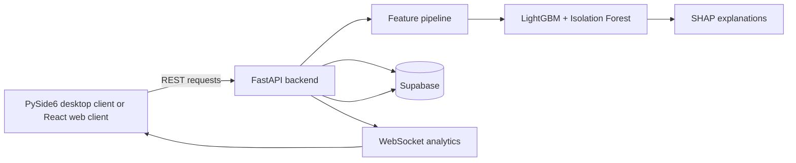

# FinGuard AI

## AI-Powered Financial Crime Detection and Risk Intelligence

FinGuard AI helps investigators identify and understand suspicious transaction
activity, including potential mule accounts and unusual transaction routing.
It combines transaction history, engineered behavioral signals, machine
learning risk scoring, anomaly detection, and explanations in an investigation
workflow.

## Project Demo

[Watch the FinGuard AI launch video](assets/videos/finguard-ai-launch.mp4)

<video src="assets/videos/finguard-ai-launch.mp4" controls width="100%"></video>

*FinGuard AI launch/demo video. If inline playback is not available in a
GitHub client, use the direct video link above.*

## What is implemented

- FastAPI backend with REST endpoints, WebSocket analytics updates, health
  checks, authentication, and generated investigation reports.
- PySide6 desktop investigation client with dashboard, alerts, live
  transactions, accounts, network analysis, analytics, regional risk, and
  payment-method views.
- React, TypeScript, and Vite web client in [`web/`](web/).
- Feature engineering for transaction velocity, fan-in/fan-out behavior,
  amount deviation, bank relationships, timing, and historical behavior.
- LightGBM risk classification and Isolation Forest anomaly detection.
- SHAP-based local explanations for model results.
- NetworkX transaction relationship analysis.
- Supabase-backed transaction, account, alert, and investigation data.
- IBM benchmark and phase-four intelligence API routers.
- Docker and Render configuration for the FastAPI service and web client.

## Architecture and workflow



For a prediction, the backend reads available transaction context, builds the
feature vector, calculates a LightGBM risk probability and Isolation Forest
anomaly signal, and returns an investigation-oriented result with explanation
data. Risk levels currently map to these operational bands:

| Score | Level | Status |
| ---: | --- | --- |
| 90-100 | Critical | Under Investigation |
| 75-89 | High | Open Alert |
| 40-74 | Medium | Monitored |
| 0-39 | Low / Safe | Active / Normal |

## Technology stack

- **Backend:** Python, FastAPI, Uvicorn, Supabase
- **Machine learning:** pandas, NumPy, scikit-learn, imbalanced-learn,
  LightGBM, Isolation Forest, SHAP, joblib
- **Graph and reporting:** NetworkX and ReportLab
- **Desktop client:** PySide6, Matplotlib, Seaborn
- **Web client:** React, TypeScript, Vite
- **Operations:** Docker Compose and Render

## Repository layout

| Path | Purpose |
| --- | --- |
| [`backend/`](backend/) | FastAPI application, routers, database access, and feature pipeline |
| [`frontend/`](frontend/) | PySide6 desktop client |
| [`web/`](web/) | React/Vite web client |
| [`models/`](models/) | Serialized models and model configuration |
| [`evaluation/`](evaluation/) | Evaluation outputs and benchmark material |
| [`screenshots/`](screenshots/) | Application screenshots |
| [`assets/videos/`](assets/videos/) | Final project demo video |
| [`Dockerfile`](Dockerfile) | Backend container image |
| [`render.yaml`](render.yaml) | Render backend and static-site services |

## Local setup

### Backend API

Python 3.12 is used by the Docker image. Create and activate a virtual
environment, then install the complete local dependency set:

```bash
python -m venv .venv
# macOS/Linux:
source .venv/bin/activate
# Windows PowerShell:
.venv\Scripts\Activate.ps1

pip install -r requirements.txt
```

Copy [`.env.example`](.env.example) to `.env` and set the Supabase connection
values. The `.env` file is local-only and must not be committed.

Start the API from the repository root:

```bash
uvicorn backend.main:app --host 127.0.0.1 --port 8000 --reload
```

The API is available at `http://127.0.0.1:8000`. FastAPI's interactive
documentation is available at [`/docs`](http://127.0.0.1:8000/docs), with the
OpenAPI schema at `/openapi.json`. The health endpoint is `/health`.

### Web client

```bash
cd web
npm install
npm run dev
```

Set `VITE_API_URL` in `web/.env` when the API is not using the web client's
default local configuration. See [`web/README.md`](web/README.md) for the
scaffold-specific commands.

### Docker

The container runs the backend only; the PySide6 desktop client remains a
separate local application.

```bash
docker compose up --build
```

The service listens on `http://127.0.0.1:8000`. The Compose setup stores
generated reports in the `finguard_reports` volume.

## API overview

The main FastAPI application currently exposes:

- `POST /login`
- `GET /health`
- `GET /dashboard`
- `GET /accounts` and `GET /accounts/{account_id}`
- `GET /transactions`
- `GET /alerts`
- `GET /network/{account_id}`
- `GET /risk/{account_id}` and `GET /explanation/{account_id}`
- `POST /predict`
- `GET /analytics/monthly`
- `GET /regional-risk` and `GET /payment-methods`
- `POST /investigation-report`
- `WS /ws/analytics`

Additional benchmark and intelligence routes are registered in
[`backend/ibm_benchmark_router.py`](backend/ibm_benchmark_router.py) and
[`backend/phase4_router.py`](backend/phase4_router.py). The running
`/docs` page is the authoritative request and response reference.

## Deployment

[`render.yaml`](render.yaml) defines a FastAPI web service and a React/Vite
static site. [`Dockerfile`](Dockerfile) builds the API image and uses the
repository's model files. Configure Supabase credentials and CORS values
through the deployment environment rather than committing secrets.

The repository's public remote is
[`Ayush-0915/Private-Project`](https://github.com/Ayush-0915/Private-Project).
