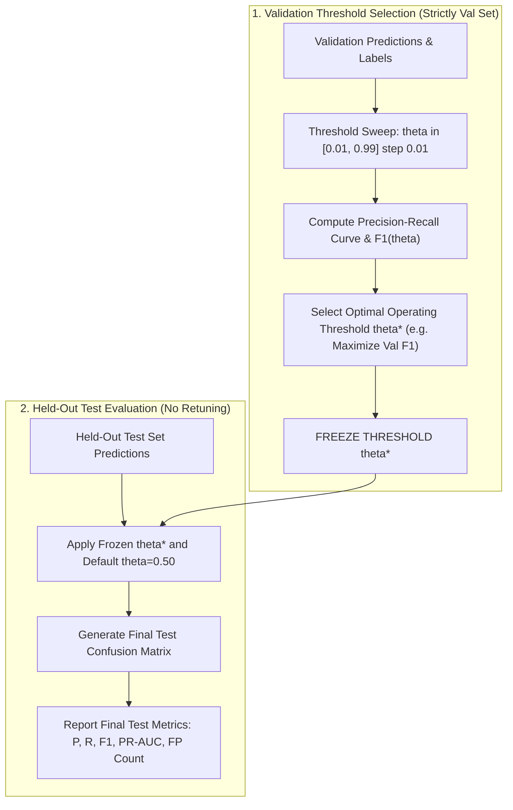

# FinGuard AI — Experimental Evaluation Plan: IBM AML Dataset

**Document Version:** 1.0.0  
**Date:** 2026-10-20  
**Target Dataset:** IBM Transactions for Anti-Money Laundering (`HI-Small_Trans.csv`)  
**Kaggle Source:** [https://www.kaggle.com/datasets/ealtman2019/ibm-transactions-for-anti-money-laundering-aml](https://www.kaggle.com/datasets/ealtman2019/ibm-transactions-for-anti-money-laundering-aml)  
**Status:** Verification & Planning Complete — Pre-Download / Pre-Training Gate  
**Location:** `evaluation/amlsim_evaluation/EXPERIMENT_PLAN.md`

---

## 1. Objective & Production Isolation Rules

The objective of this phase is to establish a rigorous, leakage-free, and reproducible experimental evaluation framework for FinGuard AI using the official IBM Transactions for Anti-Money Laundering (`HI-Small_Trans.csv`) dataset.

### Strict Safety & Isolation Rules
1. **Zero Production Touch:** Production model artifacts in [`models/`](file:///c:/Users/ayush/Desktop/Private/MuleGuard/models/) (`muleguard_lightgbm.pkl`, `muleguard_isolation_forest.pkl`, `shap_explainer.pkl`) must **not** be overwritten, retrained, or altered.
2. **Zero Database Touch:** The live Supabase database and local showcase records must **not** receive writes, deletions, or schema changes.
3. **Codebase Preservation:** Backend application code ([`backend/main.py`](file:///c:/Users/ayush/Desktop/Private/MuleGuard/backend/main.py)), runtime endpoints, and frontend client code ([`frontend/app.py`](file:///c:/Users/ayush/Desktop/Private/MuleGuard/frontend/app.py)) remain unmodified.
4. **Isolated Working Directory:** All experimental scripts, evaluation data splits, and benchmark logs must reside strictly under `evaluation/amlsim_evaluation/` or a Git-ignored `data/` directory.

---

## 2. Dataset Acquisition, Provenance & Verification

### 2.1 Local Availability Verification
- **Local Filesystem Audit:** An exhaustive audit of the workspace (`C:\Users\ayush\Desktop\Private\MuleGuard`), `Desktop`, `Downloads`, and user home directory confirmed that **neither `HI-Small_Trans.csv` nor any Kaggle archive is present locally**.
- **Historical Path Audit:** In [`notebook.ipynb`](file:///c:/Users/ayush/Desktop/Private/MuleGuard/notebook.ipynb) (cells 1 and 9), the dataset was loaded from `C:\Users\Raghav\OneDrive\Desktop\Projects\HI-Small_Trans.csv`. This path belonged to the original upstream developer environment and does not exist on this machine (`Test-Path "C:\Users\Raghav"` returned `False`).

### 2.2 Dataset Provenance & Licensing
- **Dataset Title:** IBM Transactions for Anti-Money Laundering (AML)
- **Authors / Creators:** Mark Weber, Elliot Altman, et al. (MIT-IBM Watson AI Lab / IBM Research)
- **Publication Citation:** *"Anti-Money Laundering in Financial Networks: Synthetic Data and Graph Convolutional Networks for Anomaly Detection"* (KDD Workshop on Anomaly Detection in Finance / arXiv:1907.03144).
- **License:** Community Data License Agreement — Permissive — Version 1.0 (CDLA-Permissive-1.0). Commercial and academic use permitted with attribution; no warranty.
- **Generator Background:** Synthesized using an augmented multi-agent financial simulation engine (AMLSim) coupled with multi-bank routing and multi-currency foreign exchange post-processing.

### 2.3 Verified Schema & Statistical Properties
Extracted directly from code executions and output streams in [`notebook.ipynb`](file:///c:/Users/ayush/Desktop/Private/MuleGuard/notebook.ipynb):

| Property | Verified Value | Evidence Source |
| :--- | :--- | :--- |
| **Primary File** | `HI-Small_Trans.csv` | `notebook.ipynb: cell 9` |
| **Total Rows** | `5,078,345` transactions | `notebook.ipynb: cell 9` (`Shape: (5078345, 11)`) |
| **Total Columns** | `11` raw columns | `notebook.ipynb: cell 10` |
| **Missing Values** | `0` null values across all columns | `notebook.ipynb: cell 6` |
| **Duplicate Rows** | `9` duplicate rows identified | `notebook.ipynb: cell 6` |
| **Timestamp Range** | `2022-09-01 00:00:00` to `2022-09-11 15:33:00` (~11 days) | `notebook.ipynb: cell 17` |
| **Normal Transactions** | `5,073,168` (`99.8981%`) | `notebook.ipynb: cell 11` |
| **Laundering Transactions** | `5,177` (`0.1019%`) | `notebook.ipynb: cell 11` |
| **Class Imbalance Ratio**| **`979.94 : 1`** (Negative : Positive) | `notebook.ipynb: cell 11` |
| **Currencies (15)** | US Dollar, Euro, Yuan, Rupee, UK Pound, Canadian Dollar, Yen, Ruble, Australian Dollar, Mexican Peso, Brazil Real, Saudi Riyal, Shekel, Swiss Franc, Bitcoin | `models/category_encoders.pkl` & `notebook.ipynb: cell 15` |
| **Payment Formats (7)** | Wire, Cheque, Credit Card, ACH, Cash, Bitcoin, Reinvestment | `models/category_encoders.pkl` & `notebook.ipynb: cell 12` |

#### Raw Column Definitions & Dtypes:
1. `Timestamp`: String (`YYYY/MM/DD HH:MM`) &rarr; Datetime64[ns]
2. `From Bank`: Integer (int32)
3. `Account`: String / Hex identifier (Sender account)
4. `To Bank`: Integer (int32)
5. `Account.1`: String / Hex identifier (Receiver account)
6. `Amount Received`: Float (float32)
7. `Receiving Currency`: String (Categorical, 15 values)
8. `Amount Paid`: Float (float32)
9. `Payment Currency`: String (Categorical, 15 values)
10. `Payment Format`: String (Categorical, 7 values)
11. `Is Laundering`: Binary Integer (int8: `0` or `1`)

### 2.4 Acquisition Requirements & Protocol
Because the raw dataset file is ~1.5 GB uncompressed (~250 MB compressed), it must be acquired before evaluation:
1. **Kaggle API Authentication:**
   - User must supply Kaggle API credentials (`kaggle.json`).
   - Token must be placed at `%USERPROFILE%\.kaggle\kaggle.json` (outside the project repository).
   - Ensure permissions are restricted (`chmod 600` equivalent on Windows).
2. **Selective File Download Command:**
   ```powershell
   kaggle datasets download -d ealtman2019/ibm-transactions-for-anti-money-laundering-aml -f HI-Small_Trans.csv -p data/aml_dataset/ --unzip
   ```
3. **Repository Cleanliness:**
   - `data/` and `*.csv` are explicitly added to [`.gitignore`](file:///c:/Users/ayush/Desktop/Private/MuleGuard/.gitignore) to prevent accidental Git commits.

---

## 3. The 26-Feature Contract & Acceptance Criteria

Inspection of [`models/muleguard_lightgbm.txt`](file:///c:/Users/ayush/Desktop/Private/MuleGuard/models/muleguard_lightgbm.txt) shows that the 242 trees in the production booster rely heavily on all 26 features. In particular, currency spread, payment formats, bank IDs, and behavioral aggregates account for the majority of decision splits.

### 3.1 Feature Contract Specification Table

| # | Feature Name | Raw Source (`HI-Small_Trans.csv`) | Expected Type | Tree Splits | Transformation & Handling | Zero-Shot Status | Retrain Status |
| :-: | :--- | :--- | :---: | :-: | :--- | :---: | :---: |
| **1** | `from_bank` | `From Bank` | `int64` | 7 | Cast to numeric float | **PASS** | **PASS** |
| **2** | `to_bank` | `To Bank` | `int64` | 5 | Cast to numeric float | **PASS** | **PASS** |
| **3** | `amount_received` | `Amount Received` | `float64` | 3 | Cast to float | **PASS** | **PASS** |
| **4** | `receiving_currency` | `Receiving Currency` | `category` | 2 | Map via `category_encoders.pkl` | **PASS** | **PASS** |
| **5** | `amount_paid` | `Amount Paid` | `float64` | 10 | Cast to float | **PASS** | **PASS** |
| **6** | `payment_currency` | `Payment Currency` | `category` | 11 | Map via `category_encoders.pkl` | **PASS** | **PASS** |
| **7** | `payment_format` | `Payment Format` | `category` | 30 | Map via `category_encoders.pkl` | **PASS** | **PASS** |
| **8** | `hour` | `Timestamp` | `int8` | 1 | `timestamp.dt.hour` (`0`–`23`) | **PASS** | **PASS** |
| **9** | `day_of_week` | `Timestamp` | `int8` | 0 | `timestamp.dt.dayofweek` (`0`–`6`) | **PASS** | **PASS** |
| **10** | `amount_diff` | Derived | `float64` | 11 | `amount_received - amount_paid` | **PASS** | **PASS** |
| **11** | `amount_ratio` | Derived | `float64` | 26 | `amount_received / (amount_paid + 1e-6)`| **PASS** | **PASS** |
| **12** | `currency_match` | Derived | `int8` | 3 | `(receiving_currency == payment_currency).astype(int8)` | **PASS** | **PASS** |
| **13** | `same_bank` | Derived | `int8` | 2 | `(from_bank == to_bank).astype(int8)` | **PASS** | **PASS** |
| **14** | `sender_transaction_count` | Historical ledger | `int64` | 21 | Cumulative sender transfers up to $t_k < t$ | **CONDITIONAL** | **PASS** |
| **15** | `sender_total_amount` | Historical ledger | `float64` | 3 | Cumulative sender volume up to $t_k < t$ | **CONDITIONAL** | **PASS** |
| **16** | `sender_avg_amount` | Historical ledger | `float64` | 14 | Cumulative sender mean up to $t_k < t$ | **CONDITIONAL** | **PASS** |
| **17** | `sender_max_amount` | Historical ledger | `float64` | 8 | Cumulative sender max up to $t_k < t$ | **CONDITIONAL** | **PASS** |
| **18** | `sender_unique_receivers` | Historical ledger | `int64` | 4 | Cumulative distinct receivers up to $t_k < t$| **CONDITIONAL** | **PASS** |
| **19** | `sender_unique_banks` | Historical ledger | `int64` | 11 | Cumulative distinct dest banks up to $t_k < t$| **CONDITIONAL** | **PASS** |
| **20** | `receiver_transaction_count`| Historical ledger | `int64` | 17 | Cumulative receiver credits up to $t_k < t$ | **CONDITIONAL** | **PASS** |
| **21** | `receiver_total_amount` | Historical ledger | `float64` | 16 | Cumulative receiver volume up to $t_k < t$ | **CONDITIONAL** | **PASS** |
| **22** | `receiver_avg_amount` | Historical ledger | `float64` | 16 | Cumulative receiver mean up to $t_k < t$ | **CONDITIONAL** | **PASS** |
| **23** | `receiver_max_amount` | Historical ledger | `float64` | 13 | Cumulative receiver max up to $t_k < t$ | **CONDITIONAL** | **PASS** |
| **24** | `receiver_unique_senders` | Historical ledger | `int64` | 3 | Cumulative distinct senders up to $t_k < t$ | **CONDITIONAL** | **PASS** |
| **25** | `receiver_unique_banks` | Historical ledger | `int64` | 0 | Cumulative distinct origin banks up to $t_k < t$| **CONDITIONAL** | **PASS** |
| **26** | `seconds_since_previous` | Historical ledger | `float64` | 5 | Elapsed seconds since last sender tx; `.fillna(999999)` | **PASS** | **PASS** |

### 3.2 Acceptance Gate Criteria

- **PASS Criteria:** The feature raw columns exist natively in `HI-Small_Trans.csv`, have exact dtype alignment, and require no synthetic fabrication or neutral imputation.
- **CONDITIONAL Criteria (Applies to Features 14–25):**
  - **Zero-Shot Baseline:** Marked **CONDITIONAL** because `muleguard_lightgbm.pkl` was trained on features computed with **full-dataset lifetime lookahead** (spanning all 11 days). Evaluating the model using strictly prior historical statistics ($t_k < t$) introduces an unavoidable distribution shift relative to its training distribution. The zero-shot evaluation is permitted solely as a diagnostic baseline to measure this performance drop, without modifying the model.
  - **Experimental Retraining:** Marked **PASS** because all aggregates will be recomputed consistently under a leakage-free expanding-window protocol.
- **BLOCKED Criteria:** A feature is marked BLOCKED if required raw inputs are absent, if currency/bank fields must be fabricated with dummy values, or if target-derived fields are used. On `HI-Small_Trans.csv`, **zero features are BLOCKED** because the dataset contains all 11 required raw columns.

---

## 4. Leakage-Safe Feature Engineering Architecture

### 4.1 Temporal Lookahead Elimination
The original defect in `notebook.ipynb:21-24` executed:
```python
# DEFECTIVE ORIGINAL IMPLEMENTATION:
sender_features = df.groupby("sender_account").agg(...)  # Over entire 5.08M rows!
```
Under this defective code, an account performing a laundering burst on Day 10 had its Day 1 transactions tagged with its Day 10 lifetime counts and sums.

#### Leakage-Safe Expanding-Window Formulation:
For every transaction $i$ occurring at timestamp $t_i$:
$$\text{History}(A, t_i) = \{ j \mid \text{Account}(j) = A \land t_j < t_i \}$$
$$\text{Count}(A, t_i) = |\text{History}(A, t_i)|$$
$$\text{Total}(A, t_i) = \sum_{j \in \text{History}(A, t_i)} \text{Amount}_j$$
$$\text{Max}(A, t_i) = \max_{j \in \text{History}(A, t_i)} \text{Amount}_j \quad (\text{or } 0.0 \text{ if empty})$$

Transactions occurring strictly after $t_i$ ($t_j \ge t_i$) are barred from participating in feature computation for transaction $i$.

### 4.2 Simultaneous Transaction Handling (Ties at Timestamp $t$)
In `HI-Small_Trans.csv`, timestamps are recorded at 1-minute resolution (`YYYY/MM/DD HH:MM`), meaning hundreds of transactions share the exact same timestamp string.

#### Deterministic Tie-Breaking Protocol:
1. **Rule 1 (Strictly Prior Timestamp — Primary Standard):**
   Aggregates for any transaction at timestamp $t$ only consider transactions completed at $t_k < t$. Transactions occurring within the same timestamp batch do not update each other's historical states. This reflects real-world operational batching where simultaneous transfers are scored against the established ledger state.
2. **Rule 2 (Deterministic File-Index Secondary Ordering):**
   Within a tied timestamp group, transactions maintain their deterministic file row order (`row_id`). If intra-minute velocity is tracked:
   $$t_j < t_i \lor (t_j = t_i \land \text{row\_id}_j < \text{row\_id}_i)$$
   Missing time delta for the first transaction of an account is imputed deterministically as `999999.0`.

### 4.3 Anti-Leakage Feature Exclusion List
The following fields must be excluded from feature vectors:
- `Is Laundering` (Ground-truth target label)
- `is_sar`, `isFraud` (External simulator target aliases)
- `alert_id`, `alertID` (Sub-graph topology grouping IDs)
- `sar_type` / pattern names (`fan_in`, `cycle`, `bipartite`)
- `accounts.csv: IS_SAR` (Oracle account classification flag)

---

## 5. Chronological Splitting & Dual Generalization Scenarios

### 5.1 Temporal Split Boundaries
To prevent temporal contamination, the dataset will be partitioned chronologically:

```text
Full Horizon: 2022-09-01 00:00:00  ------------------------------------>  2022-09-11 15:33:00
|-------------------------------|-----------------------|-----------------------|
|       TRAIN (70%)             |    VALIDATION (15%)   |       TEST (15%)      |
|  2022-09-01 00:00 to          |  2022-09-08 00:00 to   |  2022-09-09 18:00 to  |
|  2022-09-07 23:59             |  2022-09-09 17:59     |  2022-09-11 15:33     |
|-------------------------------|-----------------------|-----------------------|
```

- **Training Period:** First ~7.0 days (~3.55M rows). Used to fit feature encoders, historical baselines, and model weights.
- **Validation Period:** Next ~1.75 days (~760K rows). Used exclusively for early stopping, hyperparameter tuning, and **freezing the decision threshold**.
- **Held-Out Test Period:** Final ~1.75 days (~760K rows). Evaluated once with frozen thresholds and frozen encoders.

### 5.2 Dual Generalization Scenarios (Entity & Typology Leakage Control)
In financial transaction graphs, splitting strictly by time still allows laundering rings that began in the training period to extend into the test period. An ML model might simply memorize the corrupt `Account` strings rather than detecting laundering behavior.

To isolate this effect, evaluation will report metrics across two scenarios:

#### Scenario A: Temporal Forward Evaluation (Standard In-Distribution Stream)
- Evaluates detection performance across **all** transactions in the held-out test window.
- Measures how well the system detects ongoing laundering activity where historical account profiles were established during training.

#### Scenario B: Graph-Isolated / Unseen Entity & Typology Evaluation (Out-of-Distribution)
- Subsets the held-out test set into transactions where **neither the sender nor the receiver** ever appeared in the training set:
  $$\text{Accounts}_{\text{test\_unseen}} = \{ \text{tx} \in \text{Test} \mid \text{sender} \notin \text{Accounts}_{\text{train}} \land \text{receiver} \notin \text{Accounts}_{\text{train}} \}$$
- Tests whether the model's behavioral features generalize to brand new accounts and fresh laundering rings without account-level familiarity.

---

## 6. Threshold Selection & Evaluation Protocol

### 6.1 Strict Validation-Only Threshold Calibration Protocol
A common methodological flaw is selecting a threshold that maximizes test F1 (which leaks test labels into decision boundaries).



1. **Prediction Generation:** Generate raw validation probabilities: $p_{\text{val}} = \text{model.predict}(X_{\text{val}})$.
2. **Sweep on Validation:** Sweep candidate thresholds $\theta \in [0.01, 0.99]$ in increments of $0.01$.
3. **Select Operating Threshold $\theta^*$:** Identify the threshold $\theta^*$ that maximizes validation $F_1$:
   $$\theta^* = \arg\max_{\theta} F_1(y_{\text{val}}, p_{\text{val}} \ge \theta)$$
   *(Alternatively, select $\theta$ meeting a target operational precision, e.g. minimum 10% precision).*
4. **Freeze Threshold:** Record and freeze $\theta^*$.
5. **Evaluate on Held-Out Test Set:** Apply $\theta^*$ to test predictions $p_{\text{test}}$. **No threshold adjustment or tuning is permitted on test data.**

### 6.2 Model Experiment Suite

#### Experiment 1: Zero-Shot Baseline Evaluation (Production Model)
- Model: [`models/muleguard_lightgbm.pkl`](file:///c:/Users/ayush/Desktop/Private/MuleGuard/models/muleguard_lightgbm.pkl) (frozen, unretrained).
- Feature Vector: 26 features generated with leakage-safe expanding windows on `HI-Small_Trans.csv`.
- Thresholds: Default $\theta = 0.50$ and validation-calibrated $\theta^*$.
- Metrics: Precision, Recall, $F_1$, PR-AUC, ROC-AUC, False Positive count.

#### Experiment 2: Leakage-Safe Retrained LightGBM
- Model: LightGBM Booster trained strictly on `Train` split with early stopping on `Val` split.
- Imbalance Strategy: Grid search on `scale_pos_weight` $\in [1.0, 5.0, 10.0, 50.0, \sqrt{N_{\text{neg}}/N_{\text{pos}}}]$ to suppress false positives compared to the production ratio ($1231.8$).
- Hyperparameters: Learning rate `0.05`, num_leaves `63`, feature_fraction `0.8`, bagging_fraction `0.8`.

#### Experiment 3: Independent Isolation Forest Benchmark
- Model: `IsolationForest` (300 estimators, max_samples 256) fitted strictly on normal transactions ($y=0$) from the `Train` split.
- Anomaly Scoring: Continuous score $s = -\text{decision\_function}(X)$.
- Evaluation: Standalone PR-AUC and ROC-AUC of anomaly scores against ground-truth laundering labels.

### 6.3 Reporting Standard
Every experiment must report:
1. Class prevalence (Negative count, Positive count, Imbalance ratio).
2. Continuous metrics: PR-AUC (Average Precision), ROC-AUC.
3. Operating point metrics at $\theta = 0.50$ and frozen $\theta^*$:
   - Confusion Matrix ($TP, FP, FN, TN$)
   - Precision ($TP / [TP + FP]$)
   - Recall ($TP / [TP + FN]$)
   - $F_1$ Score
   - False Positive Count ($FP$) and False Positive Rate ($FPR$)
   - Specificity ($TN / [TN + FP]$)

---

## 7. Current Blockers & Next Action Items

### Summary of Blockers
1. **Dataset Missing Locally:** `HI-Small_Trans.csv` is not present in the workspace or local drive. Evaluation cannot begin until the dataset is acquired.
2. **Kaggle API Credentials Required:** Automated acquisition via the Kaggle CLI requires user-provided API credentials (`kaggle.json`).

### Recommended Next Steps (Awaiting User Direction)
1. **Acquire Dataset:** User provides `kaggle.json` or manually downloads `HI-Small_Trans.csv` into `data/aml_dataset/`.
2. **Execute Ingestion & Validation Script:** Implement a standalone data verification script to verify row counts, column types, and timestamp bounds on the physical file.
3. **Execute Isolated Benchmark Suite:** Run Experiments 1, 2, and 3 under `evaluation/amlsim_evaluation/` without touching production models or Supabase.
