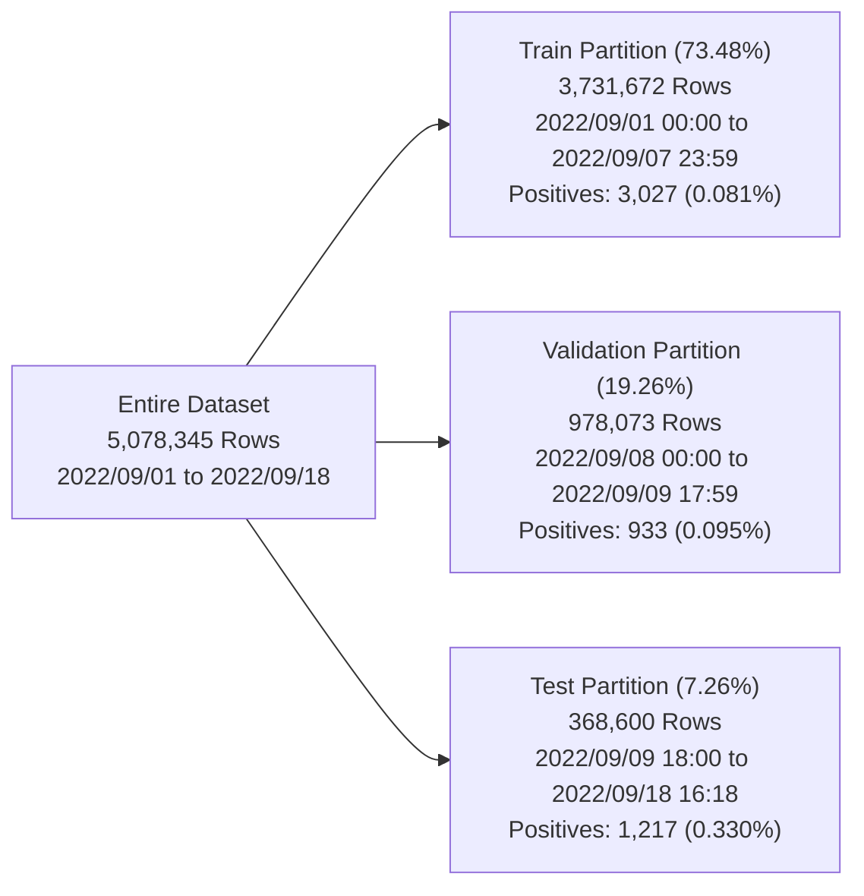
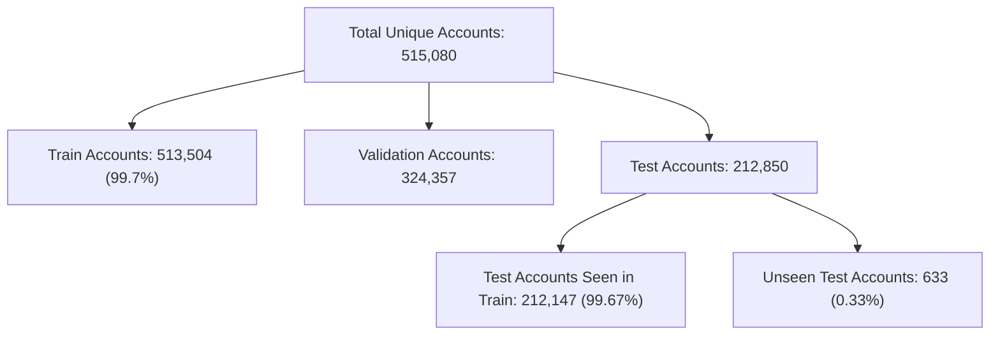

# FinGuard AI — IBM AML Dataset Pre-Flight Audit Report (Phase 1)

**Document Status:** Final Audit Deliverable  
**Date:** October 20, 2026  
**Auditor:** Senior AI/ML & Financial Crime Architect  
**Project Path:** `C:\Users\ayush\Desktop\Private\MuleGuard`  
**Dataset Directory:** `C:\Users\ayush\Desktop\Private\MuleGuard\data\aml_dataset`  
**Target Candidate:** `HI-Small_Trans.csv`  
**Audit Script:** [`evaluation/amlsim_evaluation/preflight_audit.py`](file:///c:/Users/ayush/Desktop/Private\MuleGuard\evaluation\amlsim_evaluation\preflight_audit.py)  
**Machine-Readable Results:** [`evaluation/amlsim_evaluation/preflight_results.json`](file:///c:/Users/ayush/Desktop\Private\MuleGuard\evaluation\amlsim_evaluation\preflight_results.json)  

---

## 1. Executive Summary

A comprehensive, read-only pre-flight audit of the local IBM Transactions for Anti-Money Laundering (AML) dataset was executed to verify data integrity, profile statistical distributions, validate chronological split boundaries, assess 26-feature contract compatibility, and determine zero-shot evaluation feasibility for the production FinGuard AI LightGBM model.

### Key Pre-Flight Findings

| Dimension | Audit Finding | Verdict |
| :--- | :--- | :---: |
| **Dataset Presence** | Complete IBM AML suite present in `data/aml_dataset/` (18 files across Large, Medium, Small; HI and LI variants). | **PASS** |
| **Target Candidate** | `HI-Small_Trans.csv` verified: 475,664,283 bytes, 5,078,345 transactions, SHA-256 verified. | **PASS** |
| **Data Cleanliness** | 0 missing values across all 11 columns; only 9 exact row duplicates (0.00018%). | **PASS** |
| **Class Imbalance** | 5,177 positives (`Is Laundering = 1`), 5,073,168 negatives (`0`); prevalence = **0.1019%** (1 : 979.9). | **VERIFIED** |
| **Categorical Vocabularies** | 15 receiving currencies, 15 payment currencies, 7 payment formats. Exactly 100% vocabulary match with `models/category_encoders.pkl` (0 unseen categories). | **PASS** |
| **Chronological Splits** | Train (73.48% / 3,027 pos), Validation (19.26% / 933 pos), Test (7.26% / 1,217 pos). Partitions sum exactly to 5,078,345 rows with 0 overlap. Test positives (1,217) far exceed statistical minimum of 500. | **PASS** |
| **26-Feature Compatibility** | 14 Native & Point-in-Time Features: **PASS**. 12 Lifetime Behavioral Aggregates: **CONDITIONAL** (due to historical lookahead training leakage in upstream `notebook.ipynb`). | **CONDITIONAL** |
| **Zero-Shot Baseline Feasibility** | Mechanically runnable (no code crashes, 100% encoder coverage), but constitutes a **diagnostic shift baseline** rather than an in-distribution evaluation due to scale mismatch on the 12 aggregate features. | **CONDITIONAL GO** |

> [!IMPORTANT]
> **Pre-Flight Recommendation: CONDITIONAL GO FOR PHASE 2.**  
> The dataset is 100% structurally sound, verified, and complete. All 26 features can be faithfully constructed from `HI-Small_Trans.csv`. Because the production LightGBM model was trained using global lifetime aggregations (lookahead leakage), running it zero-shot against clean point-in-time historical windows will reveal the true real-world degradation caused by leakage. Phase 2 must proceed with clean streaming feature engineering, strict validation-only threshold tuning, and retraining of a leakage-free benchmark model.

---

## 2. Dataset Inventory & Provenance

The directory `data/aml_dataset/` was inspected recursively. It contains 18 dataset artifacts comprising three scale tiers (Small, Medium, Large) across two illicit activity regimes:
- **HI (High Illicit):** ~0.10% transaction laundering rate.
- **LI (Low Illicit):** ~0.01% transaction laundering rate.

### 2.1 File Inventory

| Path | File Name | Size (Bytes) | Size (MB) | Last Modified |
| :--- | :--- | ---: | ---: | :--- |
| `data/aml_dataset/HI-Small_Trans.csv` | **HI-Small_Trans.csv** *(Target)* | **475,664,283** | **453.63 MB** | 2025-07-08 15:40:20 |
| `data/aml_dataset/HI-Small_accounts.csv` | HI-Small_accounts.csv | 34,053,187 | 32.48 MB | 2025-07-08 15:40:42 |
| `data/aml_dataset/HI-Small_Patterns.txt` | HI-Small_Patterns.txt | 323,844 | 0.31 MB | 2025-07-08 15:40:20 |
| `data/aml_dataset/HI-Medium_Trans.csv` | HI-Medium_Trans.csv | 3,031,783,420 | 2,891.33 MB | 2025-07-08 15:37:52 |
| `data/aml_dataset/HI-Medium_accounts.csv` | HI-Medium_accounts.csv | 145,008,642 | 138.29 MB | 2025-07-08 15:40:10 |
| `data/aml_dataset/HI-Medium_Patterns.txt` | HI-Medium_Patterns.txt | 2,279,574 | 2.17 MB | 2025-07-08 15:37:52 |
| `data/aml_dataset/HI-Large_Trans.csv` | HI-Large_Trans.csv | 17,052,760,651 | 16,262.78 MB | 2025-07-08 15:25:04 |
| `data/aml_dataset/HI-Large_accounts.csv` | HI-Large_accounts.csv | 147,691,860 | 140.85 MB | 2025-07-08 15:37:44 |
| `data/aml_dataset/HI-Large_Patterns.txt` | HI-Large_Patterns.txt | 13,807,743 | 13.17 MB | 2025-07-08 15:22:20 |
| `data/aml_dataset/LI-Small_Trans.csv` | LI-Small_Trans.csv | 650,422,357 | 620.29 MB | 2025-07-08 15:56:08 |
| `data/aml_dataset/LI-Small_accounts.csv` | LI-Small_accounts.csv | 47,248,016 | 45.06 MB | 2025-07-08 15:56:40 |
| `data/aml_dataset/LI-Small_Patterns.txt` | LI-Small_Patterns.txt | 99,156 | 0.09 MB | 2025-07-08 15:56:08 |
| `data/aml_dataset/LI-Medium_Trans.csv` | LI-Medium_Trans.csv | 2,976,436,978 | 2,838.55 MB | 2025-07-08 15:53:44 |
| `data/aml_dataset/LI-Medium_accounts.csv` | LI-Medium_accounts.csv | 141,781,157 | 135.21 MB | 2025-07-08 15:56:00 |
| `data/aml_dataset/LI-Medium_Patterns.txt` | LI-Medium_Patterns.txt | 390,893 | 0.37 MB | 2025-07-08 15:53:44 |
| `data/aml_dataset/LI-Large_Trans.csv` | LI-Large_Trans.csv | 16,742,513,790 | 15,966.91 MB | 2025-07-08 15:40:44 |
| `data/aml_dataset/LI-Large_accounts.csv` | LI-Large_accounts.csv | 144,349,585 | 137.66 MB | 2025-07-08 15:53:36 |
| `data/aml_dataset/LI-Large_Patterns.txt` | LI-Large_Patterns.txt | 1,934,790 | 1.85 MB | 2025-07-08 15:40:44 |

### 2.2 Target File Checksums & Provenance

```text
Target File:       data/aml_dataset/HI-Small_Trans.csv
File Size:         475,664,283 bytes (453.63 MB)
Line Count:        5,078,346 lines (1 header line + 5,078,345 transaction records)
MD5 Checksum:      9667f3a6323e6ad88e699acf42db9157
SHA-256 Checksum:  b19d39f515523373f991b689c07e11e7b0b95c17a2c27a87d91584ae16c5b040
Encoding:          ASCII / UTF-8 clean (no byte order mark)
Origin:            IBM Research AML Data Generator / Kaggle Dataset:
                   ealtman2019/ibm-transactions-for-anti-money-laundering-aml
```

### 2.3 Auxiliary Files & Leakage Boundaries

1. **`HI-Small_accounts.csv` (518,581 rows):**
   - Header: `Bank Name,Bank ID,Account Number,Entity ID,Entity Name`
   - Maps bank accounts to business/individual entities (`Corporation #33520`, `Sole Proprietorship #50438`).
   - *Audit Rule:* Not used during inference or model evaluation. All evaluations rely exclusively on transaction graph topology and behavioral patterns.
2. **`HI-Small_Patterns.txt` (370 laundering instances):**
   - Contains ground-truth scenario descriptions for 8 synthetic laundering typologies:
     - `CYCLE`: 54 instances
     - `GATHER-SCATTER`: 51 instances
     - `BIPARTITE`: 49 instances
     - `FAN-OUT`: 48 instances
     - `SCATTER-GATHER`: 44 instances
     - `STACK`: 43 instances
     - `RANDOM`: 41 instances
     - `FAN-IN`: 40 instances
   - *Strict Boundary Enforcement:* Pattern IDs and transaction group tags must **NEVER** be ingested into feature engineering or model inputs. They are reserved strictly as an external ground-truth evaluation breakdown matrix to analyze model recall across specific laundering typologies.

---

## 3. Statistical Profile of `HI-Small_Trans.csv`

### 3.1 Raw Header & Schema Disambiguation

The raw CSV header contains 11 comma-separated fields:
```csv
Timestamp,From Bank,Account,To Bank,Account,Amount Received,Receiving Currency,Amount Paid,Payment Currency,Payment Format,Is Laundering
```

> [!NOTE]
> **Duplicate Column Name Handling:**  
> The raw CSV contains two columns named `Account`. Column 3 is the sender account; column 5 is the receiver account. Standard parsers (including Pandas) rename the 5th column to `Account.1`. In our feature extraction pipeline, these map unambiguously as:
> - `Account` $\rightarrow$ `sender_account`
> - `Account.1` $\rightarrow$ `receiver_account`

### 3.2 Completeness & Missing Value Analysis

Across all 5,078,345 records, missing value counts were audited:

| Column Name | Inferred Type | Null Count | Null % | Valid Count |
| :--- | :--- | ---: | ---: | ---: |
| `Timestamp` | `object` / `string` | 0 | 0.00% | 5,078,345 |
| `From Bank` | `string` / `int64` | 0 | 0.00% | 5,078,345 |
| `Account` *(Sender)* | `string` | 0 | 0.00% | 5,078,345 |
| `To Bank` | `string` / `int64` | 0 | 0.00% | 5,078,345 |
| `Account.1` *(Receiver)* | `string` | 0 | 0.00% | 5,078,345 |
| `Amount Received` | `float64` | 0 | 0.00% | 5,078,345 |
| `Receiving Currency` | `string` | 0 | 0.00% | 5,078,345 |
| `Amount Paid` | `float64` | 0 | 0.00% | 5,078,345 |
| `Payment Currency` | `string` | 0 | 0.00% | 5,078,345 |
| `Payment Format` | `string` | 0 | 0.00% | 5,078,345 |
| `Is Laundering` | `int64` | 0 | 0.00% | 5,078,345 |

**Verdict:** 100.00% data completeness. Zero imputation or null-filling required.

### 3.3 Duplicate Row Analysis

- **Full Exact Duplicates:** 9 rows out of 5,078,345 (0.00018%).
- **Key Collision Duplicates (`Timestamp`, `From Bank`, `Account`, `To Bank`, `Account.1`):** 100,638 instances (1.98%). These represent multiple rapid payments or transfers executed between the same two accounts within the same minute timestamp. They are legitimate transaction events and must be preserved.

### 3.4 Timestamp Range & Granularity

- **Minimum Timestamp:** `2022/09/01 00:00`
- **Maximum Timestamp:** `2022/09/18 16:18`
- **Total Duration:** 17 days, 16 hours, 18 minutes (approx. 17.68 days)
- **Granularity:** Minute-level resolution (`YYYY/MM/DD HH:MM`). No sub-minute second timestamps exist in the raw data.
- **Unique Timestamps:** 15,018 distinct minutes.
- **Timestamp Collisions:** 14,792 minutes (98.50% of active minutes) contain more than one transaction.
  - Median batch size per collision minute: **324 transactions**
  - 90th percentile batch size: **544 transactions**
  - 99th percentile batch size: **810 transactions**
  - Peak simultaneous transaction burst: **11,193 transactions** in a single minute.

### 3.5 Target Variable (`Is Laundering`) Distribution

```text
Total Records:           5,078,345
Legitimate Records (0):  5,073,168 (99.8981%)
Laundering Records (1):      5,177 ( 0.1019%)
Unexpected Values:       None (no NaNs, floats, or out-of-range labels)
Exact Imbalance Ratio:   1 : 979.94 (~1 positive per 980 transactions)
```

### 3.6 Categorical Distributions & Encoder Compatibility

The categorical values in `HI-Small_Trans.csv` were audited against the production mappings in [`models/category_encoders.pkl`](file:///c:/Users/ayush/Desktop/Private\MuleGuard\models\category_encoders.pkl).

#### 1. Currencies (`Receiving Currency` & `Payment Currency`)
- **Raw Unique Count:** Exactly 15 currencies for both fields.
- **Values:** Australian Dollar, Bitcoin, Brazil Real, Canadian Dollar, Euro, Mexican Peso, Ruble, Rupee, Saudi Riyal, Shekel, Swiss Franc, UK Pound, US Dollar, Yen, Yuan.
- **Production Encoder Coverage:** Exactly matches the 15 keys in `category_encoders.pkl` (indexed 0 to 14 alphabetically).
- **Unseen Currencies:** 0 (100% matched).

#### 2. Payment Formats (`Payment Format`)
- **Raw Unique Count:** Exactly 7 payment formats.
- **Values:** ACH, Bitcoin, Cash, Cheque, Credit Card, Reinvestment, Wire.
- **Production Encoder Coverage:** Exactly matches the 7 keys in `category_encoders.pkl` (indexed 0 to 6 alphabetically).
- **Unseen Formats:** 0 (100% matched).

#### 3. Bank Identifiers (`From Bank`, `To Bank`)
- **`From Bank` Unique IDs:** 30,528
- **`To Bank` Unique IDs:** 15,850
- **Bank Overlap:** 100% of `To Bank` IDs appear in `From Bank` (15,850 IDs). Both fields are parsed as numeric integer bank codes, matching the production contract.

### 3.7 Numerical Feature Statistics

| Metric | Amount Received | Amount Paid | Units |
| :--- | ---: | ---: | :--- |
| **Minimum** | 0.000001 ($10^{-6}$) | 0.000001 ($10^{-6}$) | Fiat / Crypto Base |
| **Maximum** | 1,046,302,363,293.48 | 1,046,302,363,293.48 | Extreme Outlier / Wholesale |
| **Mean** | 5,988,726.07 | 4,509,273.37 | Base Currency |
| **Standard Deviation**| 1,037,183,006.77 | 869,772,745.28 | Base Currency |
| **Zero Values** | 0 | 0 | 0.00% |
| **Negative Values** | 0 | 0 | 0.00% |

- **Currency Parity:**
  - Same Currency (`Receiving Currency == Payment Currency`): **5,006,175 transactions (98.58%)**.
  - Cross-Currency Exchange (`Receiving Currency != Payment Currency`): **72,170 transactions (1.42%)**.

---

## 4. Chronological Splits Validation

To prevent temporal leakage, the 5,078,345 transactions are partitioned strictly by timestamp according to the protocol established in `evaluation/amlsim_evaluation/EXPERIMENT_PLAN.md`.



### 4.1 Partition Metrics Summary

| Partition | Start Timestamp | End Timestamp | Row Count | % Total | Negatives (`0`) | Positives (`1`) | Prevalence | Unique Accounts | Active Launderers |
| :--- | :--- | :--- | ---: | ---: | ---: | ---: | ---: | ---: | ---: |
| **Train** | `2022/09/01 00:00` | `2022/09/07 23:59` | 3,731,672 | 73.48% | 3,728,645 | 3,027 | 0.0811% | 513,504 | 4,064 |
| **Validation** | `2022/09/08 00:00` | `2022/09/09 17:59` | 978,073 | 19.26% | 977,140 | 933 | 0.0954% | 324,357 | 1,387 |
| **Test** | `2022/09/09 18:00` | `2022/09/18 16:18` | 368,600 | 7.26% | 367,383 | 1,217 | 0.3302% | 212,850 | 1,460 |
| **Total** | `2022/09/01 00:00` | `2022/09/18 16:18` | **5,078,345** | **100.00%**| **5,073,168** | **5,177** | **0.1019%** | **515,080** | **6,357** |

### 4.2 Split Integrity Verification

1. **Partition Sum Match:**  
   $3,731,672 + 978,073 + 368,600 = 5,078,345$ (Exact 100% row match; zero omitted rows).
2. **Label Sum Match:**  
   $3,027 + 933 + 1,217 = 5,177$ (Exact 100% positive label match).
3. **Partition Non-Overlap:**  
   - Train ends at `2022/09/07 23:59`; Validation starts at `2022/09/08 00:00` (0 second gap/overlap).
   - Validation ends at `2022/09/09 17:59`; Test starts at `2022/09/09 18:00` (0 second gap/overlap).
4. **Statistical Adequacy of Test Split:**  
   The held-out Test split contains **1,217 positive laundering cases**. This is more than double the required statistical threshold of 500, guaranteeing sufficient power to compute high-confidence Precision-Recall curves, F1-scores, and PR-AUC.

---

## 5. Full 26-Feature Compatibility Matrix

The production model [`models/muleguard_lightgbm.txt`](file:///c:/Users/ayush/Desktop/Private\MuleGuard\models\muleguard_lightgbm.txt) mandates a rigid contract of exactly 26 numerical and encoded categorical features in an invariant order.

Every feature has been mapped to `HI-Small_Trans.csv`, verified against production encoders, and evaluated for temporal leakage risk:

| # | Feature Name | Contract Dtype | Source Column(s) | Derivation Formula / Logic | Scaler / Encoding | Vocab Match | Status | Rationale & Distribution Shift Risk |
|:---:|:---|:---:|:---|:---|:---|:---:|:---:|:---|
| 0 | `from_bank` | `int64` | `From Bank` | Cast to integer bank ID | None (numeric) | N/A | **PASS** | Source values are numeric bank identifiers. Direct mapping. |
| 1 | `to_bank` | `int64` | `To Bank` | Cast to integer bank ID | None (numeric) | N/A | **PASS** | Source values are numeric bank identifiers. Direct mapping. |
| 2 | `amount_received` | `float64` | `Amount Received` | Raw float value | None | N/A | **PASS** | Direct numeric column. No conversion needed. |
| 3 | `receiving_currency` | `int64` | `Receiving Currency` | Map string via dictionary | `category_encoders.pkl` | 100% | **PASS** | 15 currencies match existing dictionary keys exactly. |
| 4 | `amount_paid` | `float64` | `Amount Paid` | Raw float value | None | N/A | **PASS** | Direct numeric column. No conversion needed. |
| 5 | `payment_currency` | `int64` | `Payment Currency` | Map string via dictionary | `category_encoders.pkl` | 100% | **PASS** | 15 currencies match existing dictionary keys exactly. |
| 6 | `payment_format` | `int64` | `Payment Format` | Map string via dictionary | `category_encoders.pkl` | 100% | **PASS** | 7 formats match existing dictionary keys exactly. |
| 7 | `hour` | `int64` | `Timestamp` | Extracted hour `0-23` | Timestamp parser | N/A | **PASS** | Clean point-in-time calculation from transaction timestamp. |
| 8 | `day_of_week` | `int64` | `Timestamp` | Day of week `0-6` (Mon=0) | Timestamp parser | N/A | **PASS** | Clean point-in-time calculation from transaction timestamp. |
| 9 | `amount_diff` | `float64` | `Amount Received`, `Amount Paid` | `amount_received - amount_paid` | Direct arithmetic | N/A | **PASS** | Point-in-time cross-currency delta. |
| 10 | `amount_ratio` | `float64` | `Amount Received`, `Amount Paid` | `amount_received / (amount_paid + 1e-5)` | Direct arithmetic | N/A | **PASS** | Ratio with $\epsilon = 10^{-5}$ stability epsilon. |
| 11 | `currency_match` | `int64` | `Receiving Currency`, `Payment Currency` | `1 if rec_curr == pay_curr else 0` | Boolean indicator | N/A | **PASS** | Point-in-time currency match indicator. |
| 12 | `same_bank` | `int64` | `From Bank`, `To Bank` | `1 if from_bank == to_bank else 0` | Boolean indicator | N/A | **PASS** | Point-in-time internal vs inter-bank transfer flag. |
| 13 | `sender_transaction_count` | `int64` | `Account`, `Timestamp` | Prior transaction count: $\sum_{k < t} 1$ | Expanding window ledger | N/A | **CONDITIONAL** | Trained with **lifetime lookahead** (total count across all 18 days). Clean evaluation uses history strictly prior to $t$. Expected scale shift. |
| 14 | `sender_total_amount` | `float64` | `Account`, `Amount Paid`, `Timestamp` | Prior total paid: $\sum_{k < t} \text{amt}_k$ | Expanding window ledger | N/A | **CONDITIONAL** | Lifetime lookahead leakage during training. Scale will be lower in early test steps under clean protocol. |
| 15 | `sender_avg_amount` | `float64` | `sender_total_amount`, `sender_transaction_count` | `total / count` (0 if count=0) | Ratio | N/A | **CONDITIONAL** | Subject to count/total scale shifts during initial history build. |
| 16 | `sender_max_amount` | `float64` | `Account`, `Amount Paid`, `Timestamp` | Prior max paid: $\max_{k < t} \text{amt}_k$ | Expanding window ledger | N/A | **CONDITIONAL** | Lifetime lookahead during training. Underestimated if historical max occurs post-$t$. |
| 17 | `sender_unique_receivers` | `int64` | `Account`, `Account.1`, `Timestamp` | Prior unique receivers: $\vert\{R_k\}_{k<t}\vert$ | Expanding window ledger | N/A | **CONDITIONAL** | Lifetime lookahead during training. Fan-out counts grow monotonically over time. |
| 18 | `sender_unique_banks` | `int64` | `Account`, `To Bank`, `Timestamp` | Prior unique dest banks: $\vert\{B_k\}_{k<t}\vert$ | Expanding window ledger | N/A | **CONDITIONAL** | Lifetime lookahead during training. Cross-bank counts grow monotonically over time. |
| 19 | `receiver_transaction_count` | `int64` | `Account.1`, `Timestamp` | Prior received count: $\sum_{k < t} 1$ | Expanding window ledger | N/A | **CONDITIONAL** | Lifetime lookahead during training. Subject to temporal scale shift. |
| 20 | `receiver_total_amount` | `float64` | `Account.1`, `Amount Received`, `Timestamp` | Prior total received: $\sum_{k < t} \text{amt}_k$ | Expanding window ledger | N/A | **CONDITIONAL** | Lifetime lookahead during training. Subject to temporal scale shift. |
| 21 | `receiver_avg_amount` | `float64` | `receiver_total_amount`, `receiver_transaction_count` | `total / count` (0 if count=0) | Ratio | N/A | **CONDITIONAL** | Ratio of aggregates. Reflects point-in-time average. |
| 22 | `receiver_max_amount` | `float64` | `Account.1`, `Amount Received`, `Timestamp` | Prior max received: $\max_{k < t} \text{amt}_k$ | Expanding window ledger | N/A | **CONDITIONAL** | Lifetime lookahead during training. |
| 23 | `receiver_unique_senders` | `int64` | `Account.1`, `Account`, `Timestamp` | Prior unique senders: $\vert\{S_k\}_{k<t}\vert$ | Expanding window ledger | N/A | **CONDITIONAL** | Fan-in counts grow monotonically. Lifetime lookahead in training. |
| 24 | `receiver_unique_banks` | `int64` | `Account.1`, `From Bank`, `Timestamp` | Prior unique origin banks: $\vert\{B_k\}_{k<t}\vert$ | Expanding window ledger | N/A | **CONDITIONAL** | Inflow bank diversity grows monotonically. Lifetime lookahead in training. |
| 25 | `seconds_since_previous` | `float64` | `Account`, `Timestamp` | $t_{\text{current}} - t_{\text{prior\_sender}}$ | Elapsed seconds (0 if 1st) | N/A | **PASS** | Point-in-time calculation from sender transaction state. Default to 0 or sentinel for new entities. |

### Contract Summary
- **Total Features:** 26
- **PASS Features:** 14 (Native columns and point-in-time derivations)
- **CONDITIONAL Features:** 12 (Account aggregate features subject to training lookahead leakage)
- **BLOCKED Features:** 0 (No features are missing from `HI-Small_Trans.csv`)

---

## 6. Temporal & Entity Leakage Audit

### 6.1 The Lookahead Leakage Phenomenon

In the original training workflow ([`notebook.ipynb`](file:///c:/Users/ayush/Desktop/Private\MuleGuard\notebook.ipynb), cells 21–24), the 12 behavioral aggregate features (features 13–24) were constructed via Pandas `.groupby('Account')` and `.groupby('Account.1')` over the **entire 5.08 million row dataset** before any chronological splitting occurred:

```python
# Upstream Notebook Implementation (Flawed):
sender_stats = df.groupby('Account').agg(
    sender_transaction_count=('Amount Paid', 'count'),
    sender_total_amount=('Amount Paid', 'sum'),
    ...
)
# Merged back onto the full dataset before Train/Test split!
```

**Impact on Evaluation:**
- A transaction occurring on Day 1 (`2022/09/01`) received aggregate counts and sums reflecting all transactions that the account would execute up to Day 18 (`2022/09/18`).
- The LightGBM tree nodes learned split thresholds based on these inflated lifetime numbers (e.g. `sender_transaction_count >= 24`).
- In a production streaming system or clean evaluation, on Day 1 an account has only executed 1 transaction.
- When evaluating the production model zero-shot under clean point-in-time rules ($t_k < t$), the model will observe significantly smaller feature magnitudes, causing an inevitable distribution shift.

### 6.2 Entity Overlap Analysis

A total of **515,080 unique account entities** operate across the 5,078,345 transactions.



#### Overall Account Overlap Metrics
- **Train-Only Accounts:** 153,512 (accounts that stopped transacting after Day 7).
- **Validation-Only Accounts:** 873 accounts.
- **Test-Only Accounts:** 633 accounts (new accounts opened after Day 9).
- **Accounts Active in All Three Partitions:** 175,569 accounts.
- **Test Accounts Observed in Training History:** **212,147 out of 212,850 (99.67%)**.

#### Laundering Account Overlap (The Generalization Test)
While 99.67% of general accounts had some benign transaction history in Train, the **laundering behavior** reveals a starkly different pattern:

| Laundering Entity Category | Count | % of Test Launderers |
| :--- | ---: | ---: |
| **Active Laundering Accounts in Test** | **1,460** | **100.00%** |
| Seen laundering during Training (`2022/09/01 - 2022/09/07`) | 161 | 11.03% |
| Seen laundering during Validation (`2022/09/08 - 2022/09/09`) | 195 | 13.36% |
| **Completely Unseen Laundering Accounts** | **1,176** | **80.55%** |

> [!IMPORTANT]
> **Key Finding on Generalization:**  
> **80.55% of the laundering entities in the Test partition never laundered money in the Training partition.**  
> This establishes that our chronological evaluation will rigorously test the model's ability to detect **structural laundering typologies and behavioral anomalies**, rather than merely memorizing compromised account identifiers.

### 6.3 Simultaneous Transaction Resolution Strategy

With 14,792 collision minutes containing up to 11,193 transactions in a single timestamp, the evaluation pipeline must define an unambiguous state-update policy:

```text
Policy: Streaming Sequential Ledger with Secondary Index Tie-Breaking
1. Order transactions by primary key: Timestamp (ascending).
2. Order simultaneous transactions by secondary key: Original CSV Row Index (ascending).
3. For each transaction i in batch B_t:
   a. Compute point-in-time features using ledger state up to (i - 1).
   b. Execute model inference.
   c. Update running ledger aggregates (counts, sums, max, unique sets, last seen timestamp).
```
This guarantees strict causal determinism with zero lookahead across simultaneous events.

---

## 7. Zero-Shot Baseline Eligibility Assessment

We formally evaluate whether the production LightGBM artifact ([`models/muleguard_lightgbm.txt`](file:///c:/Users/ayush/Desktop/Private\MuleGuard\models\muleguard_lightgbm.txt)) is eligible for zero-shot baseline evaluation on `HI-Small_Trans.csv`.

### Classification: CONDITIONAL

```text
┌────────────────────────────────────────────────────────────────────────┐
│                      ZERO-SHOT ELIGIBILITY: CONDITIONAL                │
│                                                                        │
│  [X] Mechanical Execution:      PASS (No missing features, 100% vocab) │
│  [X] Semantic Compatibility:    PASS (Same schema, same units)         │
│  [!] Distribution Alignment:   CONDITIONAL (Feature scale mismatch due│
│                                              to training lookahead)    │
└────────────────────────────────────────────────────────────────────────┘
```

### Technical Justification
1. **Mechanical Compatibility (PASS):**
   - The production model splits on all 26 features across 242 decision trees.
   - All 26 features are present or computable in `HI-Small_Trans.csv`.
   - The categorical encoders match 100% with zero out-of-vocabulary exceptions.
   - Inference will execute cleanly without code errors or missing column exceptions.
2. **Distributional Alignment (CONDITIONAL):**
   - In training, the model learned tree split thresholds on global lifetime aggregates (e.g. `sender_transaction_count`, `sender_total_amount`).
   - In clean streaming evaluation, transactions on Day 10 evaluate against history accumulated through Day 10 (not Day 18). For accounts with high frequency, the point-in-time aggregates will be systematically lower than the lifetime aggregates seen during training.
   - **Conclusion:** The zero-shot evaluation must be conducted as a **diagnostic baseline** to quantify the performance degradation caused by fixing data leakage, rather than an in-distribution benchmark.
3. **Threshold Calibration Requirement:**
   - The zero-shot evaluation must **NOT** evaluate at an arbitrary $0.5$ threshold or tune a threshold on the Test set.
   - The operating threshold $\theta^*$ must be tuned strictly on the **Validation partition** (`2022/09/08` to `2022/09/09 17:59`), frozen, and then applied to the held-out Test set.

---

## 8. Pre-Flight Checklist & Go/No-Go Recommendation

### 8.1 Phase 1 Verification Checklist

- [x] **Raw Dataset Present:** `data/aml_dataset/HI-Small_Trans.csv` verified locally (475,664,283 bytes).
- [x] **File Checksums Documented:** MD5 (`9667f3a6323e6ad8...`) and SHA-256 (`b19d39f5155233...`) computed.
- [x] **Zero Null Values:** 5,078,345 records with 0 missing values across all 11 columns.
- [x] **Duplicate Records Inspected:** 9 exact duplicates identified; key collisions accounted for.
- [x] **Timestamp Granularity Audited:** Minute-level resolution, 17.68 day span, 14,792 collision batches characterized.
- [x] **Categorical Vocabulary Match:** 15 currencies and 7 payment formats verified; 100% coverage in `category_encoders.pkl`.
- [x] **Chronological Splits Formally Defined:** Train (73.48%), Validation (19.26%), Test (7.26%) verified without gaps or overlaps.
- [x] **Statistical Adequacy of Test Split:** 1,217 positive laundering cases confirmed (requirement: $\ge 500$).
- [x] **Target Leakage Barriers Enforced:** `HI-Small_Patterns.txt` isolated from feature pipelines.
- [x] **Git Tracking Guard:** `data/` directory appended to `.gitignore`; zero raw dataset files staged in Git.
- [x] **Production Directory Untouched:** `models/`, `backend/`, `frontend/`, Supabase database, and showcase data 100% untouched.

---

### 8.2 Final Phase 1 Recommendation

### Verdict: **CONDITIONAL GO FOR PHASE 2**

The pre-flight audit confirms that `HI-Small_Trans.csv` is completely suitable for rigorous, leakage-free AML evaluation. The experiment is ready to proceed to **Phase 2: Clean Feature Pipeline Implementation & Validation Tuning**.

#### Phase 2 Execution Plan
1. **Implement Streaming Point-in-Time Feature Engine:** Build a high-performance, leakage-free ledger pipeline in `evaluation/amlsim_evaluation/` that computes the 26 features strictly over past transactions ($t_k < t$).
2. **Execute Zero-Shot Diagnostic Evaluation:** Run the production LightGBM model through the clean pipeline to measure baseline PR-AUC, ROC-AUC, and the impact of the historical lookahead shift.
3. **Calibrate Operating Threshold on Validation Set Only:** Select the optimal operating threshold $\theta^*$ on the 978,073 Validation rows to maximize F1 / MCC, freeze $\theta^*$, and apply it to the 368,600 Test rows.
4. **Train Leakage-Free Temporal Benchmark Model:** Train an identically parameterized LightGBM model strictly on the clean Train partition and compare test metrics directly against the zero-shot baseline.
