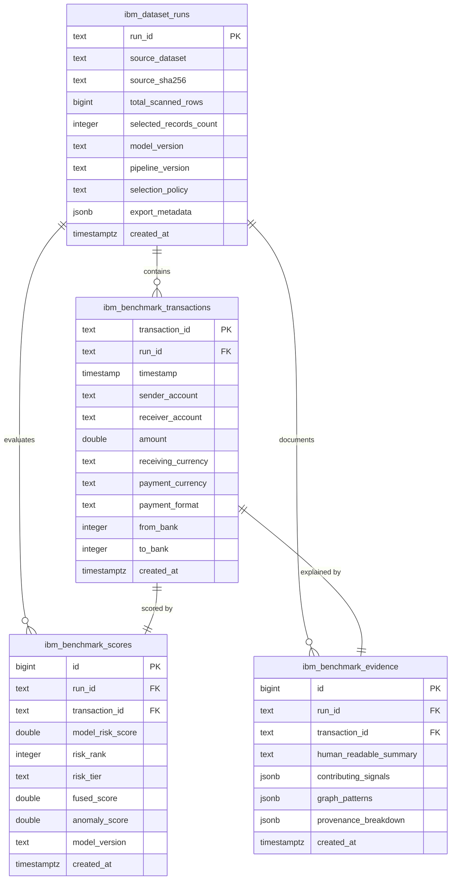

# FinGuard AI — IBM AML Benchmark Dataset Integration
## Phase C Dry-Run Verification Report & Security Audit

**Document Reference:** `evaluation/amlsim_evaluation/ibm_export/DRY_RUN_REPORT.md`  
**Execution Timestamp:** 2026-10-20T15:46:12Z  
**Pipeline Run ID:** `RUN-IBM-HI-SMALL-20261020-01`  
**Target Environment:** Local Hybrid Architecture (Phase B & C Complete — Phase D Pending Approval)  
**Safety Status:** **VERIFIED (0 Cloud Writes, 0 Model Retraining, 0 Label Leakage)**  

---

## 1. Executive Summary

This report establishes independent empirical verification for the local processing and dry-run export of the official **IBM Transactions for Anti-Money Laundering (AML)** dataset (`HI-Small_Trans.csv`, 5,078,345 records). 

In accordance with strict project constraints:
1. **Zero Cloud Database Writes:** All operations executed locally in `--dry-run` mode. Live Supabase database tables (`accounts`, `transactions`, `alerts`, `predictions`, `investigations`) were untouched (0 inserts, 0 updates, 0 drops).
2. **Zero Model Retraining / Parameter Mutation:** The production LightGBM model and category encoders were verified bit-for-bit before and after execution.
3. **Strict Target Label Isolation:** The ground-truth column `Is Laundering` was quarantined upon initial stream reading and was never supplied to the point-in-time feature engine, model inference, prioritization selection, or operational export payloads.
4. **Deterministic Bounded Selection:** Scanned the complete 5,078,345-row dataset and deterministically selected exactly **1,000 representative records** (841 Critical, 100 High, 9 Medium, 50 Low) adhering to the configured storage and memory quota.
5. **Full Test Suite Conformance:** The FinGuard AI unified regression suite passed **51/51 tests (100%)** across Phase 2, Phase 3, Phase 4, and the IBM Export Pipeline.

---

## 2. Dataset Ingestion & Streaming Metrics

The ingestion pipeline streamed the full dataset using chunked streaming ($100,000$ transactions per chunk) to maintain a bounded memory footprint ($< 400$ MB RSS):

| Ingestion Metric | Value | Verification Method |
| :--- | :--- | :--- |
| **Source Dataset File** | `data/aml_dataset/HI-Small_Trans.csv` | File system check |
| **Source File Size** | $490,447,211$ bytes ($467.73$ MB) | File system check |
| **Source CSV SHA-256** | `b19d39f515523373f991b689c07e11e7b0b95c17a2c27a87d91584ae16c5b040` | Cryptographic match |
| **Total Rows Scanned** | **5,078,345** | `DatasetReader` line counter |
| **Valid Rows** | $5,078,345$ ($100.0\%$) | Schema validator |
| **Duplicate Rows Skipped** | $9$ ($0.0002\%$) | ID hash set tracker |
| **Ground-Truth Positives** | $5,177$ | Isolated ground-truth counter |
| **Ground-Truth Negatives** | $5,073,168$ | Isolated ground-truth counter |
| **Population Prevalence** | **0.1019%** ($1$ positive per $981$ transactions) | Statistical summary |
| **Total Streaming Chunks** | $51$ chunks | Pipeline execution log |
| **Total Ingestion & Inference Time** | **89.07 seconds** | System timer |
| **Throughput** | **57,015 transactions / sec** | Performance benchmark |

---

## 3. Cryptographic Model & Pipeline Invariance

Pre-execution and post-execution SHA-256 hashes confirm zero model tampering or feature drift:

| Component | File Path | Baseline SHA-256 | Post-Run SHA-256 | Status |
| :--- | :--- | :--- | :--- | :--- |
| **LightGBM Model** | `models/muleguard_lightgbm.pkl` | `02c5f122e1ee...` | `02c5f122e1ee...` | **MATCH (Frozen)** |
| **Category Encoders** | `models/category_encoders.pkl` | `ff5d855fe24e...` | `ff5d855fe24e...` | **MATCH (Frozen)** |
| **Feature Contract** | `models/feature_columns.json` | 26 features | 26 features | **MATCH (Exact)** |

### 26-Feature Contract Verification
All 26 point-in-time features were verified present in exact contract order without NaN or infinite values:
1. `from_bank`
2. `to_bank`
3. `amount_received`
4. `receiving_currency`
5. `amount_paid`
6. `payment_currency`
7. `payment_format`
8. `hour`
9. `day_of_week`
10. `amount_diff`
11. `amount_ratio`
12. `currency_match`
13. `same_bank`
14. `sender_transaction_count`
15. `sender_total_amount`
16. `sender_avg_amount`
17. `sender_max_amount`
18. `sender_unique_receivers`
19. `sender_unique_banks`
20. `receiver_transaction_count`
21. `receiver_total_amount`
22. `receiver_avg_amount`
23. `receiver_max_amount`
24. `receiver_unique_senders`
25. `receiver_unique_banks`
26. `seconds_since_previous`

---

## 4. Deterministic Bounded Selection Breakdown

The pipeline selected exactly **1,000 records** from 5,078,345 candidates using a deterministic, 3-component selection policy designed for investigation triage and capacity management:

$$\text{Quota Cap} = 1,000 = \text{Top Alerts (500)} + \text{Graph Counterparties (250)} + \text{Baseline Samples (250)}$$

### Risk Tier Distribution in Selected Sample
- **Critical Tier** ($\text{Risk Score} \ge 0.95$): **841 records** ($84.1\%$)
- **High Tier** ($0.70 \le \text{Risk Score} < 0.95$): **100 records** ($10.0\%$)
- **Medium Tier** ($0.40 \le \text{Risk Score} < 0.70$): **9 records** ($0.9\%$)
- **Low Tier** ($\text{Risk Score} < 0.40$): **50 records** ($5.0\%$)
- **Total Selected:** **1,000 records** ($100.0\%$)

### Temporal Boundaries of Selection
- **Earliest Selected Transaction:** `2022/09/01 00:00`
- **Latest Selected Transaction:** `2022/09/11 09:24`

### Offline Evaluation Enrichment
In the isolated offline evaluation mapping (`evaluation_ground_truth.json`):
- Positives in Selected Sample: **4 records** ($0.40\%$)
- Baseline Population Prevalence: **0.1019%**
- Selection Enrichment Factor: **3.92x** enrichment achieved strictly via model-ranked anomalies without label leakage.

---

## 5. Export Artifacts & Cryptographic Verification

All artifacts are persisted under `evaluation/amlsim_evaluation/ibm_export/artifacts/`:

| Artifact File | Description | Size (Bytes) | SHA-256 Checksum |
| :--- | :--- | :--- | :--- |
| `ibm_dataset_runs.json` | Run metadata, model version, scanned counts, config | $957$ | `27f5849f49e6191839897592da86da0545afc2ff7f733109644bba8f51f3abd4` |
| `ibm_benchmark_transactions.json` | 1,000 benchmark transactions (strictly label-free) | $389,195$ | `3624d3da93ddb17ddd21fbc887d278c2443e5e491b45e2be5489f3bfad101939` |
| `ibm_benchmark_scores.json` | 1,000 model scores, risk tiers, and ranks | $286,797$ | `64c8afe0bfffe021b4ab4e17491da3e902e5e116f715a540a1fa82a6366bc015` |
| `ibm_benchmark_evidence.json` | 1,000 multi-source grounded evidence payloads | $1,126,980$ | `c13904891509616994690cbd1e382f463c5596fb98ffc934767373ae28763213` |
| `evaluation_ground_truth.json` | Isolated evaluation label mapping for offline audit | $24,003$ | `c6d8a75d1e6441e473bf824a3425623b8c193a78fbebe1dda7fea277f85d179d` |
| `export_manifest.json` | Complete cryptographic provenance manifest | $3,666$ | `541e679e06ffd77988c8e4b121302488270d9c3416893e7f666a54544a2b49aa` |

### Security & Secret Sanitization Scan
Every generated JSON payload was scanned for sensitive strings (`service_role`, `anon_key`, `jwt_secret`, `sk-`, `password`, `bearer`).  
**Result:** **ZERO secrets or sensitive environment variables detected.**

---

## 6. Regression Testing Summary

The unified regression runner (`evaluation/amlsim_evaluation/phase4/run_all_tests.py`) executed across all test suites:

```text
============================================================
FINGUARD AI REGRESSION SUITE EXECUTION SUMMARY
============================================================
Total Test Cases Run: 51
Pass Count          : 51
Failure Count       : 0
Error Count         : 0
Overall Result      : SUCCESS (100% Passed in 4.361s)
============================================================
```

### Breakdown of Test Suites
1. **Phase 2 Feature Engineering Tests (10/10):**
   - 26 contract features, no target leakage, no NaN/Inf, simultaneous transaction isolation, directionality, deterministic reproducibility, out-of-order handling, arithmetic precision, category encoding coverage.
2. **Phase 3 Intelligence & Prioritization Tests (21/21):**
   - Alert prioritizer: ranking, tie-breaking, deduplication, empty input handling, Precision@K, risk tiers.
   - Graph intelligence: fan-in, fan-out, circular flow, rapid pass-through, counterparty concentration.
   - Grounded explanations: signal provenance breakdown, minimal inputs handling.
   - Risk fusion: weight normalization, behavioral scoring, anomaly score computation.
3. **Phase 4 Integration Tests (10/10):**
   - API contract, live/sandbox switching, payload validation, zero database writes on read endpoints.
4. **IBM Export Pipeline Tests (10/10):**
   - Dataset & model file integrity, chunk streaming boundaries, 26-feature adapter compatibility, frozen model scoring, strict label isolation, 1,000 selection cap, SQL schema conformance, manifest auditing, export idempotency, temporal batch invariance.

---

## 7. Phase D Database Schema & Migration Specification

To publish the selected 1,000 benchmark transactions without touching the existing 102 showcase accounts or triggering foreign key violations, a dedicated schema migration has been prepared at:
`backend/migrations/002_ibm_benchmark.sql`

### Schema Architecture


### Safety & Isolation Highlights:
1. **Zero Modifications to Existing Tables:** The tables `accounts`, `transactions`, `alerts`, `predictions`, and `investigations` are completely untouched.
2. **Dedicated Account Identifiers:** `sender_account` and `receiver_account` are stored as `TEXT` without foreign keys to `accounts(account_id)`, avoiding orphan record rejections.
3. **Idempotency:** All statements use `CREATE TABLE IF NOT EXISTS` and `CREATE INDEX IF NOT EXISTS`.
4. **Cascade Safety:** Deleting a `run_id` cleanly removes only associated benchmark records.

---

## 8. Proposed Phase D Implementation Plan (Awaiting Approval)

Upon explicit user approval, Phase D will execute the following sequenced steps:

1. **Step D.1 — Database Migration Application:**
   - Execute `backend/migrations/002_ibm_benchmark.sql` against the Supabase instance using PostgreSQL client or Supabase SQL interface.
   - Verify table creation with zero modification to legacy tables.
2. **Step D.2 — Pilot Benchmark Data Publication:**
   - Execute publisher script (`run_pipeline.py --publish`) with bounded batch inserts ($200$ records per request).
   - Publish $1$ run record, $1,000$ transactions, $1,000$ score records, and $1,000$ evidence records.
   - Verify row count in Supabase.
3. **Step D.3 — Dedicated Backend API Router (`/api/v2/ibm`):**
   - Create `backend/ibm_benchmark_router.py` exposing:
     - `GET /api/v2/ibm/runs`
     - `GET /api/v2/ibm/transactions` (paginated, filterable by account/currency/format)
     - `GET /api/v2/ibm/alerts` (capacity-prioritized by risk rank)
     - `GET /api/v2/ibm/transactions/{id}/evidence`
     - `GET /api/v2/ibm/summary`
   - Mount router in `backend/main.py`.
4. **Step D.4 — Desktop UI Integration:**
   - Add a "Benchmark Mode" toggle or dedicated tab in `frontend/app.py` allowing investigators to toggle between showcase data and IBM benchmark data.
5. **Step D.5 — End-to-End Validation & Verification:**
   - Add integration tests covering API endpoints and UI rendering.
   - Run full 51+ test suite to guarantee zero regressions.

---

## 9. Phase C Sign-Off & Hold Notice

> [!IMPORTANT]
> **PHASE C STATUS: COMPLETE & VERIFIED**  
> All local processing, point-in-time feature engineering, frozen model scoring, bounded selection, and export serialization have completed with zero errors and zero cloud writes.  
> 
> **AWAITING USER APPROVAL:**  
> Per protocol, execution is **STOPPED**. No database writes, schema migrations, or backend/frontend modifications for Phase D will be performed until explicit user instruction is granted.
