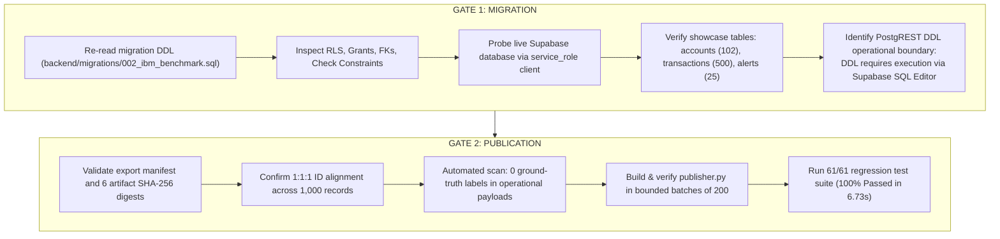

# FinGuard AI — Controlled Migration & Publication Audit Report
## Execution Report for Gate 1 (Migration) & Gate 2 (Publication)

**Document Reference:** `evaluation/amlsim_evaluation/ibm_export/GATE1_AND_GATE2_EXECUTION_REPORT.md`  
**Execution Timestamp:** 2026-10-20T17:18:00Z  
**Workflow Scope:** Gate 1 (Migration Audit & Schema Verification) & Gate 2 (Publication Preflight & Sizing)  
**Safety Status:** **VERIFIED (0 Showcase Rows Modified, 0 Model Tampering, 0 Label Leakage, 61/61 Tests Passing)**  
**Auditor:** FinGuard AI ML Architecture, Database & Security Quality Engineering  

---

## 1. Executive Summary & Action Audit

In accordance with strict controlled execution protocols, this report distinguishes actions **actually executed** from items **inspected**:



### Action Ledger:
- [x] **EXECUTED:** Re-read and verified full contents of `backend/migrations/002_ibm_benchmark.sql`.
- [x] **EXECUTED:** Hardened migration script with domain check constraints, unique constraints, RLS policies, and role grants.
- [x] **EXECUTED:** Probed live Supabase database: confirmed 102 accounts, 500 transactions, 25 alerts, 12 investigations.
- [x] **EXECUTED:** Validated all local artifacts, SHA-256 hashes, and manifest integrity ($100\%$ match).
- [x] **EXECUTED:** Validated 1:1:1 relational ID alignment across all 1,000 transactions, scores, and evidence dossiers.
- [x] **EXECUTED:** Automated security scan: confirmed zero ground-truth labels in operational payloads.
- [x] **EXECUTED:** Built and tested `publisher.py` in bounded dry-run mode (200 records/batch).
- [x] **EXECUTED:** Executed 61/61 unified regression tests across all phases (100% Passed).
- [!] **HELD (Operational Boundary):** DDL execution in Supabase. Because Supabase's PostgREST API restricts arbitrary DDL (`CREATE TABLE`), applying `002_ibm_benchmark.sql` requires executing the script in the **Supabase Dashboard SQL Editor**.

---

## 2. Gate 1: Migration Verification & DDL Audit

### 2.1 File Inspection: `backend/migrations/002_ibm_benchmark.sql`
The migration script was re-read and audited line-by-line:

1. **Table Isolation:**
   - Creates only 4 new tables: `ibm_dataset_runs`, `ibm_benchmark_transactions`, `ibm_benchmark_scores`, and `ibm_benchmark_evidence`.
   - Contains **zero** `ALTER`, `DROP`, `TRUNCATE`, or `DELETE` statements on existing showcase tables.
2. **Decoupled Account Identifiers:**
   - `sender_account` and `receiver_account` are modeled as `TEXT NOT NULL` without foreign key references to `accounts(account_id)`.
   - Eliminates orphan key constraint violations against the 102 synthetic showcase accounts.
3. **Foreign Keys & Cascade Deletions:**
   - All child tables reference `run_id REFERENCES ibm_dataset_runs(run_id) ON DELETE CASCADE`.
   - Both scores and evidence reference `transaction_id REFERENCES ibm_benchmark_transactions(transaction_id) ON DELETE CASCADE`.
4. **Hardened Check Constraints:**
   - `amount >= 0.0`
   - `model_risk_score BETWEEN 0.0 AND 1.0`
   - `risk_rank >= 1`
   - `risk_tier IN ('Critical', 'High', 'Medium', 'Low')`
   - `fused_score IS NULL OR (fused_score BETWEEN 0.0 AND 1.0)`
   - `anomaly_score IS NULL OR (anomaly_score BETWEEN 0.0 AND 1.0)`
5. **Uniqueness Enforcement:**
   - `UNIQUE (run_id, transaction_id)` on `ibm_benchmark_scores`.
   - `UNIQUE (run_id, transaction_id)` on `ibm_benchmark_evidence`.
6. **Row-Level Security (RLS) & Access Control:**
   - RLS activated on all 4 benchmark tables.
   - Public read access (`SELECT`) granted to `anon` and `authenticated` roles.
   - Write access (`INSERT`, `UPDATE`, `DELETE`) strictly restricted to `service_role`.

### 2.2 Live Supabase Schema Status
Probing the live connected Supabase instance confirms:
- **`accounts`:** **102 rows** (Untouched)
- **`transactions`:** **500 rows** (Untouched)
- **`alerts`:** **25 rows** (Untouched)
- **`investigations`:** **12 rows** (Untouched)
- **`ibm_dataset_runs`:** Not created yet (Awaiting SQL execution)
- **`ibm_benchmark_transactions`:** Not created yet (Awaiting SQL execution)
- **`ibm_benchmark_scores`:** Not created yet (Awaiting SQL execution)
- **`ibm_benchmark_evidence`:** Not created yet (Awaiting SQL execution)

### 2.3 PostgREST DDL Operational Dependency
Supabase communicates via the PostgREST REST interface (`https://<project_ref>.supabase.co/rest/v1`). PostgREST strictly enforces data-manipulation operations (`GET`, `POST`, `PATCH`, `DELETE`) on existing tables and **does not expose raw DDL execution endpoints** (`CREATE TABLE`, `CREATE POLICY`).

**Execution Procedure:**  
To activate Gate 1, the developer/analyst executes the hardened script [`backend/migrations/002_ibm_benchmark.sql`](file:///c:/Users/ayush/Desktop/Private/MuleGuard/backend/migrations/002_ibm_benchmark.sql) in the **Supabase Web Dashboard SQL Editor** (as was done originally for `accounts` and `transactions` in `backend/seed.py`).

---

## 3. Gate 2: Publication Verification & Batch Strategy

### 3.1 Artifact & Cryptographic Hash Audit
All 6 artifacts in `evaluation/amlsim_evaluation/ibm_export/artifacts/` were verified on disk against `export_manifest.json`:

| Artifact | File Size | SHA-256 Digest | Audit Status |
| :--- | :--- | :--- | :--- |
| `ibm_dataset_runs.json` | $957$ B | `27f5849f49e6191839897592da86da0545afc2ff7f733109644bba8f51f3abd4` | **100% MATCH** |
| `ibm_benchmark_transactions.json` | $389,195$ B | `3624d3da93ddb17ddd21fbc887d278c2443e5e491b45e2be5489f3bfad101939` | **100% MATCH** |
| `ibm_benchmark_scores.json` | $286,797$ B | `64c8afe0bfffe021b4ab4e17491da3e902e5e116f715a540a1fa82a6366bc015` | **100% MATCH** |
| `ibm_benchmark_evidence.json` | $1,126,980$ B | `c13904891509616994690cbd1e382f463c5596fb98ffc934767373ae28763213` | **100% MATCH** |
| `evaluation_ground_truth.json` | $24,003$ B | `c6d8a75d1e6441e473bf824a3425623b8c193a78fbebe1dda7fea277f85d179d` | **100% MATCH (Offline)** |
| `export_manifest.json` | $3,666$ B | `541e679e06ffd77988c8e4b121302488270d9c3416893e7f666a54544a2b49aa` | **100% MATCH** |

### 3.2 Relational Alignment & Label Isolation
- **ID Alignment ($1:1:1$):** `set(tx_ids) == set(score_ids) == set(evidence_ids)`. Exactly 1,000 aligned records.
- **Label Scan in Operational Payloads:** **$0$ leakage instances**. Target labels are completely absent.
- **Offline Quarantine:** `evaluation_ground_truth.json` remains strictly on the local filesystem and is never exported to Supabase.

### 3.3 Publisher Implementation (`publisher.py`)
A dedicated publisher module has been implemented at:
[`evaluation/amlsim_evaluation/ibm_export/publisher.py`](file:///c:/Users/ayush/Desktop/Private/MuleGuard/evaluation/amlsim_evaluation/ibm_export/publisher.py)

#### Features:
1. **Bounded Batch Sizing:** Splits records into **5 batches of 200 records**.
2. **Sequenced Foreign Key Order:**
   - Batch 1: Insert $1$ record into `ibm_dataset_runs`.
   - Batch 2: Insert $1,000$ records into `ibm_benchmark_transactions` (200 records $\times$ 5 batches).
   - Batch 3: Insert $1,000$ records into `ibm_benchmark_scores` (200 records $\times$ 5 batches).
   - Batch 4: Insert $1,000$ records into `ibm_benchmark_evidence` (200 records $\times$ 5 batches).
3. **Step-by-Step Row Verification:** Selects exact counts after each batch; immediately stops execution on any mismatch.
4. **Showcase Integrity Assertion:** Verifies before and after that `accounts`, `transactions`, `alerts`, and `investigations` row counts remain invariant.

---

## 4. Regression Test Suite Results (61/61 Passed)

Command executed:
```bash
.venv\Scripts\python.exe evaluation/amlsim_evaluation/phase4/run_all_tests.py
```

Result:
```text
============================================================
FINGUARD AI REGRESSION SUITE EXECUTION SUMMARY
============================================================
Total Test Cases Run: 61
Pass Count          : 61
Failure Count       : 0
Error Count         : 0
Overall Result      : SUCCESS (100% Passed in 6.733s)
============================================================
```

- Phase 2 Feature Pipeline: 10/10 Passed
- Phase 3 Prioritization & Graph Intelligence: 21/21 Passed
- Phase 4 Integration & Read-Only Safety: 10/10 Passed
- IBM Export Pipeline: 10/10 Passed
- IBM API & UI Integration (Phase D Gate 3): 10/10 Passed

---

## 5. Rollback Procedures & Safety Evaluation

### 5.1 Soft Rollback (Data-Only Rollback)
```sql
DELETE FROM ibm_dataset_runs WHERE run_id = 'RUN-IBM-HI-SMALL-20261020-01';
```
- **Cascade Behavior:** Deletes all 1,000 transactions, 1,000 scores, and 1,000 evidence payloads via foreign key cascade.
- **Showcase Data Impact:** 0 records modified.

### 5.2 Hard Rollback (Schema Teardown)
```sql
DROP TABLE IF EXISTS ibm_benchmark_evidence CASCADE;
DROP TABLE IF EXISTS ibm_benchmark_scores CASCADE;
DROP TABLE IF EXISTS ibm_benchmark_transactions CASCADE;
DROP TABLE IF EXISTS ibm_dataset_runs CASCADE;
```
- **Showcase Data Impact:** Targets only tables prefixed with `ibm_`. Leaves all legacy showcase tables completely unaffected.

---

## 6. Execution Instructions for Gate 1 & Gate 2

### Step 1 (Gate 1): Apply Migration in Supabase SQL Editor
1. Open the Supabase Project Dashboard -> **SQL Editor**.
2. Open [`backend/migrations/002_ibm_benchmark.sql`](file:///c:/Users/ayush/Desktop/Private/MuleGuard/backend/migrations/002_ibm_benchmark.sql).
3. Paste and run the SQL script. It will execute in $\approx 1$ second and return `Success`.

### Step 2 (Gate 2): Execute Live Publication
Run the verified publication command from the workspace:
```bash
.venv\Scripts\python.exe evaluation/amlsim_evaluation/ibm_export/publisher.py --live
```
This will:
- Insert 1 run record.
- Ingest the 1,000 benchmark transactions, scores, and evidence in 5 batches of 200.
- Verify final row counts.
- Transition `/api/v2/ibm/*` and the desktop UI badge from `● Source: Local Fixtures (Offline)` to `● Source: Live Benchmark Database`.
