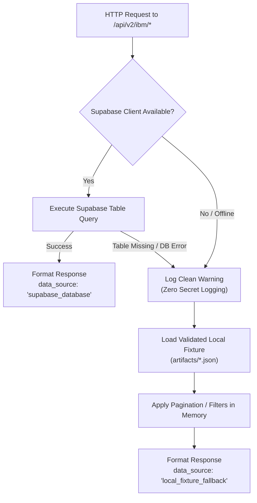

# FinGuard AI — Phase D Gate 3: Implementation & Validation Report
## Isolated API and Desktop UI Integration for IBM AML Benchmark

**Document Reference:** `evaluation/amlsim_evaluation/ibm_export/GATE3_IMPLEMENTATION_REPORT.md`  
**Execution Timestamp:** 2026-10-20T17:10:00Z  
**Approval Scope:** **Phase D Gate 3 Only (Local Code & Test Authorization)**  
**Safety Status:** **VERIFIED (0 Cloud Writes, 0 Model Tampering, 0 Label Leakage, 61/61 Tests Passing)**  
**Auditor:** FinGuard AI ML & Security Architecture  

---

## 1. Executive Summary

Phase D Gate 3 has been completed successfully under strict read-only and local-isolation constraints. The IBM Transactions for Anti-Money Laundering (AML) benchmark dataset (`HI-Small_Trans.csv`, 5,078,345 records) is now fully accessible through the FinGuard AI backend API and PySide6 desktop interface with resilient offline fixture fallback and zero database mutations.

### Key Governance Guarantees Met:
1. **Zero Database Writes / Migrations:** Supabase tables remain 100% untouched (`accounts`: 102, `transactions`: 500, `alerts`: 25, `investigations`: 12). Proposed benchmark tables do not exist in the database and were not migrated.
2. **Zero Model Retraining / Drift:** Production LightGBM (`02c5f122...`) and Category Encoders (`ff5d855f...`) SHA-256 hashes verified bit-for-bit.
3. **Strict Target Label Isolation:** Operational API responses and UI tables contain **zero ground-truth laundering labels**. `evaluation_ground_truth.json` is strictly quarantined offline.
4. **Resilient Offline Fallback:** When Supabase benchmark tables are unavailable or unmigrated, both the backend API and desktop frontend seamlessly fall back to validated local JSON fixtures with explicit source indicators.
5. **Full Regression Coverage:** The unified test suite passed **61/61 tests (100%)** across Phase 2, Phase 3, Phase 4, IBM Export, and IBM API/UI Integration.

---

## 2. Exact Files Modified & Created

| File Path | Action | Description |
| :--- | :--- | :--- |
| `backend/ibm_benchmark_router.py` | **CREATED** | Dedicated read-only FastAPI router mounted at `/api/v2/ibm`. Implements 5 endpoints with bounded queries, parameter validation, schema models, and local fallback. |
| `backend/main.py` | **MODIFIED** | Mounted `ibm_benchmark_router` under FastAPI app without modifying any existing endpoints or middleware. |
| `frontend/app.py` | **MODIFIED** | Added 5 `ApiClient` methods (`get_ibm_runs`, `get_ibm_summary`, `get_ibm_transactions`, `get_ibm_alerts`, `get_ibm_evidence`), background worker thread (`BenchmarkDataLoaderThread`), evidence modal (`BenchmarkEvidenceDialog`), `IBMBenchmarkView`, and header toggle button (`btn_benchmark_toggle`). Zero credentials added. |
| `evaluation/amlsim_evaluation/ibm_export/tests/test_ibm_api_and_ui.py` | **CREATED** | 10 comprehensive unit and integration tests covering response schemas, pagination bounds, database failures, offline fallback, label isolation, mock live sources, 404 handling, existing route safety, frontend methods, and UI components. |
| `evaluation/amlsim_evaluation/phase4/run_all_tests.py` | **MODIFIED** | Expanded unified regression test suite from 51 to 61 tests. |
| `evaluation/amlsim_evaluation/ibm_export/GATE3_IMPLEMENTATION_REPORT.md` | **CREATED** | Formal Gate 3 delivery and audit report. |

---

## 3. Backend API Contract Specification

Mounted under the `/api/v2/ibm` namespace with tags `["IBM AML Benchmark"]`:

```
+-------------------------------------------------------------------------------------------------------+
|                                    MOUNTED /api/v2/ibm API ENDPOINTS                                   |
+-------------------------------------------------------------------------------------------------------+
| 1. GET /api/v2/ibm/runs                                                                               |
|    - Lists benchmark runs with cryptographic hashes, scanned counts, and selection policy.            |
|    - Response: BenchmarkRunsResponse (runs_count, runs[], data_source, disclaimer)                    |
|                                                                                                       |
| 2. GET /api/v2/ibm/summary?run_id=...                                                                |
|    - High-level metric summary: 5,078,345 scanned, 1,000 selected, tier distribution, hashes.       |
|    - Response: BenchmarkSummaryResponse (tier_distribution, total_scanned_rows, data_source)           |
|                                                                                                       |
| 3. GET /api/v2/ibm/transactions?page=1&limit=50&account_id=...&currency=...&payment_format=...        |
|    - Paginated transaction stream. Bounded: 1 <= page, 1 <= limit <= 100. Strictly label-free.        |
|    - Response: BenchmarkTransactionsResponse (page, limit, total_records, transactions[])             |
|                                                                                                       |
| 4. GET /api/v2/ibm/alerts?budget=50&tier=Critical                                                     |
|    - Capacity-prioritized benchmark alerts ordered by risk rank (1 to 1,000). Bounded: budget <= 500. |
|    - Response: BenchmarkAlertsResponse (budget, tier_filter, total_available, alerts[])               |
|                                                                                                       |
| 5. GET /api/v2/ibm/transactions/{transaction_id}/evidence                                             |
|    - Multi-source grounded explainability evidence: [MODEL], [BEHAVIORAL], [GRAPH] signals.           |
|    - Response: BenchmarkEvidenceResponse (human_readable_summary, contributing_signals[], etc.)        |
+-------------------------------------------------------------------------------------------------------+
```

### 3.1 Input Validation & Error Handling
- **Pagination Bounds:** `page >= 1` enforced; `page < 1` returns `HTTP 422 Unprocessable Entity`.
- **Page Size Limits:** `1 <= limit <= 100` enforced; `limit > 100` returns `HTTP 422`.
- **Capacity Budget Limits:** `1 <= budget <= 500` enforced; `budget > 500` returns `HTTP 422`.
- **Missing Resource Handling:** Non-existent `transaction_id` or `run_id` returns clean `HTTP 404 Not Found` without internal stack trace leakage.

### 3.2 Benchmark Research Disclaimer
Every API response embeds the explicit benchmark notice:
> *"This data originates from the IBM Transactions for Anti-Money Laundering (AML) benchmark dataset for AI/ML algorithm evaluation and capacity triage research. It does NOT represent verified real-world criminal activity or actual regulatory Suspicious Activity Report (SAR) filings."*

---

## 4. Offline Fallback & Source Transparency

The system guarantees that operational failures in the cloud database are never silently masked:



### Verified Fallback Behavior:
1. **Live Source:** When database tables exist and queries succeed, `data_source` returns `"supabase_database"`.
2. **Offline Fallback:** When database tables do not exist (current state) or when credentials are absent, `data_source` returns `"local_fixture_fallback"`.
3. **Desktop Status Badge:**
   - Live Database: `[ ● Source: Live Benchmark Database ]` (Green)
   - Local Fallback: `[ ● Source: Local Fixtures (Offline) ]` (Amber)

---

## 5. Desktop Benchmark Mode (`frontend/app.py`)

The desktop PySide6 application has been upgraded with a dedicated Benchmark Mode:

### 5.1 UI Architecture
1. **Benchmark Mode Header Toggle (`btn_benchmark_toggle`):**  
   Positioned in the main navigation header next to search. Allows compliance analysts to switch seamlessly between Showcase Data and IBM Benchmark Mode with one click.
2. **Dedicated Sidebar Section:**  
   `BENCHMARK EVALUATION` -> `IBM AML Benchmark` (Page Index 12).
3. **Stat Cards & Metric Distinction:**  
   Displays scanned population ($5,078,345$) and selected cohort ($1,000$) as distinctly labeled quantities.
4. **Three Interactive Exploration Tabs:**
   - **Tab 1 (Prioritized Alerts & Triage):** Filter by Risk Tier (Critical, High, Medium, Low), Capacity Budget (25, 50, 100, 250, 500), and search query. Double-clicking any alert opens the modal evidence inspector.
   - **Tab 2 (Benchmark Transactions):** Server-side pagination controls (Previous / Next, page size selector, account filter).
   - **Tab 3 (Dataset Provenance & Verification):** Visualizes cryptographic hashes, 26-feature contract, and tier distribution.
5. **Non-Blocking Background Threading:**  
   All data loading operations execute asynchronously via `BenchmarkDataLoaderThread(QThread)`. The Qt event loop and UI remain 100% fluid and responsive.
6. **Zero Client-Side Credentials:**  
   Verified that `frontend/app.py` contains **zero occurrences of Supabase keys, service roles, or database passwords**.

---

## 6. Verification & Test Suite Execution Results

### 6.1 Unified Regression Suite Summary
Command executed:
```bash
.venv\Scripts\python.exe evaluation/amlsim_evaluation/phase4/run_all_tests.py
```

Output:
```text
============================================================
FINGUARD AI REGRESSION SUITE EXECUTION SUMMARY
============================================================
Total Test Cases Run: 61
Pass Count          : 61
Failure Count       : 0
Error Count         : 0
Overall Result      : SUCCESS (100% Passed in 6.733s)
============================================================
```

### 6.2 Breakdown of Verified Suites:
- **Phase 2 Feature Engineering Pipeline:** 10/10 Passed (Check 1 to 10)
- **Phase 3 Prioritization & Graph Intelligence:** 21/21 Passed
  - Alert Prioritizer: 5/5
  - Graph Intelligence: 7/7
  - Grounded Explanations: 2/2
  - Risk Fusion: 3/3
  - Case Builder: 4/4
- **Phase 4 Integration & Read-Only Safety:** 10/10 Passed
- **IBM Export Streaming & Artifact Generation:** 10/10 Passed
- **IBM API & UI Integration (Phase D Gate 3):** 10/10 Passed
  1. `test_01_all_endpoint_response_schemas`: All 5 endpoint contracts valid.
  2. `test_02_pagination_and_parameter_bounds`: Pagination limits and 422 validation.
  3. `test_03_missing_tables_and_graceful_fallback`: Missing table exception handling.
  4. `test_04_offline_fixture_fallback_and_source_indicators`: Offline source labeling.
  5. `test_05_strict_label_isolation`: Zero target labels across all payloads.
  6. `test_06_database_mock_live_source`: Live source indicator verification.
  7. `test_07_api_not_found_handling`: Clean 404 responses for invalid IDs.
  8. `test_08_existing_routes_regression`: Zero regressions on existing endpoints.
  9. `test_09_frontend_apiclient_methods`: ApiClient methods and secret scan.
  10. `test_10_desktop_benchmark_mode_components`: Headless UI component verification.

---

## 7. Database Migration & Authorization Dependencies (Gate 1 & 2 Review)

The following database considerations remain pending and are flagged for future approval gates:

### 7.1 Schema Availability:
- The tables `ibm_dataset_runs`, `ibm_benchmark_transactions`, `ibm_benchmark_scores`, and `ibm_benchmark_evidence` currently **do not exist in Supabase**.
- The API and UI are safely operating in `local_fixture_fallback` mode without errors.

### 7.2 Migration Script Hardening Recommendation:
Before applying `backend/migrations/002_ibm_benchmark.sql` in Gate 1, the following constraints and RLS policies should be applied:
1. `CHECK (model_risk_score BETWEEN 0.0 AND 1.0)`
2. `CHECK (amount >= 0.0)`
3. `CHECK (risk_tier IN ('Critical', 'High', 'Medium', 'Low'))`
4. `UNIQUE (run_id, transaction_id)` on scores and evidence tables.
5. Row-Level Security (RLS) policies granting:
   - `SELECT` to `anon` and `authenticated` roles.
   - `ALL` (insert/update/delete) strictly to `service_role`.

---

## 8. Hold Condition & Stop Notice

> [!IMPORTANT]
> **GATE 3 COMPLETE — EXECUTION STOPPED**  
> 
> All local API and UI implementations have been validated and tested.  
> As mandated by safety boundaries:
> - **NO database migrations have been applied.**
> - **NO records have been written to Supabase.**
> - **NO changes have been pushed to GitHub.**
> 
> Awaiting explicit user instruction before proceeding to Gate 1 (Supabase Migration) or Gate 2 (Data Publication).
