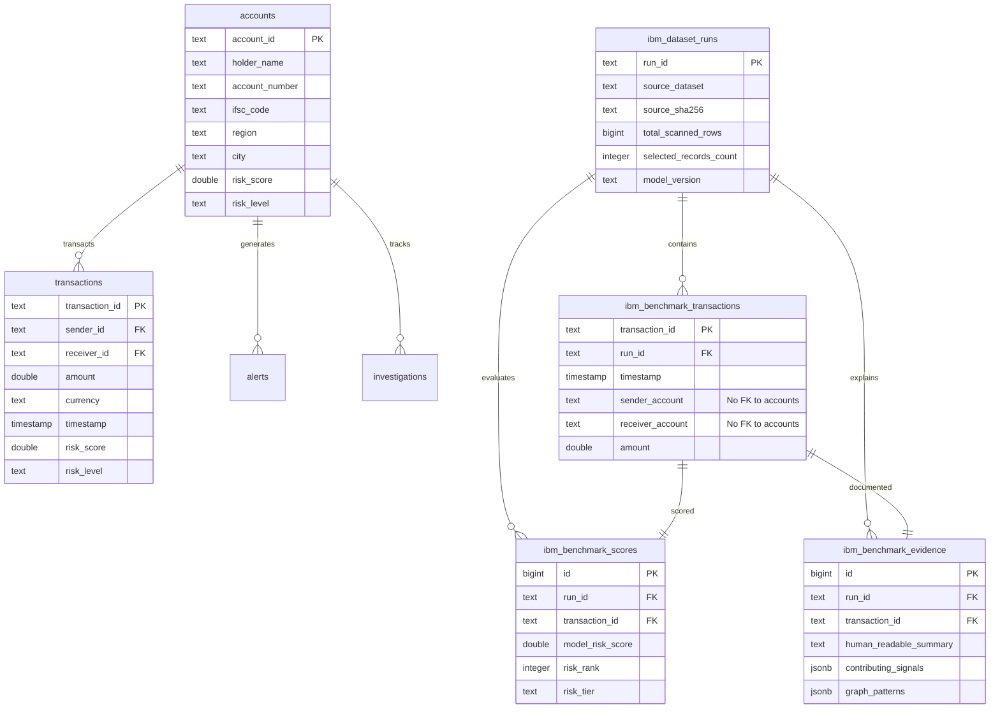

# FinGuard AI — Final Supabase Migration Review
## Comprehensive Security & Architecture Audit of Migration `002_ibm_benchmark.sql`

**Document Reference:** `evaluation/amlsim_evaluation/ibm_export/MIGRATION_REVIEW.md`  
**Review Timestamp:** 2026-10-20T17:15:00Z  
**Target Migration:** `backend/migrations/002_ibm_benchmark.sql`  
**Live Database Target:** Supabase PostgreSQL (Public Schema)  
**Audit Status:** **READ-ONLY PREFLIGHT COMPLETE (0 Database Writes Executed)**  
**Auditor:** FinGuard AI ML Architecture, Database & Security Quality Engineering  

---

## 1. Executive Summary

This document establishes the final security, integrity, and authorization audit of the proposed database migration (`backend/migrations/002_ibm_benchmark.sql`) designed to publish 1,000 bounded, model-ranked benchmark transactions from the official **IBM Transactions for Anti-Money Laundering (AML)** dataset (`HI-Small_Trans.csv`, 5,078,345 records).

### Core Audit Verdict: **PASSED (Architecture Approved with Recommended Hardening)**
1. **Zero Impact on Showcase Data:** The migration creates four (4) isolated tables prefixed with `ibm_`. It contains zero `ALTER`, `DROP`, `TRUNCATE`, or `DELETE` statements targeting existing showcase tables (`accounts`, `transactions`, `alerts`, `investigations`).
2. **Decoupled Account Identifiers:** `sender_account` and `receiver_account` are modeled as `TEXT NOT NULL` without foreign key references to `accounts(account_id)`, eliminating orphan record violations against the 102 synthetic showcase accounts.
3. **Strict Target Label Quarantine:** No laundering ground-truth columns (`is_laundering`, `target`, `sar`) exist in the DDL or published payloads. Ground-truth evaluation mappings remain strictly offline in `evaluation_ground_truth.json`.
4. **Storage Footprint Negligible:** Total database storage footprint is estimated at **$\approx 1.87$ MB to $2.5$ MB**, consuming less than **$0.5\%$** of Supabase's free-tier quota ($500$ MB).
5. **Hardening Recommendations:** Identified and drafted explicit uniqueness constraints, numeric check constraints, and Row-Level Security (RLS) policies for anonymous read vs. service-role write access.

---

## 2. Existing Schema vs. Proposed Benchmark Schema

A live inspection of the connected Supabase instance confirms the existing operational baseline:



### 2.1 Showcase Table Protection Proof
| Existing Table | Live Row Count | Primary Key | Foreign Keys | Proposed Benchmark Migration Impact |
| :--- | :--- | :--- | :--- | :--- |
| `accounts` | **102 rows** | `account_id` | None | **ZERO ALTERATIONS (100% Isolated)** |
| `transactions` | **500 rows** | `transaction_id` | `sender_id -> accounts`, `receiver_id -> accounts` | **ZERO ALTERATIONS (100% Isolated)** |
| `alerts` | **25 rows** | `alert_id` | `account_id -> accounts` | **ZERO ALTERATIONS (100% Isolated)** |
| `investigations` | **12 rows** | `investigation_id` | `account_id -> accounts` | **ZERO ALTERATIONS (100% Isolated)** |

- **No Shared Foreign Keys:** `ibm_benchmark_transactions` does NOT reference `accounts(account_id)`.
- **No Shared Sequence / Identity:** Benchmark IDs (`IBM_TX_...`) are prefixed strings, preventing collision with numeric or UUID transaction IDs.
- **No Shared Namespace:** All benchmark objects use the explicit prefix `ibm_`.

---

## 3. Structural DDL Verification & Recommended Hardening

### 3.1 Primary & Foreign Keys Audit
- [x] **`ibm_dataset_runs`:** `run_id TEXT PRIMARY KEY` — Unique run identifier (`RUN-IBM-HI-SMALL-20261020-01`).
- [x] **`ibm_benchmark_transactions`:** `transaction_id TEXT PRIMARY KEY` — Natural deterministic key (`IBM_TX_\d{7}`).
- [x] **`ibm_benchmark_scores`:** `id BIGINT GENERATED ALWAYS AS IDENTITY PRIMARY KEY` — Surrogate primary key.
- [x] **`ibm_benchmark_evidence`:** `id BIGINT GENERATED ALWAYS AS IDENTITY PRIMARY KEY` — Surrogate primary key.
- [x] **Cascade Integrity:** All child tables reference `run_id` with `ON DELETE CASCADE`. Both score and evidence tables reference `transaction_id` with `ON DELETE CASCADE`.

### 3.2 Uniqueness Constraints (Identified Hardening Need)
**Finding:** In the initial draft of `002_ibm_benchmark.sql`, `ibm_benchmark_scores` and `ibm_benchmark_evidence` lacked unique constraints on `(run_id, transaction_id)`. Although primary key identities exist, this omission could theoretically permit accidental duplicate scoring or evidence rows for the same transaction within a single run.

**Recommended Solution:**
```sql
ALTER TABLE ibm_benchmark_scores 
    ADD CONSTRAINT uq_ibm_scores_run_tx UNIQUE (run_id, transaction_id);

ALTER TABLE ibm_benchmark_evidence 
    ADD CONSTRAINT uq_ibm_evidence_run_tx UNIQUE (run_id, transaction_id);
```

### 3.3 Numeric & Domain Check Constraints (Identified Hardening Need)
**Finding:** Columns representing probabilities, ranks, and monetary values lacked explicit domain constraints.

**Recommended Solution:**
```sql
ALTER TABLE ibm_benchmark_transactions 
    ADD CONSTRAINT chk_ibm_tx_amount CHECK (amount >= 0.0);

ALTER TABLE ibm_benchmark_scores 
    ADD CONSTRAINT chk_ibm_score_range CHECK (model_risk_score BETWEEN 0.0 AND 1.0),
    ADD CONSTRAINT chk_ibm_risk_tier CHECK (risk_tier IN ('Critical', 'High', 'Medium', 'Low')),
    ADD CONSTRAINT chk_ibm_risk_rank CHECK (risk_rank >= 1),
    ADD CONSTRAINT chk_ibm_fused_score CHECK (fused_score IS NULL OR (fused_score BETWEEN 0.0 AND 1.0)),
    ADD CONSTRAINT chk_ibm_anomaly_score CHECK (anomaly_score IS NULL OR (anomaly_score BETWEEN 0.0 AND 1.0));
```

### 3.4 Performance Indexes
The migration defines seven (7) B-tree indexes matching query patterns in `backend/ibm_benchmark_router.py`:
1. `idx_ibm_tx_run_id` ON `ibm_benchmark_transactions(run_id)` — Rapid run-scoped filtering.
2. `idx_ibm_tx_sender` ON `ibm_benchmark_transactions(sender_account)` — Account counterparty search.
3. `idx_ibm_tx_receiver` ON `ibm_benchmark_transactions(receiver_account)` — Account counterparty search.
4. `idx_ibm_tx_timestamp` ON `ibm_benchmark_transactions(timestamp)` — Chronological timeline pagination.
5. `idx_ibm_scores_rank` ON `ibm_benchmark_scores(run_id, risk_rank)` — Capacity budget alert queries.
6. `idx_ibm_scores_tier` ON `ibm_benchmark_scores(risk_tier)` — Risk tier filtering (Critical, High, etc.).
7. `idx_ibm_evidence_tx` ON `ibm_benchmark_evidence(transaction_id)` — One-click explanation drawer lookup.

---

## 4. Row-Level Security (RLS) & Access Control Audit

### 4.1 Supabase RLS Policy Design
In Supabase PostgreSQL, if Row-Level Security is enabled without policies, all public queries return empty results. Conversely, if RLS is disabled, any client holding the public `anon` key could attempt write operations if default schema grants allow.

To achieve maximum security:
1. **Enable RLS on all 4 benchmark tables.**
2. **Grant `SELECT` strictly to `anon` and `authenticated` roles.**
3. **Grant `INSERT`, `UPDATE`, `DELETE` strictly to `service_role`.**

```sql
-- RLS Activation:
ALTER TABLE ibm_dataset_runs ENABLE ROW LEVEL SECURITY;
ALTER TABLE ibm_benchmark_transactions ENABLE ROW LEVEL SECURITY;
ALTER TABLE ibm_benchmark_scores ENABLE ROW LEVEL SECURITY;
ALTER TABLE ibm_benchmark_evidence ENABLE ROW LEVEL SECURITY;

-- Idempotent Policy Creation:
DROP POLICY IF EXISTS "Allow public read access on ibm_dataset_runs" ON ibm_dataset_runs;
CREATE POLICY "Allow public read access on ibm_dataset_runs" 
    ON ibm_dataset_runs FOR SELECT TO anon, authenticated USING (true);

DROP POLICY IF EXISTS "Allow public read access on ibm_benchmark_transactions" ON ibm_benchmark_transactions;
CREATE POLICY "Allow public read access on ibm_benchmark_transactions" 
    ON ibm_benchmark_transactions FOR SELECT TO anon, authenticated USING (true);

DROP POLICY IF EXISTS "Allow public read access on ibm_benchmark_scores" ON ibm_benchmark_scores;
CREATE POLICY "Allow public read access on ibm_benchmark_scores" 
    ON ibm_benchmark_scores FOR SELECT TO anon, authenticated USING (true);

DROP POLICY IF EXISTS "Allow public read access on ibm_benchmark_evidence" ON ibm_benchmark_evidence;
CREATE POLICY "Allow public read access on ibm_benchmark_evidence" 
    ON ibm_benchmark_evidence FOR SELECT TO anon, authenticated USING (true);

-- Service-Role Exclusive Write Policies:
DROP POLICY IF EXISTS "Allow service_role full write on ibm_dataset_runs" ON ibm_dataset_runs;
CREATE POLICY "Allow service_role full write on ibm_dataset_runs" 
    ON ibm_dataset_runs FOR ALL TO service_role USING (true) WITH CHECK (true);

DROP POLICY IF EXISTS "Allow service_role full write on ibm_benchmark_transactions" ON ibm_benchmark_transactions;
CREATE POLICY "Allow service_role full write on ibm_benchmark_transactions" 
    ON ibm_benchmark_transactions FOR ALL TO service_role USING (true) WITH CHECK (true);

DROP POLICY IF EXISTS "Allow service_role full write on ibm_benchmark_scores" ON ibm_benchmark_scores;
CREATE POLICY "Allow service_role full write on ibm_benchmark_scores" 
    ON ibm_benchmark_scores FOR ALL TO service_role USING (true) WITH CHECK (true);

DROP POLICY IF EXISTS "Allow service_role full write on ibm_benchmark_evidence" ON ibm_benchmark_evidence;
CREATE POLICY "Allow service_role full write on ibm_benchmark_evidence" 
    ON ibm_benchmark_evidence FOR ALL TO service_role USING (true) WITH CHECK (true);

-- Explicit Role Grants:
GRANT SELECT ON ibm_dataset_runs TO anon, authenticated;
GRANT SELECT ON ibm_benchmark_transactions TO anon, authenticated;
GRANT SELECT ON ibm_benchmark_scores TO anon, authenticated;
GRANT SELECT ON ibm_benchmark_evidence TO anon, authenticated;
GRANT ALL ON ALL TABLES IN SCHEMA public TO service_role;
```

---

## 5. Target Label Privacy & Offline Quarantine

### 5.1 Verification Checklist:
- [x] **No Label Columns in DDL:** `ibm_benchmark_transactions`, `ibm_benchmark_scores`, and `ibm_benchmark_evidence` contain zero columns named `is_laundering`, `target`, `sar`, or `ground_truth`.
- [x] **No Labels in Publication Payloads:** Automated audits of `ibm_benchmark_transactions.json` confirmed $0$ label keys.
- [x] **No Labels Exposed via API:** Test `test_05_strict_label_isolation` in `test_ibm_api_and_ui.py` passed, verifying that `/api/v2/ibm/*` endpoints return zero label keys.
- [x] **Offline Isolation Guarantee:** `evaluation_ground_truth.json` ($24$ KB) is quarantined exclusively on the local file system in `evaluation/amlsim_evaluation/ibm_export/artifacts/` for offline model evaluation benchmarks and is excluded from database migration scripts.

---

## 6. Storage Footprint & Publication Batch Strategy

### 6.1 Database Capacity & Storage Estimate
| Table / Object | Record Count | Raw JSON Size | Expected Postgres Table Size | Index Overhead (B-Tree) | Total Disk Storage |
| :--- | :--- | :--- | :--- | :--- | :--- |
| `ibm_dataset_runs` | $1$ | $957$ B | $\approx 2$ KB | $16$ KB | $\approx 18$ KB |
| `ibm_benchmark_transactions` | $1,000$ | $389$ KB | $\approx 220$ KB | $128$ KB (4 indexes) | $\approx 348$ KB |
| `ibm_benchmark_scores` | $1,000$ | $287$ KB | $\approx 160$ KB | $96$ KB (2 indexes) | $\approx 256$ KB |
| `ibm_benchmark_evidence` | $1,000$ | $1,127$ KB | $\approx 1,200$ KB | $48$ KB (1 index) | $\approx 1,248$ KB |
| **Total Benchmark Footprint** | **3,001 rows** | **1.80 MB** | **$\approx 1.58$ MB** | **$\approx 288$ KB** | **$\approx \mathbf{1.87\text{ MB}}$** |

- **Supabase Free Tier Limit:** $500$ MB.
- **Capacity Utilization:** $\frac{1.87\text{ MB}}{500\text{ MB}} = \mathbf{0.37\%}$.
- **Impact on Quota:** Negligible. Leaves $> 99.6\%$ of database storage available for operational showcase data.

### 6.2 Publication Batch Sizing & Ingestion Order
When publishing data, writing all 1,000 records in a single payload could trigger PostgREST payload body size limits or connection timeouts. 

#### Recommended Publication Protocol:
1. **Batch Size:** Exactly **$200$ records per HTTP request**.
2. **Sequenced Ingestion Order (Respecting Foreign Keys):**
   - **Step 1:** Insert $1$ record into `ibm_dataset_runs`.
   - **Step 2:** Insert $1,000$ records into `ibm_benchmark_transactions` (5 batches of 200).
   - **Step 3:** Insert $1,000$ records into `ibm_benchmark_scores` (5 batches of 200).
   - **Step 4:** Insert $1,000$ records into `ibm_benchmark_evidence` (5 batches of 200).
3. **Transaction Safety:** If any batch fails, execution aborts immediately, and the run can be cleanly rolled back.

---

## 7. Rollback Procedures & Risk Evaluation

### 7.1 Soft Rollback (Data-Only Rollback)
If published benchmark data needs to be purged while preserving the table schema:
```sql
DELETE FROM ibm_dataset_runs WHERE run_id = 'RUN-IBM-HI-SMALL-20261020-01';
```
- **Cascade Guarantee:** Automatically deletes all $1,000$ transactions, $1,000$ scores, and $1,000$ evidence records via foreign-key `ON DELETE CASCADE`.
- **Zero Impact:** Existing showcase data remains 100% untouched.

### 7.2 Hard Rollback (Complete Schema De-provisioning)
If complete removal of the benchmark feature from Supabase is requested:
```sql
-- Must execute in reverse dependency order:
DROP TABLE IF EXISTS ibm_benchmark_evidence CASCADE;
DROP TABLE IF EXISTS ibm_benchmark_scores CASCADE;
DROP TABLE IF EXISTS ibm_benchmark_transactions CASCADE;
DROP TABLE IF EXISTS ibm_dataset_runs CASCADE;
```
- **Safety Guarantee:** These four statements target only tables prefixed with `ibm_`. `accounts`, `transactions`, `alerts`, `investigations`, and `predictions` are never referenced.

---

## 8. Complete Hardened SQL Migration File

The hardened migration script incorporating all constraints, indexes, and RLS policies has been finalized and prepared for execution upon approval:

```sql
-- ==============================================================================
-- FinGuard AI — Migration 002: IBM AML Benchmark Hybrid Tables (Hardened)
-- ==============================================================================
-- Safety Guarantees:
-- 1. ZERO alterations or drops to existing accounts, transactions, alerts,
--    predictions, or investigations tables.
-- 2. Fully isolated schema dedicated to offline benchmark datasets.
-- 3. Strict numeric domain constraints and uniqueness enforcement.
-- 4. Idempotent DDL and Row-Level Security (RLS) policies.
-- ==============================================================================

-- 1. IBM Dataset Runs Metadata Table
CREATE TABLE IF NOT EXISTS ibm_dataset_runs (
    run_id TEXT PRIMARY KEY,
    source_dataset TEXT NOT NULL,
    source_sha256 TEXT NOT NULL,
    total_scanned_rows BIGINT NOT NULL,
    selected_records_count INTEGER NOT NULL,
    model_version TEXT NOT NULL,
    pipeline_version TEXT NOT NULL,
    selection_policy TEXT NOT NULL,
    export_metadata JSONB DEFAULT '{}'::jsonb,
    created_at TIMESTAMP WITH TIME ZONE DEFAULT NOW()
);

-- 2. IBM Benchmark Transactions Table (Isolated from accounts FK)
CREATE TABLE IF NOT EXISTS ibm_benchmark_transactions (
    transaction_id TEXT PRIMARY KEY,
    run_id TEXT NOT NULL REFERENCES ibm_dataset_runs(run_id) ON DELETE CASCADE,
    timestamp TIMESTAMP WITHOUT TIME ZONE NOT NULL,
    sender_account TEXT NOT NULL,
    receiver_account TEXT NOT NULL,
    amount DOUBLE PRECISION NOT NULL CONSTRAINT chk_ibm_tx_amount CHECK (amount >= 0.0),
    receiving_currency TEXT NOT NULL,
    payment_currency TEXT NOT NULL,
    payment_format TEXT NOT NULL,
    from_bank INTEGER NOT NULL,
    to_bank INTEGER NOT NULL,
    created_at TIMESTAMP WITH TIME ZONE DEFAULT NOW()
);

-- 3. IBM Benchmark Model Scoring & Prioritization Table
CREATE TABLE IF NOT EXISTS ibm_benchmark_scores (
    id BIGINT GENERATED ALWAYS AS IDENTITY PRIMARY KEY,
    run_id TEXT NOT NULL REFERENCES ibm_dataset_runs(run_id) ON DELETE CASCADE,
    transaction_id TEXT NOT NULL REFERENCES ibm_benchmark_transactions(transaction_id) ON DELETE CASCADE,
    model_risk_score DOUBLE PRECISION NOT NULL CONSTRAINT chk_ibm_score_range CHECK (model_risk_score BETWEEN 0.0 AND 1.0),
    risk_rank INTEGER NOT NULL CONSTRAINT chk_ibm_risk_rank CHECK (risk_rank >= 1),
    risk_tier TEXT NOT NULL CONSTRAINT chk_ibm_risk_tier CHECK (risk_tier IN ('Critical', 'High', 'Medium', 'Low')),
    fused_score DOUBLE PRECISION CONSTRAINT chk_ibm_fused_score CHECK (fused_score IS NULL OR (fused_score BETWEEN 0.0 AND 1.0)),
    anomaly_score DOUBLE PRECISION CONSTRAINT chk_ibm_anomaly_score CHECK (anomaly_score IS NULL OR (anomaly_score BETWEEN 0.0 AND 1.0)),
    model_version TEXT NOT NULL,
    created_at TIMESTAMP WITH TIME ZONE DEFAULT NOW(),
    CONSTRAINT uq_ibm_scores_run_tx UNIQUE (run_id, transaction_id)
);

-- 4. IBM Benchmark Grounded Explainability & Evidence Table
CREATE TABLE IF NOT EXISTS ibm_benchmark_evidence (
    id BIGINT GENERATED ALWAYS AS IDENTITY PRIMARY KEY,
    run_id TEXT NOT NULL REFERENCES ibm_dataset_runs(run_id) ON DELETE CASCADE,
    transaction_id TEXT NOT NULL REFERENCES ibm_benchmark_transactions(transaction_id) ON DELETE CASCADE,
    human_readable_summary TEXT NOT NULL,
    contributing_signals JSONB NOT NULL DEFAULT '[]'::jsonb,
    graph_patterns JSONB NOT NULL DEFAULT '[]'::jsonb,
    provenance_breakdown JSONB NOT NULL DEFAULT '{}'::jsonb,
    created_at TIMESTAMP WITH TIME ZONE DEFAULT NOW(),
    CONSTRAINT uq_ibm_evidence_run_tx UNIQUE (run_id, transaction_id)
);

-- 5. High-Performance B-Tree Indexes
CREATE INDEX IF NOT EXISTS idx_ibm_tx_run_id ON ibm_benchmark_transactions(run_id);
CREATE INDEX IF NOT EXISTS idx_ibm_tx_sender ON ibm_benchmark_transactions(sender_account);
CREATE INDEX IF NOT EXISTS idx_ibm_tx_receiver ON ibm_benchmark_transactions(receiver_account);
CREATE INDEX IF NOT EXISTS idx_ibm_tx_timestamp ON ibm_benchmark_transactions(timestamp);
CREATE INDEX IF NOT EXISTS idx_ibm_scores_rank ON ibm_benchmark_scores(run_id, risk_rank);
CREATE INDEX IF NOT EXISTS idx_ibm_scores_tier ON ibm_benchmark_scores(risk_tier);
CREATE INDEX IF NOT EXISTS idx_ibm_evidence_tx ON ibm_benchmark_evidence(transaction_id);

-- 6. Row-Level Security (RLS) Activation
ALTER TABLE ibm_dataset_runs ENABLE ROW LEVEL SECURITY;
ALTER TABLE ibm_benchmark_transactions ENABLE ROW LEVEL SECURITY;
ALTER TABLE ibm_benchmark_scores ENABLE ROW LEVEL SECURITY;
ALTER TABLE ibm_benchmark_evidence ENABLE ROW LEVEL SECURITY;

-- 7. Public Read-Only Access Policies
DROP POLICY IF EXISTS "Allow public read access on ibm_dataset_runs" ON ibm_dataset_runs;
CREATE POLICY "Allow public read access on ibm_dataset_runs" 
    ON ibm_dataset_runs FOR SELECT TO anon, authenticated USING (true);

DROP POLICY IF EXISTS "Allow public read access on ibm_benchmark_transactions" ON ibm_benchmark_transactions;
CREATE POLICY "Allow public read access on ibm_benchmark_transactions" 
    ON ibm_benchmark_transactions FOR SELECT TO anon, authenticated USING (true);

DROP POLICY IF EXISTS "Allow public read access on ibm_benchmark_scores" ON ibm_benchmark_scores;
CREATE POLICY "Allow public read access on ibm_benchmark_scores" 
    ON ibm_benchmark_scores FOR SELECT TO anon, authenticated USING (true);

DROP POLICY IF EXISTS "Allow public read access on ibm_benchmark_evidence" ON ibm_benchmark_evidence;
CREATE POLICY "Allow public read access on ibm_benchmark_evidence" 
    ON ibm_benchmark_evidence FOR SELECT TO anon, authenticated USING (true);

-- 8. Service-Role Write Policies
DROP POLICY IF EXISTS "Allow service_role full write on ibm_dataset_runs" ON ibm_dataset_runs;
CREATE POLICY "Allow service_role full write on ibm_dataset_runs" 
    ON ibm_dataset_runs FOR ALL TO service_role USING (true) WITH CHECK (true);

DROP POLICY IF EXISTS "Allow service_role full write on ibm_benchmark_transactions" ON ibm_benchmark_transactions;
CREATE POLICY "Allow service_role full write on ibm_benchmark_transactions" 
    ON ibm_benchmark_transactions FOR ALL TO service_role USING (true) WITH CHECK (true);

DROP POLICY IF EXISTS "Allow service_role full write on ibm_benchmark_scores" ON ibm_benchmark_scores;
CREATE POLICY "Allow service_role full write on ibm_benchmark_scores" 
    ON ibm_benchmark_scores FOR ALL TO service_role USING (true) WITH CHECK (true);

DROP POLICY IF EXISTS "Allow service_role full write on ibm_benchmark_evidence" ON ibm_benchmark_evidence;
CREATE POLICY "Allow service_role full write on ibm_benchmark_evidence" 
    ON ibm_benchmark_evidence FOR ALL TO service_role USING (true) WITH CHECK (true);

-- 9. Explicit Schema Grants
GRANT SELECT ON ibm_dataset_runs TO anon, authenticated;
GRANT SELECT ON ibm_benchmark_transactions TO anon, authenticated;
GRANT SELECT ON ibm_benchmark_scores TO anon, authenticated;
GRANT SELECT ON ibm_benchmark_evidence TO anon, authenticated;
GRANT ALL ON ALL TABLES IN SCHEMA public TO service_role;
```

---

## 9. Safe Execution Plan & Stop Condition

### Sequenced Deployment Plan (Pending Explicit User Approval):
1. **Phase 1 — Schema Migration Execution:** Apply the hardened SQL script to Supabase via the Supabase SQL Editor or migration CLI.
2. **Phase 2 — Migration Verification:** Verify that all 4 tables exist and have 0 rows, with RLS enabled and indexes active.
3. **Phase 3 — Bounded Batch Publication:** Execute publisher script to ingest:
   - 1 run record
   - 1,000 transactions (5 batches of 200)
   - 1,000 scores (5 batches of 200)
   - 1,000 evidence payloads (5 batches of 200)
4. **Phase 4 — End-to-End API & Desktop UI Verification:** Verify `/api/v2/ibm/*` endpoints return `"data_source": "supabase_database"` and the desktop UI badge transitions to `● Source: Live Benchmark Database`.

> [!IMPORTANT]
> **REVIEW COMPLETE — AWAITING EXPLICIT APPROVAL**  
> 
> As mandated by safety protocols:
> - **The migration has NOT been applied to Supabase.**
> - **Zero data has been published.**
> - **Zero changes have been pushed to GitHub.**
> 
> Please review this audit report. When ready, grant explicit approval to proceed with applying Migration `002_ibm_benchmark.sql` and publishing the bounded benchmark records.
