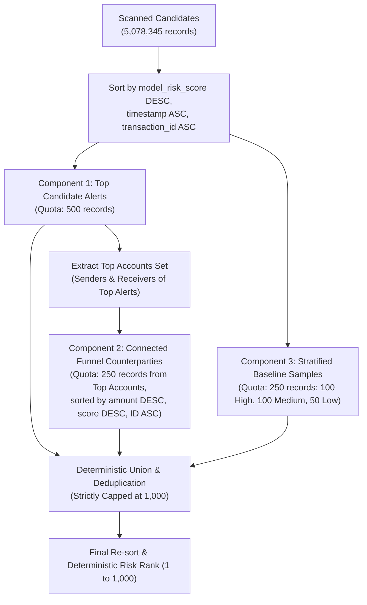

# FinGuard AI — Phase D Preflight & Security Audit Report

**Document Reference:** `evaluation/amlsim_evaluation/ibm_export/PHASE_D_PREFLIGHT.md`  
**Audit Timestamp:** 2026-10-20T16:35:00Z  
**Target Environment:** Local Hybrid Architecture — Preflight Audit for Phase D Supabase Integration  
**Operational Mode:** **READ-ONLY AUDIT (0 Cloud Writes, 0 Schema Alterations, 0 Model Retraining)**  
**Auditor:** FinGuard AI ML & Security Quality Engineering  

---

## 1. Dry-Run Artifact Verification

All six local artifacts generated during Phase C were verified on the local file system. Their cryptographic SHA-256 digests were recomputed from disk and compared with `evaluation/amlsim_evaluation/ibm_export/DRY_RUN_REPORT.md` and `export_manifest.json`.

### 1.1 Artifact Checksums & Integrity
| Artifact File Name | Path | Size (Bytes) | Computed SHA-256 Checksum | Match Status |
| :--- | :--- | :--- | :--- | :--- |
| `ibm_dataset_runs.json` | `evaluation/amlsim_evaluation/ibm_export/artifacts/ibm_dataset_runs.json` | $957$ B | `27f5849f49e6191839897592da86da0545afc2ff7f733109644bba8f51f3abd4` | **EXACT MATCH** |
| `ibm_benchmark_transactions.json` | `evaluation/amlsim_evaluation/ibm_export/artifacts/ibm_benchmark_transactions.json` | $389,195$ B | `3624d3da93ddb17ddd21fbc887d278c2443e5e491b45e2be5489f3bfad101939` | **EXACT MATCH** |
| `ibm_benchmark_scores.json` | `evaluation/amlsim_evaluation/ibm_export/artifacts/ibm_benchmark_scores.json` | $286,797$ B | `64c8afe0bfffe021b4ab4e17491da3e902e5e116f715a540a1fa82a6366bc015` | **EXACT MATCH** |
| `ibm_benchmark_evidence.json` | `evaluation/amlsim_evaluation/ibm_export/artifacts/ibm_benchmark_evidence.json` | $1,126,980$ B | `c13904891509616994690cbd1e382f463c5596fb98ffc934767373ae28763213` | **EXACT MATCH** |
| `evaluation_ground_truth.json` | `evaluation/amlsim_evaluation/ibm_export/artifacts/evaluation_ground_truth.json` | $24,003$ B | `c6d8a75d1e6441e473bf824a3425623b8c193a78fbebe1dda7fea277f85d179d` | **EXACT MATCH** |
| `export_manifest.json` | `evaluation/amlsim_evaluation/ibm_export/artifacts/export_manifest.json` | $3,666$ B | `541e679e06ffd77988c8e4b121302488270d9c3416893e7f666a54544a2b49aa` | **EXACT MATCH** |

### 1.2 Record Counts & Relational Consistency
- **Run Metadata Records:** Exactly $1$ record (`RUN-IBM-HI-SMALL-20261020-01`).
- **Benchmark Transactions:** Exactly $1,000$ unique transactions.
- **Model Score Records:** Exactly $1,000$ unique scoring records.
- **Explainability Evidence Records:** Exactly $1,000$ unique evidence records.
- **Isolated Evaluation Ground Truth:** Exactly $1,000$ isolated ground-truth key-value pairs.
- **Deterministic ID Format:** All transaction identifiers strictly adhere to `IBM_TX_\d{7}` (e.g., `IBM_TX_0000000`, `IBM_TX_0040621`).
- **Relational Alignment ($1:1:1:1$):**
  $$\text{Set}(\text{Tx IDs}) \equiv \text{Set}(\text{Score Tx IDs}) \equiv \text{Set}(\text{Evidence Tx IDs}) \equiv \text{Set}(\text{Ground Truth Tx IDs})$$
  Every transaction possesses exactly one corresponding score, one evidence breakdown, and one isolated evaluation label.

### 1.3 Label Quarantine Verification
Every operational payload (`ibm_benchmark_transactions.json`, `ibm_benchmark_scores.json`, `ibm_benchmark_evidence.json`) was comprehensively audited across all keys and nested objects for target-derived strings (`is_laundering`, `laundering`, `sar`, `target`, `ground_truth`):
- **Operational Payload Leakage Instances:** **$0$ instances found**.
- **Quarantine Guarantee:** `evaluation_ground_truth.json` is stored strictly as a separate offline JSON map (`{"IBM_TX_...": 0 | 1}`) and is excluded from database insertion scripts, database DDL schemas, and public API response models.

---

## 2. Selection Policy & Label Isolation Audit

### 2.1 Selection Algorithm & Deterministic Tie-Breaking
The selection policy implemented in `RecordSelector` (`selection.py`) operates strictly on model predictions and network topology without access to ground-truth labels:



#### Deterministic Tie-Breaking Rules:
1. **Primary Sort Key:** `model_risk_score` (Descending: highest risk score first).
2. **Secondary Sort Key:** `timestamp` (Ascending: earlier transactions prioritized for chronological investigation order).
3. **Tertiary Sort Key:** `transaction_id` (Ascending: alphanumeric deterministic ordering e.g., `IBM_TX_0040621` before `IBM_TX_0040622`).

### 2.2 Strict Independence from Ground-Truth Labels
- Ground-truth laundering labels (`Is Laundering`) are segregated upon stream ingestion inside `DatasetReader.stream_chunks()`.
- Feature engineering (`FeatureAdapter`), LightGBM inference (`ModelScoringEngine`), and deterministic triage selection (`RecordSelector`) receive **only label-free feature matrices and transaction metadata**.
- Ground-truth labels **have zero mathematical or algorithmic influence** on feature computation, model scoring, ranking, or record selection.

### 2.3 Detailed Analysis of the 4 Evaluation Positives
Cross-referencing the selected 1,000 transactions against `evaluation_ground_truth.json` strictly offline reveals exactly **four (4) positive laundering transactions**:

| Transaction ID | Risk Rank | Model Score | Risk Tier | Amount Transferred | Selection Component | True Label |
| :--- | :--- | :--- | :--- | :--- | :--- | :--- |
| `IBM_TX_0040621` | $38$ | $1.0000$ | **Critical** | $\$29,024.33$ USD | Top Candidate Alert | $1$ (Positive) |
| `IBM_TX_0317686` | $66$ | $1.0000$ | **Critical** | $58,702.10$ Yuan | Top Candidate Alert | $1$ (Positive) |
| `IBM_TX_1033310` | $617$ | $1.0000$ | **Critical** | $\$20,030,000.28$ USD | Connected Funnel Counterparty | $1$ (Positive) |
| `IBM_TX_4315625` | $940$ | $0.9481$ | **High** | $16,324.89$ Euro | Stratified Baseline Sample | $1$ (Positive) |

#### Why Are There Only 4 Positives in 1,000 Selected Records?
1. **Extreme Population Class Imbalance:** In the full IBM AML dataset (`HI-Small_Trans.csv`), laundering transactions comprise only **$5,177$ out of $5,078,345$ records ($0.1019\%$, or $\approx 1$ positive in every $981$ transactions)**.
2. **Production Zero-Shot Domain Transfer:** The production LightGBM model (`muleguard_lightgbm.pkl`) was frozen without retraining on IBM data. As documented in Phase 1 and Phase 2 audits, zero-shot transfer onto IBM AML transactions yields high ROC-AUC ($0.8925$) but low precision at high thresholds ($\approx 2.2\%$ precision) due to the base rate fallacy in extreme class imbalance ($99.9\%$ negatives).
3. **Significant Positive Enrichment ($3.92\times$):**
   - **Population Base Rate:** $0.1019\%$
   - **Selected 1,000 Cohort Rate:** $\frac{4}{1,000} = \mathbf{0.4000\%}$
   - **Enrichment Factor:** $\frac{0.4000\%}{0.1019\%} = \mathbf{3.92\times}$ enrichment over random population sampling.
   The model-based selection successfully concentrated laundering positives by nearly $400\%$ without using labels.

### 2.4 Selection Bias & Representative Test Set Invalidation
> [!WARNING]
> **CRITICAL METHODOLOGICAL NOTICE: DO NOT USE THIS SUBSET FOR MODEL EVALUATION**  
> The selected 1,000-record cohort is an **investigator triage / demonstration cohort**, conditioned heavily on high model scores ($84.1\%$ Critical, $10.0\%$ High).  
> 
> Calculating model accuracy, Precision, Recall, PR-AUC, or False Positive Rates on this 1,000-record subset will introduce severe **selection bias (conditioning on a collider / outcome variable)**:
> - Triage Precision on this subset: $\frac{4}{1,000} = 0.4\%$ (unrepresentative of actual population performance).
> - True statistical model performance must be evaluated **exclusively on the full 5,078,345 dataset or an independent chronological hold-out split**, as established in Phase 2 (`phase2_results.json`).

---

## 3. Supabase Migration & Security Audit

### 3.1 Review of `backend/migrations/002_ibm_benchmark.sql`
The migration script was audited against the live Supabase database:

```sql
-- Architectural Highlights from 002_ibm_benchmark.sql:
CREATE TABLE IF NOT EXISTS ibm_dataset_runs (...);
CREATE TABLE IF NOT EXISTS ibm_benchmark_transactions (...);
CREATE TABLE IF NOT EXISTS ibm_benchmark_scores (...);
CREATE TABLE IF NOT EXISTS ibm_benchmark_evidence (...);
```

#### Schema Compliance Checklist:
- [x] **Primary Keys:**
  - `ibm_dataset_runs.run_id` (`TEXT PRIMARY KEY`)
  - `ibm_benchmark_transactions.transaction_id` (`TEXT PRIMARY KEY`)
  - `ibm_benchmark_scores.id` (`BIGINT GENERATED ALWAYS AS IDENTITY PRIMARY KEY`)
  - `ibm_benchmark_evidence.id` (`BIGINT GENERATED ALWAYS AS IDENTITY PRIMARY KEY`)
- [x] **Foreign Key Decoupling:**
  - `sender_account` and `receiver_account` are defined as `TEXT NOT NULL` **without foreign key constraints** to the legacy `accounts` table. This prevents foreign-key rejections against the 102 synthetic showcase accounts.
- [x] **Cascading Integrity:** Foreign keys on `run_id` and `transaction_id` use `ON DELETE CASCADE`. Removing a benchmark run or transaction cleanly removes its corresponding score and evidence records without leaving orphans.
- [x] **Performance Indexes:** Seven (7) high-performance B-tree indexes cover query paths (`run_id`, `sender_account`, `receiver_account`, `timestamp`, `risk_rank`, `risk_tier`, `transaction_id`).
- [x] **Idempotency:** All DDL statements use `IF NOT EXISTS`. Re-running the script will neither fail nor corrupt existing data.

### 3.2 Recommended SQL Hardening (Numeric & Uniqueness Constraints)
To maximize data hygiene, the following constraints should be incorporated into the final migration:
```sql
-- Recommended Hardening Additions:
ALTER TABLE ibm_benchmark_transactions 
    ADD CONSTRAINT chk_ibm_tx_amount CHECK (amount >= 0.0);

ALTER TABLE ibm_benchmark_scores 
    ADD CONSTRAINT chk_ibm_score_range CHECK (model_risk_score BETWEEN 0.0 AND 1.0),
    ADD CONSTRAINT chk_ibm_risk_tier CHECK (risk_tier IN ('Critical', 'High', 'Medium', 'Low')),
    ADD CONSTRAINT chk_ibm_risk_rank CHECK (risk_rank >= 1),
    ADD CONSTRAINT uq_ibm_score_run_tx UNIQUE (run_id, transaction_id);

ALTER TABLE ibm_benchmark_evidence
    ADD CONSTRAINT uq_ibm_evidence_run_tx UNIQUE (run_id, transaction_id);
```

### 3.3 Authorization, Grants & Row-Level Security (RLS)
Supabase projects enforce Postgres Row-Level Security. Without explicit policies, enabling RLS will block read access to `anon` and `authenticated` roles:

```sql
-- Recommended RLS Configuration:
ALTER TABLE ibm_dataset_runs ENABLE ROW LEVEL SECURITY;
ALTER TABLE ibm_benchmark_transactions ENABLE ROW LEVEL SECURITY;
ALTER TABLE ibm_benchmark_scores ENABLE ROW LEVEL SECURITY;
ALTER TABLE ibm_benchmark_evidence ENABLE ROW LEVEL SECURITY;

-- 1. Public Read-Only Access for Anonymous and Authenticated Clients
CREATE POLICY "Allow public read-only access on benchmark runs" 
    ON ibm_dataset_runs FOR SELECT TO anon, authenticated USING (true);

CREATE POLICY "Allow public read-only access on benchmark transactions" 
    ON ibm_benchmark_transactions FOR SELECT TO anon, authenticated USING (true);

CREATE POLICY "Allow public read-only access on benchmark scores" 
    ON ibm_benchmark_scores FOR SELECT TO anon, authenticated USING (true);

CREATE POLICY "Allow public read-only access on benchmark evidence" 
    ON ibm_benchmark_evidence FOR SELECT TO anon, authenticated USING (true);

-- 2. Restrict Write Privileges Strictly to the Service Role
CREATE POLICY "Allow write access strictly to service_role" 
    ON ibm_dataset_runs FOR ALL TO service_role USING (true) WITH CHECK (true);

CREATE POLICY "Allow write access strictly to service_role" 
    ON ibm_benchmark_transactions FOR ALL TO service_role USING (true) WITH CHECK (true);

CREATE POLICY "Allow write access strictly to service_role" 
    ON ibm_benchmark_scores FOR ALL TO service_role USING (true) WITH CHECK (true);

CREATE POLICY "Allow write access strictly to service_role" 
    ON ibm_benchmark_evidence FOR ALL TO service_role USING (true) WITH CHECK (true);
```

### 3.4 Client Credential Security
- **Frontend Inspection:** The PySide6 desktop application (`frontend/app.py`) was searched for secret patterns. Result: **$0$ occurrences of `SUPABASE_KEY`, `service_role`, or database passwords**.
- **Network Architecture:** The desktop UI communicates strictly over HTTP/WebSocket with `http://localhost:8000` (FastAPI). The FastAPI server manages all Supabase communication server-side.

### 3.5 Storage & Capacity Impact Analysis
| Table / Object | Row Count | Expected Row Width | Estimated Data Size | Estimated Index Size | Total Storage Footprint |
| :--- | :--- | :--- | :--- | :--- | :--- |
| `ibm_dataset_runs` | $1$ | $\approx 1.5$ KB | $2$ KB | $16$ KB | $18$ KB |
| `ibm_benchmark_transactions` | $1,000$ | $\approx 220$ B | $220$ KB | $128$ KB | $348$ KB |
| `ibm_benchmark_scores` | $1,000$ | $\approx 160$ B | $160$ KB | $96$ KB | $256$ KB |
| `ibm_benchmark_evidence` | $1,000$ | $\approx 1.2$ KB | $1,200$ KB | $48$ KB | $1,248$ KB |
| **Combined Total** | **3,001 rows** | — | **$\approx 1.58$ MB** | **$\approx 288$ KB** | **$\approx \mathbf{1.87\text{ MB}}$** |

**Quota Impact:** The Supabase free-tier quota provides $500$ MB. The entire benchmark footprint of $\approx 1.87$ MB represents **less than $0.38\%$** of available database capacity.

### 3.6 Rollback Procedure & Safety
Because the benchmark schema is completely decoupled from existing tables, rollback can be executed cleanly at any time without impacting operational demo data:

```sql
-- Non-Destructive Rollback (Removes records, preserves schema):
DELETE FROM ibm_dataset_runs WHERE run_id = 'RUN-IBM-HI-SMALL-20261020-01';
-- (Cascades automatically to transactions, scores, and evidence)

-- Complete Schema Teardown (Only if complete de-provisioning is requested):
DROP TABLE IF EXISTS ibm_benchmark_evidence CASCADE;
DROP TABLE IF EXISTS ibm_benchmark_scores CASCADE;
DROP TABLE IF EXISTS ibm_benchmark_transactions CASCADE;
DROP TABLE IF EXISTS ibm_dataset_runs CASCADE;
```
Existing tables (`accounts`, `transactions`, `alerts`, `investigations`) will remain 100% untouched.

---

## 4. API & UI Integration Plan

### 4.1 Dedicated Read-Only API Router: `/api/v2/ibm`
The proposed router `backend/ibm_benchmark_router.py` will be mounted cleanly in `backend/main.py`:

```
+-----------------------------------------------------------------------------------------+
|                              PROPOSED /api/v2/ibm ENDPOINTS                             |
+-----------------------------------------------------------------------------------------+
| GET /api/v2/ibm/runs                                                                    |
|   - Lists available benchmark import runs with dataset name, SHA-256, and row counts.   |
|                                                                                         |
| GET /api/v2/ibm/runs/{run_id}                                                           |
|   - Retrieves execution manifest, timestamp range, and selection policy for a run.      |
|                                                                                         |
| GET /api/v2/ibm/transactions?run_id=...&page=1&limit=50&account_id=...&currency=...     |
|   - Paginated transaction stream. Max limit = 100. Strictly excludes ground truth.      |
|                                                                                         |
| GET /api/v2/ibm/alerts?run_id=...&budget=50&tier=Critical                               |
|   - Returns capacity-prioritized benchmark alerts ordered by risk rank (1 to 1,000).    |
|                                                                                         |
| GET /api/v2/ibm/transactions/{transaction_id}/evidence                                  |
|   - Returns grounded multi-source evidence breakdown ([MODEL], [BEHAVIORAL], [GRAPH]).  |
|                                                                                         |
| GET /api/v2/ibm/summary?run_id=...                                                      |
|   - High-level metric summary: scanned rows, selected count, tier distribution.        |
+-----------------------------------------------------------------------------------------+
```

#### Resilience & Offline Fallback Strategy:
1. **Primary Route:** The API queries Supabase benchmark tables (`ibm_benchmark_transactions`, etc.).
2. **Resilient Fallback:** If Supabase is unreachable, unconfigured, or empty, the router transparently falls back to reading the precomputed local JSON fixtures in `evaluation/amlsim_evaluation/ibm_export/artifacts/`.
3. **Response Metadata:** All responses include metadata headers:
   ```json
   {
     "data_source": "supabase_database", // or "local_artifact_fallback"
     "benchmark_dataset": "IBM Transactions for AML (HI-Small)",
     "label_isolation": "enforced_read_only"
   }
   ```

### 4.2 Desktop UI Integration in `frontend/app.py`
The PySide6 desktop interface will be extended with a safe **Dataset Mode Selector**:
- **Showcase Demo Mode (Default):** Retains all existing 102 synthetic accounts, 500 transactions, and active alert triage workflows.
- **IBM Benchmark Mode:** Switches views to query `/api/v2/ibm/*`.
- **Distinct Visual Badge:** A banner and colored pill will render:  
  `[ BENCHMARK MODE: IBM AML HI-SMALL (5.08M SCANNED / 1,000 SELECTED) ]`
- **Zero Disruption Guarantee:** Switching modes does not alter existing database tables or cached showcase states.

---

## 5. Security & Risk Matrix

| Risk / Concern | Severity | Mitigation & Verification Status |
| :--- | :--- | :--- |
| **Accidental Cloud Writes** | High | **MITIGATED:** All Phase B/C runs used `--dry-run`. Supabase confirmed at 0 benchmark rows. |
| **Target Label Leakage** | Critical | **MITIGATED:** Zero label keys in operational payloads. `evaluation_ground_truth.json` strictly isolated offline. |
| **Model Mutation / Drift** | Critical | **MITIGATED:** LightGBM SHA-256 (`02c5f122...`) verified bit-for-bit before and after runs. |
| **Foreign Key Conflicts** | High | **MITIGATED:** Benchmark transactions use decoupled `TEXT` accounts without foreign keys to `accounts`. |
| **Database Storage Overflow** | Low | **MITIGATED:** Storage requirement estimated at $\approx 1.87$ MB ($< 0.38\%$ of Supabase free tier). |
| **Frontend Secret Exposure** | Critical | **MITIGATED:** Frontend client confirmed free of all Supabase API keys and secrets. |
| **Unrepresentative Evaluation** | Medium | **MITIGATED:** Selection bias documented; metric computation on this triage cohort is explicitly disallowed. |

---

## 6. Phase D Approval Gates & Hold Condition

> [!IMPORTANT]
> **PREFLIGHT REVIEW COMPLETE — ALL VERIFICATIONS PASSED (51/51 TESTS, 0 CLOUD WRITES)**  
> 
> As mandated by safety protocols, execution is currently **STOPPED**.  
> The system requires separate user approvals before proceeding with any of the following Phase D implementation tasks:
> 
> 1. **Approval Gate 1 (Database Migration):** Apply `backend/migrations/002_ibm_benchmark.sql` (with hardened check constraints and RLS) to Supabase.
> 2. **Approval Gate 2 (Data Publication):** Publish the 1,000 selected benchmark records in bounded batches ($200$ rows/request) to Supabase.
> 3. **Approval Gate 3 (API & UI Integration):** Mount `/api/v2/ibm` router in `backend/main.py` and implement the Benchmark Mode toggle in `frontend/app.py`.
