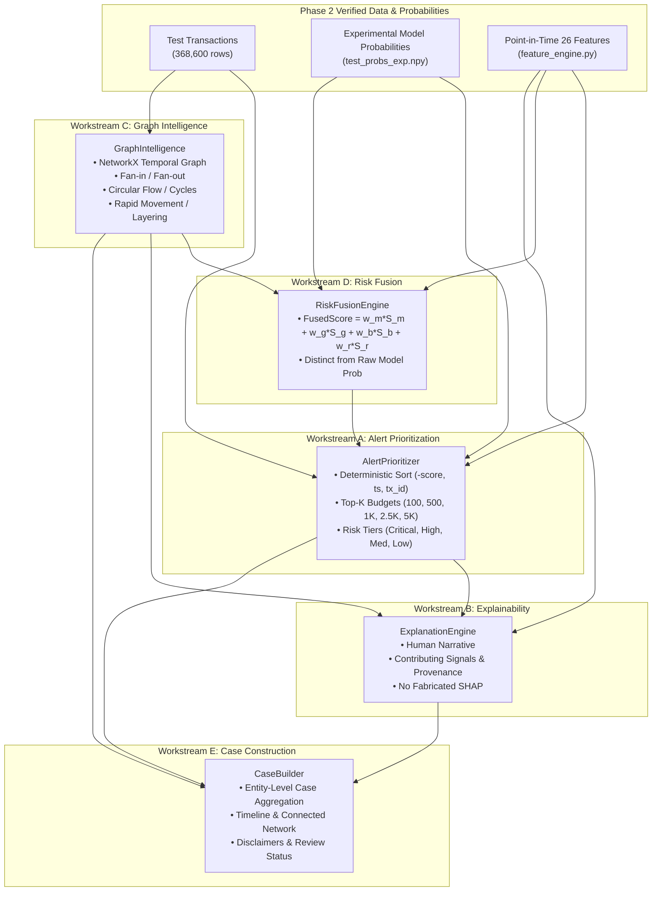

# FinGuard AI — Phase 3 Implementation Plan
**Alert Prioritization, Explainable Risk Intelligence, and Graph-Based Investigation**

**Document Status:** Approved & Baseline Established  
**Date:** October 20, 2026  
**Auditor / Architect:** Senior AI/ML & Financial Crime Architect  
**Project Root:** `C:\Users\ayush\Desktop\Private\MuleGuard`  
**Target Module Directory:** `evaluation/amlsim_evaluation/phase3/`  

---

## 1. Executive Context & Objectives

Phase 2 established a leakage-free point-in-time feature pipeline and demonstrated that the Experimental LightGBM model achieves **ROC-AUC = 0.8925** and **Recall = 94.41%** on the held-out benchmark test partition (`HI-Small_Trans.csv`). However, due to extreme class imbalance (prevalence $0.33\%$), evaluating at a static threshold generated 51,017 false positives (Precision = $2.20\%$).

The primary objective of **Phase 3** is to transform raw model probabilities into an **investigator-friendly, high-precision compliance workflow**:
1. **Alert Prioritization:** Filter and rank alerts into operational budgets (Top 100, 500, 1,000, 2,500, 5,000) with deterministic tie-breaking and configurable risk tiers.
2. **Explainable Risk Intelligence:** Provide evidence-grounded narratives, measurable signal contributions, and clear rationale for why a transaction is flagged.
3. **Graph Intelligence:** Model accounts as nodes and transactions as directed timestamped edges using NetworkX, detecting six canonical financial crime typologies (Fan-in, Fan-out, Circular Flow, High-Value Anomaly, Rapid Movement, Counterparty Concentration).
4. **Risk Fusion:** Transparently fuse tabular model probabilities, graph typology severities, behavioral anomalies, and heuristic rule signals into an operational prioritization score.
5. **Investigator Case View:** Aggregate related alerts, connected accounts, timeline sequences, and evidence into structured case files ready for dashboard display.

---

## 2. Baseline Production Hashes & Safety Commitments

To ensure absolute preservation of existing working software, all Phase 3 work is strictly confined to `evaluation/amlsim_evaluation/phase3/`. The following baseline hashes were verified prior to implementation:

| File Path | Baseline SHA-256 Checksum | Modification Policy |
| :--- | :--- | :---: |
| `models/muleguard_lightgbm.pkl` | `02c5f122e1ee729bd97bb08e8d004dae1b4b919416384c4d5c214598af702fa2` | **READ-ONLY / UNTOUCHED** |
| `models/muleguard_lightgbm.txt` | `2bf774a5d4ca4716759fd5d3303db5926ab05b02770b5f52e596910504c9e121` | **READ-ONLY / UNTOUCHED** |
| `models/muleguard_isolation_forest.pkl` | `7c0fd7b168f4621de97d9164b0b9c83202921acbaecc028e3ae42bc00517a177` | **READ-ONLY / UNTOUCHED** |
| `models/category_encoders.pkl` | `ff5d855fe24e3fddac6a136be0d8ed048e0b413486c9733b7bd5addcdc65839a` | **READ-ONLY / UNTOUCHED** |
| `models/feature_columns.json` | `2aff95d9e42d389df853185d89ab0ed7384d4480f4905829a48093bc2ed768e8` | **READ-ONLY / UNTOUCHED** |
| `backend/main.py` | `e727635019b2e028af320446088b7f78bda4b2322718102397f633309d3d7ef3` | **UNTOUCHED** |
| `backend/feature_pipeline.py` | `5f93a9f9a8197f41485d597345858445c59b51b3d98e6e964f14e98c387998ed` | **UNTOUCHED** |
| `backend/database.py` | `501113a0bf51c7d77c25498afb4168d1f572fea6f9da14e069c299a765a717f6` | **UNTOUCHED** |
| `data/aml_dataset/HI-Small_Trans.csv`| `b19d39f515523373f991b689c07e11e7b0b95c17a2c27a87d91584ae16c5b040` | **READ-ONLY / UNTOUCHED** |

---

## 3. Architecture & Data Flow

---

## 4. Planned Deliverables & Test Specifications

| Component | Target File | Core Functions & Requirements | Corresponding Test Suite |
| :--- | :--- | :--- | :--- |
| **Alert Prioritizer** | `alert_prioritizer.py` | Configurable top-$K$ triage budgets, deterministic sorting, risk-tier binning, duplicate suppression, Precision@K & Recall@K metric calculations. | `test_alert_prioritizer.py` |
| **Explanation Engine** | `explanation_engine.py` | Evidence provenance, measurable signal strengths, plain-English compliance narrative generation, zero fabricated SHAP. | `test_explanation_engine.py` |
| **Graph Intelligence** | `graph_intelligence.py` | Temporal edge construction, 6 typology detectors (fan-in, fan-out, circular flow, velocity, concentration, high-value), severity calculation. | `test_graph_intelligence.py` |
| **Risk Fusion** | `risk_fusion.py` | Transparent weighted linear fusion ($w_{\text{model}} S_{\text{model}} + w_{\text{graph}} S_{\text{graph}} + \dots$), missing signal handling, validation-only tuning. | `test_risk_fusion.py` |
| **Case Builder** | `case_builder.py` | Grouping connected alerts into entity cases, activity timeline synthesis, non-guilt investigatory disclaimers, status tracking. | `test_case_builder.py` |
| **Evaluation Runner** | `run_phase3_evaluation.py` | End-to-end evaluation on benchmark test set, batch top-$K$ profiling, unseen entity analysis, regression hash check. | All automated tests |
| **Evaluation Metrics**| `phase3_results.json` | Machine-readable results: Precision@K, Recall@K, tier counts, typology counts, volume recovery. | Output file |
| **Phase 3 Report** | `PHASE3_REPORT.md` | Comprehensive technical deliverable documenting architecture, metrics, comparisons, and operational guidance. | Authoritative report |

---

## 5. Execution Stages & Protocol

- **Stage 1 (Complete):** Repository inspection, baseline SHA-256 hashing, directory setup, implementation plan.
- **Stage 2:** Implement `alert_prioritizer.py` and execute `test_alert_prioritizer.py`.
- **Stage 3:** Implement `graph_intelligence.py`, `explanation_engine.py`, and their unit test suites.
- **Stage 4:** Implement `risk_fusion.py`, `case_builder.py`, and their unit test suites.
- **Stage 5:** Execute all unit tests and run `run_phase3_evaluation.py` on the benchmark test data.
- **Stage 6:** Run Phase 2 regression checks, verify production file hash invariance, and author `PHASE3_REPORT.md`.
